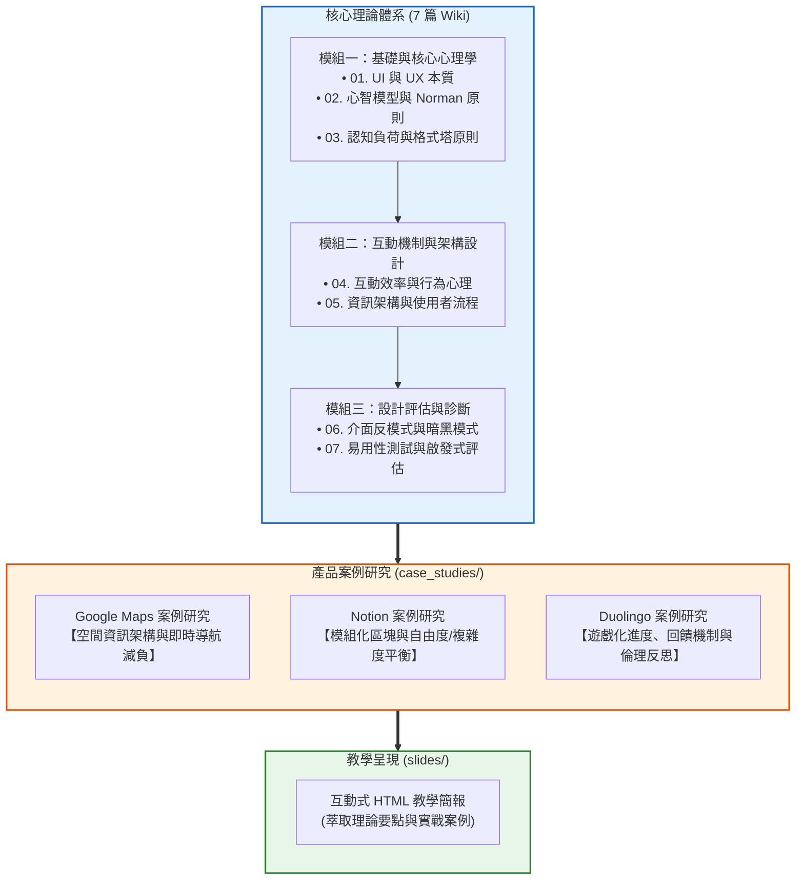

# 為什麼有些 App 特別好用？——從使用者心理到 UI/UX 設計的完整解析

歡迎來到本知識庫！這是一套專為 UI/UX 初學者設計的系統化學習地圖，探討介面好用背後的認知心理學機制與實務設計原則，並透過 Google Maps、Notion 與 Duolingo 三大產品案例研究，為後續互動式 HTML 教學簡報提供扎實的實證素材。

---

## 知識庫架構導覽 (Architecture Overview)

本專案採用 **「7 篇理論 Wiki ＋ 3 個產品案例研究 ＋ 1 份 HTML 教學簡報」** 之整合架構：

---

## 知識庫核心文章地圖 (7 篇理論 Wiki)

### 模組一：基礎與核心心理學 (Foundations)
* [[01_UI_vs_UX_Essence|01. UI 與 UX 的本質：好體驗的關鍵特徵與評估維度]]
* [[02_Mental_Models_and_Norman_Principles|02. 心智模型與 Don Norman 設計原則：縮短理解與操作鴻溝]]
* [[03_Cognitive_Load_and_Gestalt|03. 認知負荷與格式塔原則：大腦資訊處理與視覺組織機制]]

### 模組二：互動機制與架構設計 (Principles & Interactions)
* [[04_Interaction_Efficiency_and_Behavior|04. 互動效率與行為心理：費茲定律、席克定律與習慣迴圈]]
* [[05_Information_Architecture_and_Flow|05. 資訊架構與使用者流程：組織海量資訊與引導操作旅程]]

### 模組三：設計評估與診斷 (Evaluation & Diagnosis)
* [[06_Design_Anti_Patterns_and_Dark_Patterns|06. 介面反模式與暗黑模式：識別操控性設計與回歸人本倫理]]
* [[07_Usability_Testing_and_Heuristics|07. 易用性測試與啟發式評估：驗證設計的科學方法]]

---

## 產品案例研究索引 (Case Studies for Slides)

為後續教學簡報萃取所建立的深度產品實證研究，統一歸納於 `case_studies/`：

* [[case_studies/case_studies_index|案例研究主索引：三大經典產品案例研究總覽 (case_studies_index.md)]]
* [[case_studies/01_Google_Maps_Case_Study|案例一：Google Maps——極致複雜空間資訊的認知減負與即時導航典範]]
* [[case_studies/02_Notion_Case_Study|案例二：Notion——模組化區塊、多層次階層與高自由度工具的易用性平衡]]
* [[case_studies/03_Duolingo_Case_Study|案例三：Duolingo——微學習路徑、多感官回饋與遊戲化激勵的倫理反思]]

---

## 專案核心文件與來源導引
* [[AGENTS|專案規範與 AI 代理準則 (AGENTS.md)]]
* [[sources/sources_index|引用來源主索引 (sources_index.md)]]
* [[README|專案介紹與工作流程 (README.md)]]
