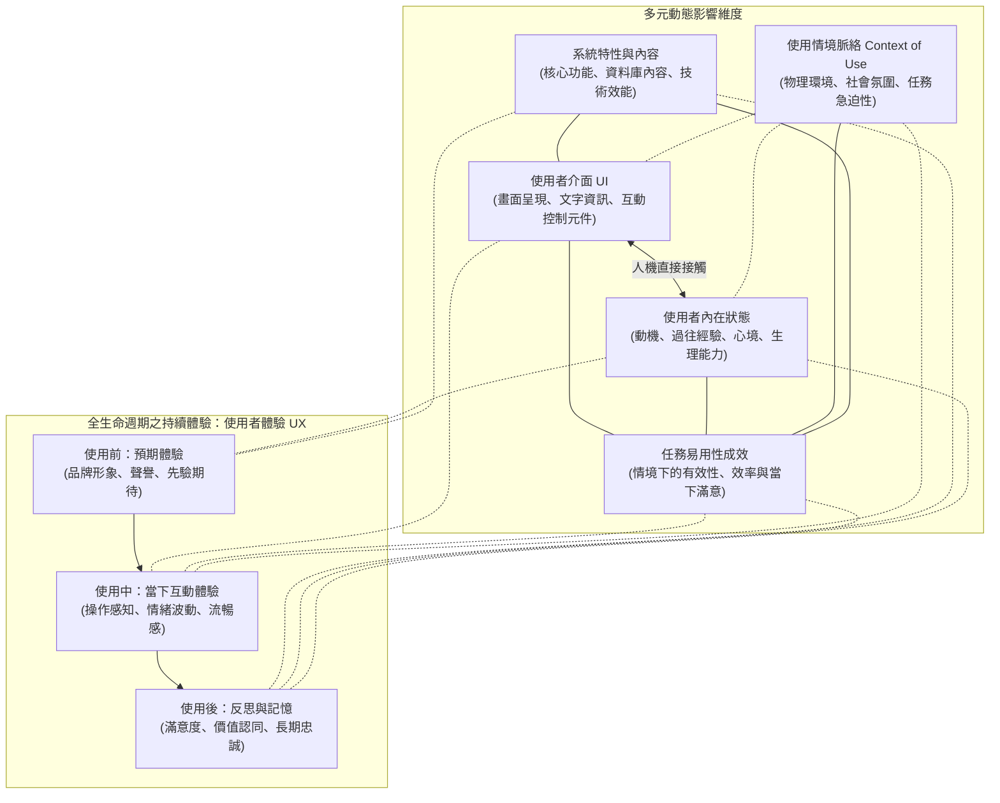
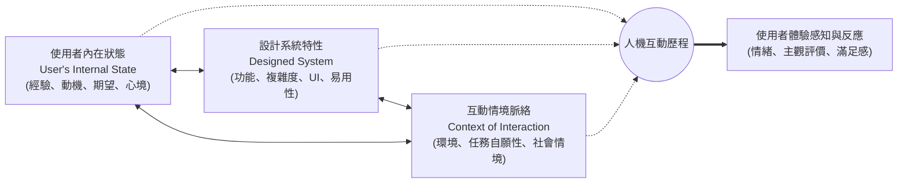
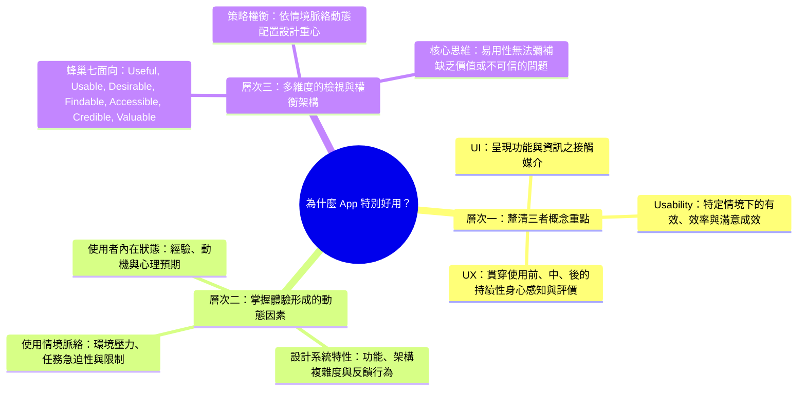

# 01｜UI 與 UX 的本質：好體驗的關鍵特徵

> [!abstract] 核心摘要 (TL;DR)
> 初學者常誤以為「介面漂亮 = 產品好用」，但視覺美觀僅是介面呈現的一環。本篇深入拆解 **UI（使用者介面）**、**Usability（易用性）** 與 **UX（使用者體驗）** 的核心差異與交互關聯：UI 是人機互動的具體接觸媒介，Usability 是在特定使用情境下達成任務的有效性、效率與滿意度，而 UX 則是使用者在全生命週期（使用前、中、後）所產生的全方位主觀身心反應。好體驗並非單一按鈕的魔法，而是使用者內在狀態、系統特性與使用情境交互作用的結果。

## 關鍵術語索引 (Glossary)
* **使用者介面 (UI, User Interface)**：人與系統進行資訊傳遞與操作控制的媒介，涵蓋畫面配置、文字、按鈕與互動控制元件。
* **易用性 (Usability)**：系統在特定使用情境下，由特定使用者達成特定目標之有效性、效率與滿意度的程度；亦指涉促進易用性的專業知識與設計屬性。
* **使用者體驗 (UX, User Experience)**：使用者因使用及／或預期使用某系統、產品或服務，所產生的感知與反應。
* **以人為中心的設計 (HCD, Human-Centred Design)**：一種系統設計與開發途徑，旨在透過聚焦於系統使用並應用人因工程與易用性知識，使互動系統更為易用。
* **使用情境脈絡 (Context of Use)**：使用者、目標與任務、資源以及環境的綜合組合。

---

## 1. 為什麼有些 App 特別好用？從日常使用經驗切入

日常生活中，我們打開手機使用各種應用程式時，往往在短短數秒內就會產生「這個 App 太好用了」或「這到底是什麼反人類設計」的主觀直覺評價。但如果進一步追問：我們口中所說的「好用」，究竟是在稱讚什麼？

### 1.1 兩類極端的日常使用體驗
**[情境示例]** 回想以下兩種截然不同的生活情境：
* **挫折的假設情境**：某款大眾運輸公車動態 App，介面視覺採用了現代風格的漸層色與擬真圖示，整體版面乍看精緻。然而，當你在正午陽光下急著趕公車時打開它，首頁卻先跳出一頁難以關閉的蓋版廣告；進到主畫面後，搜尋路線的按鈕過小且反應延遲；好不容易點進路線頁面，即時到站秒數卻忽隱忽現，甚至需要多次切換選單才能找到返程資訊。此時，無論它的視覺插畫多麼吸引人，使用者感受到的通常只有焦慮、挫折與不耐煩。
* **順暢的假設情境**：另一款設計樸素的工具 App（例如系統內建的計算機或備忘錄），沒有複雜的轉場動效，但當你需要它時，點開即可開始操作。按鈕具備適當的間距與清晰的點擊反饋，在單手操作或臨時記錄的場合下，能迅速且順暢地完成當前任務。

### 1.2 初學者的常見盲點：誤將美觀當作體驗
初入 UI/UX 領域的初學者，最容易落入「以視覺為中心」的思維陷阱，誤以為把介面重新配色、更換成現代風格的圓角圖示、套用流行的設計規範，就能自動打造出優秀的產品。

**[分析與推論]** 事實上，介面視覺的吸引力固然能引發第一眼的好感，但決定使用者是否願意長期留存並給予「好用」評價的底層關鍵，在於產品是否能在使用者身處的真實情境中，不添任何麻煩地解決其核心痛點。正如 UX 領域先驅 Don Norman 與 Jakob Nielsen 所指出的核心洞察：**典範使用者體驗的第一要件，正是無障礙且不費吹灰之力地滿足客戶的確切需求（meet the exact needs of the customer, without fuss or bother）**，其次才是簡約與優雅（[[sources/sources_index#SRC-04|SRC-04]]）。

---

## 2. UI、Usability、UX 到底有什麼不同？

在業界溝通與日常討論中，「UI」與「UX」這兩個詞彙經常被斜線綁在一起（UI/UX），甚至與「易用性（Usability）」混為一談。然而，在人機互動（HCI）與認知心理學的學理脈絡中，三者有不同的概念重點與評估角度。

### 2.1 使用者介面 (UI, User Interface)
* **概念性質**：**[人機互動領域概念說明]**（非 ISO 國際標準名詞定義）。
* **概念定義**：使用者介面是指人與數位或實體系統之間，進行資訊交換、感知傳遞與操作控制的具體媒介。在數位產品中，UI 呈現系統功能與資訊，並提供操作媒介，涵蓋畫面配置（Layout）、文字排版（Typography）、色彩與視覺提示、按鈕、圖示、表單輸入框及其他控制元件與視覺回饋。
* **生活化解釋**：如果將「駕駛汽車」比作軟體操作，UI 就像是駕駛座前方的**方向盤、排檔桿、油門煞車踏板、實體按鈕以及液晶儀表板螢幕**——它是你雙眼能看到、雙手能觸碰到的具體控制組件。
* **實際應用**：設計清晰的資訊視覺階層（Visual Hierarchy）、符合人體工學的可點擊區域大小、具備對比度且易於閱讀的字體。
* **常見誤解**：誤將 UI 限縮為純平面美工或裝飾性圖畫。事實上，UI 不僅關乎視覺的美醜，更直接決定了資訊傳達的結構與互動操作的可行性。

### 2.2 易用性 (Usability)
* **理論依據**：**[官方標準規範]** 依據國際標準組織所發布之 **ISO 9241-11:2018** (Clause 3.1.1)。
* **概念定義**：系統、產品或服務在**特定的使用情境脈絡（Context of Use）**下，能被**特定使用者**用以達成**特定目標**，並展現**有效性（Effectiveness）**、**效率（Efficiency）**與**滿意度（Satisfaction）**的程度（[[sources/sources_index#SRC-02|SRC-02]]）。
  * **有效性 (Effectiveness, Clause 3.1.12)**：使用者達成特定目標的正確性與完整程度（評估目標是否切實達成，並非直接解釋為絕對零失誤）。
  * **效率 (Efficiency, Clause 3.1.13)**：相對於所達成的成果，所消耗的資源比例（常見資源包含時間、人力心力、金錢成本與材料等各項投入）。
  * **滿意度 (Satisfaction, Clause 3.1.14)**：使用者因使用系統而產生的身體、認知與情緒反應，滿足其需求與期望的程度。
  * **修飾用語與實踐領域 (Clause 3.1.1 Note 2)**：標準同時指出，「易用性」一詞也可作為修飾用語，用來指稱有助於易用性的設計知識、專業能力、活動及設計屬性，例如易用性專業知識、易用性專業人員、易用性工程、易用性方法、易用性評估及易用性啟發式原則。
* **生活化解釋**：回到汽車的譬喻，Usability 是評估這輛車好不好開的指標——方向盤轉向是否準確、車道能否確實維持（有效性）；油門加速是否順暢、是否省油省力（效率）；行駛過程中座椅與懸吊是否舒適、駕駛是否感到安心愉快（滿意度）。
* **實際應用**：簡化購物結帳流程的填寫步驟、設計具備即時格式防呆的輸入框、提供直覺的撤銷（Undo）機制以降低操作錯誤。
* **常見誤解**：誤以為易用性是產品與生俱來、孤立存在的固定屬性。標準特別強調「特定使用情境脈絡（Specified Context of Use）」——一款針對專業工程師設計的快捷鍵命令列介面，在專業情境下效率極高（高易用性），但若拿給初學者操作，則會徹底崩潰（低易用性）。易用性永遠無法脫離使用者、任務與環境單獨存在。

### 2.3 使用者體驗 (UX, User Experience)
* **理論依據**：**[官方標準規範]** 依據國際標準組織所發布之 **ISO 9241-210:2019** (Clause 3.15)。
* **概念定義**：使用者因使用及／或預期使用某系統、產品或服務，所產生的**感知與反應（Perceptions and responses）**（[[sources/sources_index#SRC-01|SRC-01]]）。
  * **全生命週期心理歷程 (Clause 3.15 Note 1)**：使用者的感知與反應涵蓋在使用前、使用中及使用後所產生的情緒、信念、偏好、知覺、舒適感、行為與成就感。
  * **綜合影響因素 (Clause 3.15 Note 2)**：UX 是系統的品牌形象、呈現方式、功能性、系統效能、互動行為及輔助能力的綜合結果；同時也源自使用者因過往經驗、態度、技能、能力與個性所形成的內在與身體狀態，以及其使用情境脈絡。
  * **以人為中心的設計 (HCD, Clause 3.7)**：標準將 HCD 定義為一種系統設計與開發途徑，旨在透過聚焦於系統使用並應用人因工程／人體工學與易用性知識及技術，使互動系統更加易用。
* **生活化解釋**：UX 是你擁有並駕駛這輛車的「全方位旅程感受」——從買車前對該品牌的嚮往與安全信任（預期使用）、駕駛過程中的操控快感（使用中），到抵達目的地後的成就感、保養維修服務的貼心程度，以及多年後回憶起這趟自駕旅行的美好記憶（使用後）。
* **實際應用**：整體顧客旅程地圖（Customer Journey Map）規劃、服務接觸點（Touchpoints）整合、錯誤發生時的主動撫慰機制、建立符合品牌價值的微互動與情感連結。
* **常見誤解**：誤以為 UX 只是「更高級的 UI 美化」，或以為 UX 等同於 Usability。Usability 側重於任務能否順利、省力且滿意地完成，而 UX 則跨越至個人情感、品牌期待、自我認同與使用前後的長久心智反思。

### 2.4 經典辨析案例：電影評論網站的思想實驗
為了清楚說明 UI、易學性（Learnability）與整體 UX 的本質差異，Don Norman 與 Jakob Nielsen 曾提出一個極為經典的思想實驗（[[sources/sources_index#SRC-04|SRC-04]]）：

> **[概念示例與推論]** 想像一個專門提供電影評論與場次查詢的網站。該網站的介面（UI）設計得相當出色，搜尋欄位醒目、按鈕與文字呈現清晰；在操作層面上，使用者能夠非常容易理解如何輸入片名與執行搜尋。  
> 然而，若該網站的底層資料庫唯獨缺少獨立製片、獨立影展或小眾藝術電影的資料，當一位熱愛獨立電影的使用者前來搜尋時，每次都只能得到查無結果的提示。

在這個案例中：
* **介面 (UI)**：搜尋欄位、按鈕及畫面呈現清晰且具吸引力。
* **操作易學性 (Learnability / UI Usability)**：使用者能輕易理解並上手搜尋操作。
* **整體任務易用性與 UX (Task Usability & Total UX)**：依照 ISO 9241-11，易用性必須考量特定使用者在特定情境下「能否有效達成特定目標」。由於資料庫內容缺失，使用者尋找小眾電影的核心目標完全無法達成（缺乏有效性），此時即便介面再容易操作，也無法稱該系統在該任務上具有良好的整體易用性；同時，使用者的根本需求落空，整體的 **使用者體驗 (UX)** 自然隨之變得負面而失望。

這個案例忠實地說明了：**清晰美觀的 UI 與容易理解的操作，無法直接保證整體的易用性成效，更無法單獨代表完整的使用者體驗。**

---

### 2.5 三者相互關聯與多因子影響架構

為了避免將 UX 誤解為「Usability 任務結束後才發生的單向終點」，或將 UX 簡化為「UI 加上 Usability」的拼盤，我們應將其理解為多個動態因子持續相互交織的概念網絡。

在整個產品生命週期中，UX 是貫穿使用前、使用中與使用後的持續性體驗；而使用者的內在狀態、系統特性、介面呈現（UI）、具體情境脈絡及任務易用性（Usability），均在不同階段共同塑模著這份體驗：

**[分析與推論]** 從上述概念關聯圖中可以觀察到：
1. **UX 具有時間連續性**：使用者在接觸 UI 前，就已受品牌與先驗動機影響產生「預期體驗」；互動過程中，介面的反饋與任務的順暢度直接作用於當下情緒；離開系統後，系統是否真正帶來價值則沉澱為長期的反思與評價。
2. **多因子相互交織與約束**：UI 是使用者接觸系統與資訊的可見媒介，Usability 是特定情境下人機互動的具體成效指標，兩者與使用者自身狀態、系統底層內容及環境限制相互作用，共同對持續動態開展的 UX 產生深遠影響。

---

## 3. 好體驗是怎麼形成的？使用者狀態、系統特性與互動情境

既然好體驗無法單靠華麗的 UI 或單一任務的順暢度來保證，那麼究竟是什麼力量在驅動並塑造使用者的主觀感受？

### 3.1 Hassenzahl & Tractinsky (2006) 的研究議程與概念架構
在人機互動（HCI）領域的討論脈絡中，早期許多實務與研究重點常放在工作環境下的任務達成、操作效率與錯誤防範。到了 2000 年代中期，隨著數位科技逐漸融入個人日常生活與休閒領域，學者 Marc Hassenzahl 與 Noam Tractinsky 在其特刊導言論文《User experience – a research agenda》（[[sources/sources_index#SRC-03|SRC-03]]）中提出倡議，主張研究視角應從傳統側重工具性與任務效率的面向，進一步擴展至更全面的使用者體驗實證研究。

> [!note] 資料來源限制與學術邊界說明
> 依據專案規範與來源查證，本專案目前僅取得 Hassenzahl & Tractinsky (2006) 發表於 *Behaviour & Information Technology* 之官方公開摘要與出版書目資訊（全文待授權核對）。  
> **[學術邊界提醒]** 本文在此引用的「三項相關因素」係屬作者在該篇研究議程論文中提出的**概念性分類架構（Conceptual Framework）**，旨在倡導學術界關注非工具性品質，**並非該篇論文經過控制組實驗驗證後的嚴密因果統計模型**。未取得全文核對前，不作任何超出公開摘要範圍的實證推論。

### 3.2 體驗形成的三大相關因素
根據作者在論文摘要中的概念界定，使用者體驗被視為以下三項核心要素相互作用的結果（Consequence of interaction）：

1. **使用者的內在狀態 (A user's internal state)**：
   * *核心內容*：包含使用者的先驗經驗、當前需求、參與動機、心理期望、情緒心境與生理狀態。
   * *生活化解釋*：一個飢腸轆轆、心情焦慮的點餐者，與一個悠閒探索新餐廳的饕客，面對完全相同的點餐介面時，心理容忍度與操作感受會截然不同。
2. **設計系統的特性 (Characteristics of the designed system)**：
   * *核心內容*：包含系統所提供的具體功能、架構複雜度、互動行為模式、UI 呈現方式以及既有的易用性水準。
   * *生活化解釋*：系統是否反應靈敏、資訊層級是否井然有序、操作回饋是否清楚明確。
3. **互動發生的情境 (Context within which the interaction occurs)**：
   * *核心內容*：包含實體物理環境、社會組織脈絡、活動的意義性，以及使用行為的自願性（是使用者主動想用，還是工作流程被迫要求使用）。
   * *概念對照*：此處的情境脈絡概念，與 ISO 9241-11 的「使用情境脈絡（Context of Use：使用者、目標、資源與環境的組合）」在實務觀察上高度呼應，皆強調脫離真實環境空談產品好壞是毫無意義的。
   * *生活化解釋*：在安靜舒適的書房中操作筆記軟體，與在搖晃擁擠、訊號不穩的捷運車廂中趕著發送緊急訊息，情境壓力對體驗造成的影響有天壤之別。

### 3.3 工具性品質 vs 享樂性品質
在該篇倡議架構中，另一項重要概念是區分了科技互動中的不同品質取向：
* **工具性／實用性品質 (Pragmatic / Instrumental Aspects)**：關注產品是否具備合適的功能，能協助使用者有效且高效率地達成實用性目標（與傳統易用性關注的核心目標一致）。
* **享樂性／非工具性品質 (Hedonic / Non-instrumental Aspects)**：關注產品能否帶來主觀的情感體驗、視覺美感與心理滿足。作者在摘要中明確指出，UX 不應僅僅關注工具性面向，美學（Aesthetics）與情緒（Emotions）等非工具性特質同樣是理解人機互動的關鍵成分。

> [!note] 摘要支持範圍說明
> **[概念邊界提醒]** 依據 Hassenzahl & Tractinsky (2006) 官方摘要，作者明確提出了情感、美感與非工具性（Non-instrumental）維度的重要性。業界常提及的「自主感、新穎感、自我認同」等心理學概念，屬於後續 UX 研究者與實務界的延伸闡述與可能實踐方向，不可直接視為該篇論文公開摘要所列舉的既定內容。

**[分析與推論]** 過去的軟體開發往往較注重功能能否正常運作（工具性面向）；但許多廣獲好評的應用程式，往往是在滿足基本任務目標的同時，也透過良好的美學呈現與細緻反饋（享樂性面向），為使用者帶來更為愉悅的整體感受。

### 3.4 核心觀念的五步解構
* **概念定義**：好體驗不是靜態物件的固有特徵，而是「特定心智狀態的使用者」在「特定時空情境下」與「特定系統」互動後，在工具性與享樂性維度所引發的綜合主觀共鳴。
* **理論依據**：Hassenzahl & Tractinsky (2006) 官方摘要之研究議程架構；ISO 9241-11 Context of Use。
* **生活化解釋**：就像一場難忘的晚餐體驗，不只取決於廚師煮的菜本身好不好吃（系統特性），還取決於你今天心情如何、是不是很餓（使用者狀態），以及餐廳環境是安靜浪漫還是吵雜悶熱（情境脈絡）。
* **實際應用**：設計 App 時導入「情境訪談（Contextual Inquiry）」與「使用者人物誌（Persona）」，評估使用者在戶外極端情境（如強光、單手手持）下的心理壓力，進而調整按鈕熱區與反饋強度。
* **常見誤解**：以為存在一套「放諸四海皆準」的絕對最佳設計，忽視了使用者狀態與情境脈絡的動態變化。

---

## 4. 好 UX 的七個面向：Peter Morville 的使用者體驗蜂巢

如果好體驗是由如此多元的動態因子所塑造，設計團隊與初學者該如何有系統、有條理地檢視與診斷一款產品的體驗品質？

資訊架構學家 Peter Morville 於 2004 年發表的專文《User Experience Design》（[[sources/sources_index#SRC-05|SRC-05]]）中，提出了著名的**使用者體驗蜂巢模型（User Experience Honeycomb）**，將體驗品質具體解構為七個彼此關聯的思考面向。

> [!note] 框架定位與限制說明
> **[概念框架定位]** 蜂巢模型是由資深專家提出的定性思考與溝通架構，**並非經過統計心理計量學（Psychometrics）驗證的標準化測量量表**。模型各面向之間不存在固定的數學權重或絕對的因果鏈條，其實踐價值在於提供團隊一個跳脫單一維度的結構化檢視視角。

### 4.1 七大核心面向詳細解構

#### 1. 有用 (Useful)
* **概念定義**：產品、系統或內容是否具備明確目的，能夠滿足使用者的真實需求或解決實質問題。
* **生活化解釋**：雨天時一把能擋雨的雨傘是有用的；如果一把傘雖然雕刻精美但布料漏水，它就失去了「有用」的立足點。
* **實際應用**：在開發新功能前進行嚴謹的需求驗證，避免團隊投入大量資源打造出使用者根本不需要的冗餘功能。
* **常見誤解**：誤將「功能數量多」當成「有用」；堆疊大量冷門功能反而會增加系統複雜度，削弱真正的有用性。

#### 2. 可用／易用 (Usable)
* **概念定義**：在蜂巢框架中，Usable 探討操作介面是否容易理解、操作流程是否順暢，使用者能否在較低的阻力與摸索成本下順利完成任務。它提醒設計者關注使用者在與介面互動時的流暢度與易理解程度。
* **概念對照**：此處為 Morville 提出的定性啟發面向，用以檢視操作層面的友善程度；不應將其與 ISO 9241-11 具備明確量測標準（有效性、效率、滿意度）的正式國際標準定義混淆。
* **生活化解釋**：門把手的設計是否讓人一看就懂是要推還是拉，不需要張貼「請按／請拉」的警語貼紙。
* **實際應用**：清晰的導覽標籤、符合閱讀直覺的版面排版、即時的操作錯誤提示與防呆設計。
* **常見誤解**：誤以為只要系統功能很強，介面難用一點使用者「自然會去學」，忽視了操作阻力對任務完成的負面影響。

#### 3. 令人渴望 (Desirable)
* **概念定義**：透過視覺美學、品牌調性、微互動細節與情感設計，激發使用者的正向情緒、好感與主觀喜愛。
* **生活化解釋**：兩款保溫杯保溫效果完全一樣，但其中一款造型簡約、手感溫潤、配色優雅，讓人光是拿在手上就覺得賞心悅目。
* **實際應用**：細緻流暢的轉場微互動、統一且具品牌特色的視覺風格、親切有溫度的文案口吻。
* **常見誤解**：誤以為「令人渴望」只是表面的視覺化妝術；事實上，良好的情感連結有助於拉近使用者與產品的心理距離，帶來更愉悅的操作感受。

#### 4. 易尋／可找 (Findable)
* **概念定義**：資訊架構與導航設計是否清晰，讓使用者在需要時能夠迅速定位、檢索並瀏覽目標內容。
* **生活化解釋**：大賣場的走道天花板上掛著清晰的分類看板，讓你想買牙膏時能在 30 秒內走進清潔用品區找到貨架。
* **實際應用**：符合直覺的選單層級、提供自動完成與容錯提示的站內搜尋列、麵包屑導航（Breadcrumbs）。
* **常見誤解**：以為只要內容存在，使用者就能找到；若資訊藏在過深的選單階層中，在使用者眼裡就等於不存在。

#### 5. 無障礙 (Accessible)
* **概念定義**：考量各類身心條件與障礙（包含視覺、聽覺、運動肢體或暫時性受損），使所有人都能平等地獲取資訊與操作系統。
* **生活化解釋**：建築物門口除了階梯外，同時設有平緩的無障礙坡道，讓推嬰兒車的父母與坐輪椅的朋友都能順暢進出。
* **實際應用**：確保文字與背景具備足夠的色彩對比度、所有圖像具備替代文字（Alt text）、支援螢幕閱讀器與純鍵盤操作。
* **常見誤解**：誤以為無障礙設計只是為了極少數身心障礙者而做的額外負擔；事實上，良好的無障礙設計（例如在強光下提高對比度、吵雜環境提供字幕）能造福所有情境下的使用者。

#### 6. 可信 (Credible)
* **概念定義**：系統、內容與品牌機制是否展現出足夠的透明度、專業性與安全性，足以贏得使用者的信任。
* **生活化解釋**：一家實體診所牆上掛著合格醫師執照，藥品標示清楚、價格透明，讓病患能安心就診。
* **實際應用**：透明無隱藏費用的結帳明細、清楚易懂的隱私權授權說明、安全連線憑證與真實顧客評價展示。
* **常見誤解**：以為可信度只是公關問題；介面中任何誘導性文案或未明說的自動續費條款，都會瞬間摧毀使用者對產品的信任。

#### 7. 具價值 (Valuable)
* **概念定義**：產品體驗能否為終端使用者帶來實質價值（解決痛點、節省時間、豐富生活），同時為產品擁有者或組織創造可持續效益（商業營收、非營利影響力）。
* **生活化解釋**：一項好的外送服務，為忙碌上班族節省了外出覓食的時間，同時也讓店家與平台獲得合理收益。
* **實際應用**：在滿足使用者核心任務的同時，平衡產品的商業轉換指標，形成雙贏的永續循環。
* **常見誤解**：過度偏向商業變現而犧牲使用者利益（如滿版廣告），或只顧滿足使用者免費偏好而導致團隊無法永續營運。

---

### 4.2 七大面向設計自我檢視表

| 蜂巢面向 | 核心自問 (Self-Inquiry) | 介面正向訊號 (Do) | 常見介面警訊 (Don't) |
| :--- | :--- | :--- | :--- |
| **Useful (有用)** | 這個功能到底解決了使用者的什麼真實問題？ | 核心功能直接命中高頻痛點，直截了當 | 堆疊華麗卻乏人問津的雞肋功能 |
| **Usable (易用)** | 使用者操作時需要思考或摸索多久？ | 操作動線平順，按鈕位置與反饋符合直覺 | 步驟繁冗、操作卡頓、缺少防呆與撤銷 |
| **Desirable (令人渴望)** | 介面細節能否引發使用者的好感與愉悅？ | 視覺風格優雅協調，微互動精緻適度 | 排版粗糙、動效雜亂刺眼、語氣冰冷 |
| **Findable (易尋)** | 使用者想找某項資訊或功能時，找得到嗎？ | 資訊架構層級扁平清晰，搜尋容錯度高 | 選單層層深埋，關鍵設定隱蔽難尋 |
| **Accessible (無障礙)** | 弱視、色盲或單手操作者能否順暢使用？ | 色彩對比度達標，支援字體放大與旁白 | 淺灰字配白底、重要狀態僅靠顏色區分 |
| **Credible (可信)** | 這個畫面看起來安全、透明且值得信任嗎？ | 權限索取理由充分，費用標註公開清楚 | 偷偷預勾附加收費、暗藏難以取消的訂閱 |
| **Valuable (具價值)** | 這趟操作是否同時滿足了使用者與組織的目標？ | 流程兼顧使用者問題解決與產品長期留存 | 短視近利的點擊誘餌，透支品牌信用 |

---

### 4.3 核心思維辨析：權衡取捨與延伸分析

在理解了蜂巢的七個維度後，初學者必須建立一個關鍵的策略思維：**這七個面向在真實產品中並非權重均等的平分關係，更不是盲目追求面面俱到的核對清單。**

1. **延伸分析觀點：易用性是必要但不充分條件**：
   * **[分析與推論]** 根據這七個面向的實踐意涵，我們可以推導出一個重要的設計法則：**「易用性無法彌補產品本身缺乏實用價值或可信度的問題」**。  
   * 一個詐騙釣魚網站即便將表單設計得極其流暢、一鍵完成（極高 Usability），它的本質依然是不可信且有害的（缺乏 Credible 與 Valuable）；同樣地，一款操作極為平順但根本無人需要的 App（缺乏 Useful），其最終命運依然是無人問津。易用性是讓好產品發光發熱的加速器，但它無法單獨成為產品存在的理由。
2. **依情境脈絡動態取捨 (Trade-offs)**：
   * **[情境分析示例]** 不同類型的數位產品，其設計重點需依據具體目標與使用情境進行權衡，並無放諸四海皆準的固定優先順序：
     * **行動銀行／醫療等工具型 App**：在緊急或高度嚴肅的情境下，設計通常更為聚焦於 **Credible（可信）**、**Useful（有用）** 與 **Usable（易用）** 的穩健表現，避免過度繁複的裝飾性動畫影響轉帳或查詢的效率與清晰度。
     * **社群／娛樂／手遊等休閒型 App**：這類產品通常會更重視 **Desirable（令人渴望）** 與流暢操作的營造，透過風格化的美學與生動的微互動，為使用者帶來更多的樂趣與正向情緒。
   * **關鍵原則**：設計策略應當隨情境（Context of Use）動態調整，絕非僵化地宣告某些面向在任何情況下都必然優於其他面向。

---

## 5. 三款熱門 App 的 UX 設計觀察

在釐清了 UI、Usability、UX 的本質差異，並掌握了蜂巢架構與情境動態模型後，我們如何將這些理論視角投射到真實世界的數位產品中？

本章選取三款廣泛使用的產品——**Google Maps**、**Notion** 與 **Duolingo**，分別從「資訊尋找與情境適配」、「功能複雜度與入門門檻」以及「互動反饋與情緒激勵」三個切點進行初步觀察。

> [!note] 介面觀察環境與事實界定說明
> * **觀察日期**：2026 年 11 月 21 日
> * **觀察平台與版本環境**：
>   * **Google Maps**：分別於 Android (v11.x) 與 iOS (v6.x) 行動應用程式之預設地圖檢視與路線規劃畫面觀察。
>   * **Notion**：於桌面端網頁瀏覽器環境（Desktop Web）之個人工作區新建空白頁面觀察。
>   * **Duolingo**：於 iOS 行動應用程式（v7.x）之標準基礎課程練習單元觀察。
> * **[語意層次嚴格區分]** 以下各案例中，「實際介面特徵」均為上述指定日期與環境下可被重現之客觀客體呈現；涉及跨平台之細微差異已明確標記；所引伸之「設計目的」與「潛在心理效應」均明確標記為 **[分析與推論]**，非產品團隊官方內部演算法或未公開決策之既定事實。

### 5.1 Google Maps：資訊尋找（Findable）與操作情境（Context of Use）

#### 1. 產品與使用情境
Google Maps 是普遍應用的地理導航與生活探索工具。使用者的操作情境高度動態，包含室內靜態規劃、戶外步行尋路，以及交通工具行進中的路線指引。

#### 2. 實際介面特徵
* **[介面觀察]**（基於 2026 年 11 月 21 日實際操作）：
  * **主地圖探索畫面**：在預設瀏覽狀態下，搜尋列呈現在介面上方懸浮區域（在 Android 與 iOS 畫面上皆具備搜尋框與語音/個人帳號圖示；但在部分詳細資訊卡片向上滑動展開時，搜尋列會被卡片覆蓋，並非在所有畫面狀態下均絕對置頂）。
  * **圖資資訊分層呈現**：地圖上的地標與地名（POI, Points of Interest）依縮放層級動態調整；在大範圍全覽時呈現主要幹道與大區域標註，局部放大時依比例顯示街巷名稱與特定商家圖示。
  * **路徑規劃與模式切換**：在路線規劃情境下，介面提供「開車、大眾運輸、步行」等橫向切換分頁，各分頁對應預估時間與路徑選項。
  * **即時導航狀態**：點擊開始導航後，介面轉入導航模式，頂端呈現綠底之路線指引看板（顯示即時轉彎箭頭與路名），底端則收攏為預估剩餘時間、里程與退出導航按鈕。

#### 3. 對應 UI、Usability、UX 概念
* **UI 面向**：透過色彩與視覺提示（如綠色行車指示底色、藍色路線指示線與自身定位圖示），提供操作過程中的可見指引。
* **Usability 面向**：呼應 ISO 9241-11 的有效性與效率——定性而言，結構化的起訖點欄位與自動補全建議，有助於降低使用者輸入地址時的困惑，使設定路線的任務流程相對直接順暢。
* **UX 面向**：呼應使用情境脈絡（Context of Use）的適配性——導航模式透過精簡畫面與強化關鍵資訊對比，有助於減輕使用者在戶外移動或駕駛時的視覺干擾與焦慮感。

#### 4. 設計優點與潛在使用障礙
* **設計優點**：資訊架構層次明確，符合蜂巢模型中的 **Findable（易尋）**；漸進式揭露資訊的方式有助於維持地圖的可讀性。
* **潛在使用障礙**：在商業繁榮區或交通樞紐（如地下立體共構車站），密集重疊的圖層可能導致使用者點擊誤觸，或在室內 GPS 訊號不穩時產生定位偏移與方向判斷困難。

#### 5. 分析與推論
* **[分析與推論]** 導航啟動後介面自動隱藏探索推薦按鈕並採用大字體看板，推論此設計考量了使用者在移動或駕駛情境下注意力高度受限的特性，藉由強化關鍵指引的可見度，以支援安全與快速辨識的操作需求。

#### 6. 常見誤解
誤以為地圖 App 的好用在於「把所有商家地標一次性全部標出來」；若缺乏縮放階層的資訊過濾，資訊超載將大幅降低資訊的易尋性。

---

### 5.2 Notion：功能豐富與使用門檻（Usable）的平衡

#### 1. 產品與使用情境
Notion 是一款高自由度的模組化筆記與知識管理工具。使用者涵蓋單純記錄個人隨筆的學習者，到建立跨表格關聯資料庫與團隊專案看板的專業工作者。

#### 2. 實際介面特徵
* **[介面觀察]**（基於 2026 年 11 月 21 日 Desktop Web 版操作）：
  * 新建空白頁面時，畫面主要編輯區保持簡潔，僅呈現頁面標題輸入區，以及淺灰色預設引導文字「Type '/' for commands」。
  * 在未輸入指令或未反白文字前，頁面並不常駐傳統文書軟體的複雜排版工具列；部分進階內容格式與區塊操作可透過輸入「`/`」開啟懸浮選單。
  * 鍵入「`/`」後彈出的清單中，模組依基礎文字、標題、清單、媒體及資料庫等類別依序呈現，並支援即時文字過濾。

#### 3. 對應 UI、Usability、UX 概念
* **UI 面向**：大面積留白、簡明的字體排版與「`/`」指令提示，構成乾淨的編輯視野。
* **Usability 面向**：呼應 NN/g 所強調的「不費吹灰之力滿足需求（without fuss or bother）」——使用者單純想記錄文字時，操作路徑簡短直覺，不被非必要的設定選項打斷。
* **UX 面向**：呼應蜂巢架構中的 **Useful（有用）** 與 **Desirable（令人渴望）**——以簡約視覺提供專注的書寫環境，同時透過可擴充的積木結構支援進階任務。

#### 4. 設計優點與潛在使用障礙
* **設計優點**：以積木（Block）為基礎的模組化概念，統一了各類內容物件的操作邏輯，兼顧了輕量記錄與複雜系統建構。
* **潛在使用障礙**：**[分析與推論]** 對於缺乏模組化或結構化思維的新手使用者而言，面對大面積空白畫布時，**可能會產生「不知道下一步該建立什麼」的空白頁焦慮或摸索門檻**，這項心理反應因人而異，並非所有初學者必然發生。

#### 5. 分析與推論
* **[分析與推論]** Notion 選擇不預先展示所有功能按鈕，推論其設計策略是透過漸進式引導延後呈現複雜度，讓單純記錄文字的使用者維持較低的認知負擔，待使用者有更高階結構化需求時再主動調用。

#### 6. 常見誤解
誤以為自由度高的軟體必然難以操作；Notion 的實踐顯示，適當的預設簡化與動態呼叫機制，有助於降低功能龐大所帶來的操作阻力。

---

### 5.3 Duolingo：互動回饋與使用體驗（Desirable & Satisfaction）

#### 1. 產品與使用情境
Duolingo 是一款融入遊戲化設計理念的語言學習應用程式。使用者多利用搭車、排隊等零星日常時間進行微單元練習。

#### 2. 實際介面特徵
* **[介面觀察]**（基於 2026 年 11 月 21 日 iOS App 標準學習模式操作）：
  * 測驗題目拆解為單選、連連看或簡短填空等微型任務，畫面頂端進度條隨作答步驟逐步推進。
  * 點擊正確選項並確認時，畫面底部彈出綠色反饋橫條、打勾圖示，並伴隨上升音階之提示音效與輕微震動。
  * 若作答錯誤，底部呈現紅色反饋橫條並直接標示正確解答。
  * 在免費標準模式的單元練習中，作答錯誤會扣除愛心生命值，但在特定練習或訂閱模式下規則可能有所不同，並非所有課程或學習情境均完全採用單一重試機制。
  * 完成單元時，介面呈現吉祥物綠色貓頭鷹（Duo）動畫，並展示「連續學習紀錄（Streak）」與進度結算。

#### 3. 對應 UI、Usability、UX 概念
* **UI 面向**：高飽和度色彩提示、圓角按鈕與生動的向量角色圖像，營造輕鬆活潑的介面氛圍。
* **Usability 面向**：每個題目的操作步驟單純，介面通常僅保留一個主要前進按鈕（如底部的「檢查」或「繼續」），操作路徑高度聚焦。
* **UX 面向**：呼應 ISO 9241-11 中滿意度涵蓋「身體、認知與情緒反應」的定義，以及 Hassenzahl 對非工具性享樂品質（Hedonic Quality）的關注——透過即時反饋，讓語言學習的枯燥過程伴隨一定的成就感。

#### 4. 設計優點與潛在使用障礙
* **設計優點**：即時的多感官回饋強化了蜂巢模型中的 **Desirable（令人渴望）**，有助於為使用者帶來互動上的愉悅體驗。
* **潛在使用障礙**：過於密集的過場動畫、音效與結算流程，對於偏好嚴肅、高效率且純粹文字語法學習的使用者而言，可能會感到干擾或節奏過慢。

#### 5. 分析與推論
* **[分析與推論]** 答對時的音效、動畫與震動等即時回饋，推論其設計策略是透過多感官的正向提示增加使用者的成就感與互動愉悅感；然而，關於此類遊戲化機制能否「提升產品長期留存率」，屬於產品營運層面的未經驗證推論，尚需更多商業與實證數據檢驗。

#### 6. 常見誤解
誤以為學習類產品只要文法與詞彙正確即可；Duolingo 的介面呈現表明，重視使用者的情緒感受與即時反饋，在互動設計中同樣扮演著舉足輕重的角色。

---

## 6. 重新理解什麼是好用

走完從日常情境、國際標準、學術概念到實際 App 介面的探索旅程，我們現在可以對本篇的核心問題給出一個全面而理性的解答：**為什麼有些 App 特別好用？**

### 6.1 核心架構全景回顧
要解構「好用」，我們必須在思維中建立一個立體而非單點的視野：

1. **三者的概念重點與邊界**：
   * **UI** 是使用者「看到與操作」的表層媒介。
   * **Usability** 檢驗使用者能否在特定任務中「成功、省力且滿意」地達成目標。
   * **UX** 則是貫穿使用前、使用中與使用後的「全方位身心感知、情緒與主觀評價」。
2. **好體驗是動態互動的綜合產物**：
   * 體驗好壞不是單向寫在介面程式碼裡的固定數值，而是**使用者狀態**、**系統特性**與**使用情境脈絡（Context of Use）**三者交會共振的結果。
3. **多維度的體驗檢視與限制思維**：
   * 透過 Peter Morville 的使用者體驗蜂巢，我們理解了好體驗至少涵蓋 Useful、Usable、Desirable、Findable、Accessible、Credible 與 Valuable 七個面向。
   * **[延伸分析觀點]** 易用性是讓好產品被順暢使用的加速器，但**易用性無法彌補產品本身缺乏實用價值或可信度的問題**；設計團隊必須依據具體產品目標與情境，靈活進行策略性取捨（Trade-offs）。

### 6.2 「直覺」的理性拆解與延伸思考
在日常對話中，初學者最常聽到的讚美是「這個設計很直覺（Intuitive）」。然而，從人機互動與認知心理學的角度檢視，**「直覺」並非使用者與生俱來對數位介面的神秘感應**。

**[分析與推論]** **介面之所以讓人感到直覺，往往是因為它的表現方式符合了使用者既有的經驗與認知預期**。
* 當一個按鈕看起來可以點擊，且點擊後的系統反應符合使用者原先的猜想時，使用者不需停下來調用額外心力去猜測操作方法，這種流暢的互動過程往往被主觀形容為「直覺、好用」。
* 相反地，當介面的設計與使用者過去建立的認知習慣產生衝突（例如外觀像按鈕卻無法點擊，或是點擊後觸發了完全未預期的行為），使用者的操作流暢感就會中斷，進而產生挫折感。

> [!note] 理論延伸與來源邊界說明
> **[延伸議題定位]** 本文前述所引用的五筆核心來源（ISO 9241-210、ISO 9241-11、Hassenzahl & Tractinsky、Norman & Nielsen、Morville），主要在於確立 UI、Usability 與 UX 的本質範疇與多維框架，**並不足以單獨支持關於人類心智模型（Mental Models）與人體工學互動規律的完整學理推導**。  
> 關於「人如何透過既有經驗建構對系統的認知模型」、「介面如何透過具體標記向人傳達操作可能」，以及其背後的認知心理學實證研究，將作為下一篇文章的核心專題，並在該篇正式引入 Don Norman 的經典著作與理論來源予以系統化解析。

### 6.3 自然銜接：邁向下一篇心智模型與設計原則
既然「直覺與好用」往往取決於介面能否與使用者的經驗與預期順暢吻合，那麼設計者在實務上究竟該如何達成這種默契？
* 介面要如何透過視覺線索，主動提示「這裡可以點擊、可以拖曳」？
* 當使用者做出操作後，系統該提供什麼樣的反饋，才能讓使用者感到踏實與安心？
* 為什麼有些設計即使寫滿了繁瑣的操作文字說明，使用者依然會頻頻產生操作失誤？

要解答這些微觀互動設計的底層規律，我們必須深入探索現代互動設計的奠基石——認知心理學家 Don Norman 的經典學說。

> 👉 **下一篇導引**：[[02_Mental_Models_and_Norman_Principles|02｜心智模型與 Don Norman 設計原則]]  
> 我們將正式引進 Don Norman 於不同時期的經典著作，深入解析行動可能性（Affordance）、意符（Signifiers）、映射（Mapping）、回饋（Feedback）與心智模型（Mental Models），探討優秀的設計師如何讓介面「自己說話」，打造出真正無縫、自然的互動體驗。

