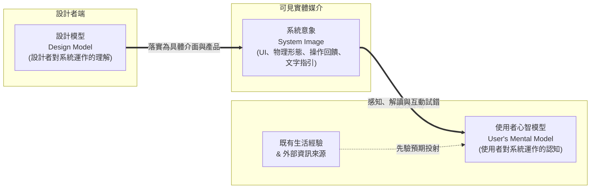
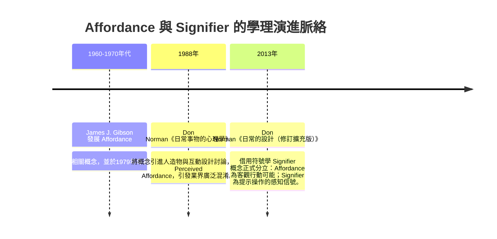
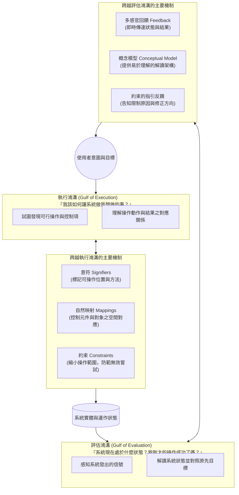

# 02｜心智模型與 Don Norman 設計原則

> [!abstract] 核心摘要 (TL;DR)
> 在 [[01_UI_vs_UX_Essence|第一篇]] 中，我們確立了「直覺好用」的本質在於介面能否與使用者的認知預期順暢吻合。本篇深入探討大腦理解系統的核心機制——**心智模型（Mental Models）**，並系統化拆解現代互動設計奠基者 Don Norman 的經典設計哲學。我們將嚴格釐清 **Affordance（客觀行動可能性）** 與 **Signifier（意符／感知線索）** 在學理史上的演進與本質界限，並剖析 **Mapping（映射）**、**Feedback（多感官回饋）**、**Constraints（約束與指引）** 等七項設計原則，揭示優秀設計師如何讓介面「自己說話」，消除人機之間的理解鴻溝。

## 關鍵術語索引 (Glossary)
* **心智模型 (Mental Model)**：使用者基於過往經驗、習慣與觀察，在腦海中對系統運作機制與控制方式所建立的內部主觀信念與模擬模型。
* **概念模型 (Conceptual Model)**：設計者為了讓系統易於被理解與操作，特意規劃並投射給使用者的簡化運作架構或隱喻。
* **系統意象 (System Image)**：由實體物件、數位介面、操作回饋、文字說明與排版等所有可感知實體所構成的整體呈現，是使用者反推系統運作的直接依據。
* **行動可能性 (Affordance)**：物質環境或系統實際提供給特定生理能力行動者的客觀行動潛能，無關乎個體是否察覺。
* **意符 (Signifier)**：任何可被感知的符號、標記或線索，用以提示使用者何處存在行動可能性以及該如何操作。
* **映射 (Mapping)**：控制元件與被控制對象、操作動作與產生結果之間的空間或因果對應關係。
* **回饋 (Feedback)**：系統在使用者操作後，透過多種感官通道及時送回的可感知信號，用以告知狀態與結果。
* **約束 (Constraints)**：透過物理、文化、語意與邏輯限制縮小可能操作範圍以防範錯誤，並提示修正方向的機制。

---

## 1. 為什麼門需要貼「推／拉」？日常挫折背後的認知斷層

日常生活中，幾乎每個人都經歷過這樣的窘境：走到一扇玻璃門前，你伸手向前推，門卻紋絲不動，直到狼狽地抬頭看見旁邊貼著一張小字標籤寫著「請拉」；或者面對一排長得一模一樣的電燈開關，每次都必須反覆開關好幾次才能矇對客廳的主燈。

### 1.1 門的設計啟示與使用困境
**[介面觀察]** 在日常環境中，門的開闔操作常引發使用者的困惑，認知心理學家 Don Norman 在其著作中曾廣泛討論過各類因外觀線索與實際機制不符而導致操作失誤的門，這類現象在互動設計社群中常被通俗地稱為「諾曼門（Norman Doors）」：
* 當一扇門的結構安裝了一根圓柱形或立體垂直把手時，人體手臂的抓握本能會直覺引導使用者做出「拉（Pull）」的動作；但若這扇門實際上只能「推（Push）」，使用者的第一次操作就很可能面臨意料之外的操作受阻與短暫挫折。
* 相對地，若推門的一側安裝的是一塊平整的金屬推板，因為扁平表面無法供手指抓握，使用者的手臂肌肉很自然地傾向做出前推動作，在多數情況下使用者無需多加思索即可順利推開。

### 1.2 標籤不是失敗的代名詞，而是提示的線索
初學者常有一種極端論點，認為「只要一件物品上面貼了使用標籤，就代表設計徹底失敗」。然而，從認知互動的角度審視：
* **[分析與推論]** 門上張貼「推／拉」文字標籤，本身是一種明確的符號化提示；但它反映出一個更深層的設計提問：**物件本身的物理形態與視覺結構，是否已經足以協助使用者在當下情境中正確、輕鬆地判斷操作方式？**
* 當物理形態傳遞的信號與實際運作邏輯產生矛盾時（例如長得像拉門卻只能推），大腦的認知流程就會被迫中斷，使用者必須調用額外的意識去解讀文字說明。好的設計追求的是讓物體形態與操作邏輯達成默契，讓使用者無需停頓思索即可順暢行動。

---

## 2. 心智模型與概念模型：大腦如何理解世界？

使用者在點開一款 App 或拿起一件工具時，從來不是一張白紙。大腦內部隨時都在運行著一套套對外在環境的預測模型。

### 2.1 心智模型 (Mental Models) 的五步解構
1. **概念定義**：
   * **[文獻事實]** 心智模型（Mental Models）的思想源頭常追溯至心理學家 Kenneth Craik (1943) 在其著作中所探討的「小型模型（small-scale model）」，他提出思維的核心在於人腦能夠在內部模擬外在現實的運作過程；後經 Philip Johnson-Laird (1983) 在認知科學領域對語言理解與心智推理模型進行系統化推展，並由 Don Norman (1988, 2013) 引入互動設計，聚焦於探討使用者如何建構對人造系統運作與控制方式的主觀理解。
2. **理論依據**：
   * 人腦的工作記憶容量極度有限，無法隨時計算真實物理世界或底層軟體代碼的全部變數。因此，大腦傾向依賴高度簡化的主觀預測模型來輔助日常操作與快速決策。
3. **生活化解釋**：
   * 你開車時不需要理解內燃機的噴油嘴壓力和曲軸齒輪比，你在腦中建立的心智模型只有「踩油門車速變快、踩煞車車速變慢、轉方向盤車頭轉向」。
4. **實際應用**：
   * 在電商網站中，使用者依循過去在實體超市積累的心智模型，直覺預期會有一個「購物車」可以暫放商品，最後在「收銀台／結帳」統一付款。
5. **常見誤解**：
   * **誤以為心智模型必然等於系統實際運作機制**：心智模型經常包含簡化、主觀推論甚至與實際工程原理不符的預期。例如許多人在搭乘電梯急著出發時，會下意識地連續多次按壓「關門」按鈕，使用者內心的心智模型往往預期「按得越多、按得越急，門就會關得越快」；然而在實際情況中，電梯是否會因為連續按壓而加速關閉，完全取決於不同廠商與型號的控制設計、定時循環與安全感應機制。這清楚說明了使用者的心理預期（心智模型）與系統真實底層邏輯（實作模型）之間可能存在落差。設計者應當同理並掌握使用者的心理預期，而非強制要求使用者先具備工程系統知識才能順暢操作。

### 2.2 概念模型 (Conceptual Models)
* **概念定義**：設計者為了讓系統易於被理解與使用，特意在介面上構建並向外傳達的「高度簡化、一致且有助於預測的運作架構或隱喻」。
* **生活化解釋**：個人電腦桌面（Desktop Metaphor）是人機互動史上最經典的概念模型——作業系統將底層複雜的二進位檔案組織，轉化呈現為大眾熟悉的辦公桌意象：「桌面上擺著資料夾，資料夾裡放著文件檔案，不要的檔案拖進垃圾桶」。
* **常見誤解**：誤將工程團隊底層資料庫的「實作模型（Implementation Model）」未經轉化直接暴露給使用者。

### 2.3 設計模型、使用者模型與系統意象 (System Image)
Don Norman 在其著作中提出了一個經典的互動溝通框架，精闢指出了人機溝通斷層的根源所在：

**[分析與推論]** 拆解三者關係：
1. **設計模型 (Design Model)**：設計師心中清晰知道系統的功能細節與邏輯。但設計師無法直接坐在每個使用者身邊耳提面命。
2. **系統意象 (System Image)**：設計師唯一能與使用者對話的管道，是透過產品本身呈現出來的一切——即由 UI 畫面、按鈕擺放、動態反饋、文字說明與實體形態所組成的「系統意象」。
3. **使用者心智模型 (User's Mental Model)**：使用者在接觸新產品時，固然強烈依賴當前「系統意象」給予的線索來反推運作方式；但同時，使用者也會調用過往的生活經驗、同類產品的操作習慣，並透過實際嘗試與試錯過程，共同拼湊出心智模型。
4. **設計的核心挑戰**：若系統意象模糊、排版混亂或反饋矛盾，使用者根據經驗所建立的心智模型就會與設計模型產生巨大斷層，進而導致頻繁的操作挫折。

---

## 3. 行動可能性 (Affordance) 與意符 (Signifier)：學理演進與核心界線

在 UI/UX 領域中，「Affordance」大概是歷史上被誤用最頻繁的詞彙。許多初學者甚至資深設計師，常把按鈕的立體陰影、凸起外觀直接稱為 Affordance。要建立扎實的設計思維，必須釐清其學理演進與現代定義。

### 3.1 三個歷史階段的理論演進
**[文獻事實]** 梳理自 1960 年代迄今的理論脈絡：

1. **第一階段：Gibson (1960s–1979) 生態心理學本源**：
   * 心理學家 James J. Gibson 在 1960 年代開始發展相關概念，歷經 1970 年代的持續探討，最終於其 1979 年經典專著《The Ecological Approach to Visual Perception》中系統性確立了 Affordance 的理論體系。
   * 他將 Affordance 定義為環境實際提供給特定動物的「客觀行動可能性（Action Possibilities）」。它是物理環境特質與行動者自身生理構造/行動能力之間相互交集的「客觀關係屬性（Relational Property）」。
   * **關鍵特質**：Affordance 存在於環境與行動者關係的客觀現實中，並非行動者主觀賦予的想像，也不取決於行動者當下是否察覺到它（例如：一段 20 公分高的階梯，對於具備健全下肢運動能力的成年人而言，客觀上具備「可拾級攀登」的 Affordance；但對於未發育出攀爬能力的嬰兒，或依賴輪椅移動的使用者而言，此物理環境與其生理能力之間便不具備攀爬的行動可能性）。
2. **第二階段：Norman (1988) 引入人造物與互動設計討論之初期爭辯**：
   * Don Norman 在其 1988 年初版著作《The Psychology of Everyday Things》中，將 Gibson 的生態概念引申至人造物件與人機介面領域。為了強調介面資訊必須能被使用者獲取，他提出了 **Perceived Affordance（感知到的可供性）** 的說法，主張設計的核心挑戰在於讓使用者能夠察覺到這些潛在的操作可能。
   * 然而，在隨後二十年間，軟體業界與互動設計社群普遍出現了語意泛化與概念簡化，常將畫面上的立體按鈕輪廓、高亮顏色等純視覺提示直接稱呼為「Affordance」，甚至將其窄化翻譯為「預設用途」，忽略了 Gibson 與 Norman 原始理論中對客觀實體行動能力的嚴謹定義。
3. **第三階段：Norman (2013) 修訂版的關鍵修正與符號學 Signifier 引入**：
   * 面對設計界長期的概念混淆，Norman 在其 2013 年修訂擴充版著作中進行了系統性反思與理論切割。
   * 他釐清了數位螢幕介面的本質層次：
     - **物理層面的 Affordance**：智慧型手機的觸控螢幕，在物理上提供給手指的客觀 Affordance 僅僅是「玻璃表面可被手指觸碰、敲擊或滑動」；
     - **軟體層面的功能支援**：例如地圖 App 程式碼支援「雙指縮放地圖」的功能，屬於軟體系統所賦予的互動能力；但這絕不代表觸控玻璃本身的物理結構只為地圖而存在；
     - **介面層面的視覺提示**：螢幕像素繪製出的按鈕外框、文字、陰影或藍色底線，其本質是向使用者大腦傳遞「在此特定座標點擊將觸發相應軟體功能」的感官線索。
   * 為此，Norman 借用了符號學（Semiotics）中長期存在的概念詞彙 **Signifier（意符）**，並將其重新詮釋引入互動設計領域：**Affordance 嚴格保留代表環境與行動者之間的客觀行動可能性；而所有用於傳達該行動可能性存在位置、以及提示操作方法的感知標記與物理線索，正式命名為「Signifier（意符）」**。Norman 特別指出，在人造系統與介面設計中，**Signifiers 是指引使用者行為最關鍵的溝通橋樑**。

---

### 3.2 Affordance vs. Signifier 精準對照表

| 比較維度 | 行動可能性 (Affordance) | 意符 (Signifier) |
| :--- | :--- | :--- |
| **理論起源** | Gibson (1960s–1979) 生態心理學 | 源自符號學 (Semiotics)；Norman (2013) 系統引入互動設計 |
| **本質屬性** | 物件/環境特性與行動者身體能力之間的**客觀關係屬性** | 任何可被使用者感知的**提示信號、物理標記或介面線索** |
| **是否依賴察覺** | 否，客觀存在（未被察覺或未被看見依然存在） | 是，必須能被使用者的感官察覺才具備傳遞引導的意義 |
| **物理世界體現** | 實體平坦地面提供「可行走」、堅固椅子提供「可坐下」 | 門上的金屬推板、開關旁的「ON/OFF」標記、走廊的地標指標 |
| **數位層次體現** | 硬體層面：觸控螢幕具備「可被手指觸碰與滑動」之物理屬性；軟體層面：程式碼支援特定互動邏輯（如縮放） | 介面層面：帶有立體輪廓與陰影的按鈕、藍色底線文字、輸入框內閃爍的游標 |
| **典型設計缺陷** | **功能缺失或能力不支援**：物理物件無法承重，或軟體底層未開發該功能，但使用者卻誤以為可以操作 | **意符缺失 (Missing Signifier)**：底層有功能但畫面上毫無提示；**假意符 (False Signifier)**：純裝飾圖示外觀像按鈕卻點不動 |

**[分析與推論]** 以智慧型手機為例，整片觸控螢幕表面客觀上都能被手指按壓（具備物理觸碰的 Affordance）；但軟體系統只在特定區域編寫了回應邏輯。使用者之所以能精準點擊右下角的「送出」，是因為設計師在那裡繪製了矩形邊框與文字——這個視覺元素就是 **Signifier**。Signifier 的核心任務，正是向使用者大腦清晰指示「何處具備操作可能」以及「如何施加操作」，化解人機溝通的模糊性。

---

## 4. Don Norman 的核心互動機制：Mapping、Feedback 與 Constraints

在 Norman 的理論體系中，除了讓按鈕可辨識外，操作控制元件與系統動態之間還必須遵循三大核心機制，以弭平人機互動的障礙。

### 4.1 映射 (Mapping)：空間與因果的自然對應
* **概念定義**：控制元件（Controls）的操作動作，與其所被控制之物件（Objects）或所產生之結果（Results）之間的對應關係。
* **自然映射 (Natural Mapping)**：利用空間實體類比、物理因果規律或普遍文化習慣所建立的對應關係。當控制元件的實體或視覺配置貼近被控對象的空間關係時，往往能顯著降低使用者理解控制關係所需的認知負擔。
* **生活化解釋**：
  * **瓦斯爐開關的配置**：四個爐嘴呈矩形排列時，若四個控制旋鈕也依相應的矩形相對位置排列，使用者便能較直覺推導出哪個開關控制哪個爐嘴；若四個旋鈕被排成一條水平直線，使用者每次開火前往往必須停頓並低頭辨識標記圖示。
  * **汽車座椅調節鈕**：許多現代汽車將座椅前後、椅背傾斜調節鈕直接設計成一個「微型座椅」形狀貼在車門或座椅側邊，向上推椅背鈕椅背就豎直，向前推底座鈕椅子就前移，在幾何空間上達成直覺對應。
* **實際應用**：音量控制垂直滑桿向上滑為調大、向下滑為調小；地圖介面按住往左拖曳，地圖視野即向左平移。
* **常見誤解**：以為只要在開關旁邊加註文字標籤就算解決了映射問題；拙劣的映射即使加了標籤，依然無法避免直覺反射時的誤觸。

### 4.2 回饋 (Feedback)：多感官通道與系統狀態的傳遞
* **概念定義**：系統在使用者執行操作後，及時送回的可感知信號，告知操作是否已被系統接收、目前的處理狀態以及最終的執行成果。
* **多維感官形式**：回饋不應侷限於單一形式，而是應依據任務情境與使用環境，靈活選用適當通道：
  1. **視覺與文字更新**：點擊按鈕時的下壓微動效、狀態文字切換（如「儲存中...」）、送出成功的勾選標記（Checkmark）。
  2. **聽覺信號**：行動支付刷卡成功時的提示音效、手機拍照時的模擬快門聲。
  3. **觸覺振動 (Haptics)**：虛擬鍵盤打字時模擬微小物理按壓的觸覺反饋。
  4. **系統狀態指示 (Status Indicators)**：當操作需要處理時間時，可視任務特性選擇合適的回饋形式，例如以骨架屏（Skeleton Screen）呈現即將載入的版面輪廓、以進度條（Progress Bar）顯示確定進度，或以載入轉圈（Spinner）指示正在非同步處理中。
* **好回饋的準則**：
  * **合理時間內的及時性**：使用者點擊後必須在合理時間內獲得初步可感知反饋，否則會誤以為點擊無效而產生重複連點。
  * **適度與精確**：過於吵雜或過多的無意義彈窗容易引發使用者的通知疲勞與忽視；錯誤發生時應具體說明問題與修正方向，避免僅拋出「發生未知錯誤」等晦澀代碼。

### 4.3 約束 (Constraints)：防止錯誤與引導修正的雙向機制
* **概念定義**：透過限制使用者的可能操作範圍，主動阻絕無效操作並防止錯誤發生；**同時必須明確讓使用者理解受到限制的原因，並清楚告知該如何調整修正**。
* **四大約束類型 (Norman 分類)**：
  1. **物理約束 (Physical Constraints)**：藉由實體外形或邊界限制操作方向。例如 USB Type-A 插頭設計成矩形非對稱，只有一個方向能插入；三孔電源插座透過接地孔位置防止插反。在數位介面中，可視邊界與滑桿端點阻擋亦屬此類。
  2. **文化約束 (Cultural Constraints)**：依賴社會文化中約定俗成的慣例符號。例如交通號誌中紅色代表「停止/禁止」、綠色代表「通行」；文字閱讀方向（左至右）；右上角三角形或叉叉代表「關閉」。
  3. **語意約束 (Semantic Constraints)**：利用使用者對當前情境「意義」的理解來限制行為。例如在行事曆預約介面中，已過期的過去日期被灰階鎖定，因為情境語意上無法向過去預約。
  4. **邏輯約束 (Logical Constraints)**：透過空間配置或推理邏輯推導出唯一的可能操作。例如組裝模型時剩下最後一個螺絲孔與一顆螺絲，邏輯上該螺絲必然屬於該孔。
* **實際應用與指引**：在使用者未完整填寫表單必填項目時，送出按鈕維持禁用狀態；**但同時必須在缺漏欄位旁顯示明確的星號或紅字提示**，告知使用者必須先填寫該項目才能解鎖送出功能。
* **常見誤解**：以為約束只是單純「把按鈕禁用（Disabled）」，忽視了雙向溝通；若單純禁用按鈕卻不說明原因，只會造成使用者的困惑與焦慮。

---

### 4.4 操作鴻溝 (The Two Gulfs) 與互動機制的對應

Don Norman 提出了人機互動中最著名的心理鴻溝概念：**執行鴻溝 (Gulf of Execution)** 與 **評估鴻溝 (Gulf of Evaluation)**。

**[分析與推論]** 鴻溝與機制的對應關係：
* **執行鴻溝 (Gulf of Execution)**：衡量使用者將心理意圖轉化為實際物理操作時的阻力。使用者面臨「這個系統能做什麼？按鈕在哪裡？我該怎麼按？」的困惑。**主要透過清晰的 Signifiers（指出操作入口）、合理的 Mappings（直覺的對應）以及適度的 Constraints（排除錯誤操作）來協助跨越**。
* **評估鴻溝 (Gulf of Evaluation)**：衡量使用者在執行操作後，判斷系統當前狀態並將其與原先心理目標比對時的難度。使用者面臨「系統剛剛有反應嗎？它到底成功了沒有？現在停在哪一步？」的疑慮。**主要透過即時清晰的 Feedback（狀態呈現）、一致的 Conceptual Model（解讀依據）以及 Constraints 的原因提示來協助跨越**。
* **重要學理界定**：上述設計機制與兩種鴻溝的對應，是**功能上的主要側重，而非絕對排他性的切分**。例如 Constraints 既能在操作前縮小選項（輔助執行），也能在受阻時提供文字提示（輔助評估）。

---

## 5. Don Norman 七項設計原則全貌（2013 修訂版統整）

在 2013 年修訂版中，Norman 將前述所有概念進一步提煉、系統化整合成「設計的七項基本原則（The 7 Fundamental Principles of Design）」。

### 5.1 保留原始英文術語之七項原則定義
1. **Discoverability (可發現性)**：使用者能夠清楚看出當前有哪些行動是可行的，以及操作控制項位於何處。
2. **Feedback (回饋)**：關於操作動作之執行成果以及系統當前內部狀態的資訊，能夠即時、明確且完整地傳達給使用者。
3. **Conceptual Model (概念模型)**：設計所投射出的良好概念模型，能透過清晰的系統意象（System Image）傳遞所有必要資訊，引導使用者在腦海中建立起合理、一致且有助於預測的心智模型（Mental Model），並在操作受阻時賦予掌控感。
4. **Affordances (行動可能性)**：物件與系統存在適當的物理或數位特性，以支援所欲執行的具體行動。
5. **Signifiers (意符)**：提供了可被感知到的信號、標記或線索，向使用者明確傳達行動可能性（Affordance）的存在位置以及該如何進行操作。
6. **Mappings (映射)**：控制元件與被控制對象之間、操作動作與產生的結果之間，維持符合人體空間與認知直覺的對應關係。
7. **Constraints (約束)**：妥善運用物理、邏輯、語意與文化限制來防範操作錯誤，並在操作受阻時提供清晰的修正指引。

---

### 5.2 七項設計原則的核心檢核維度

| 原則名稱 (Norman 2013) | 介面核心自問 (Self-Inquiry) | 正向設計訊號 (Do) | 反面設計警訊 (Don't) |
| :--- | :--- | :--- | :--- |
| **Discoverability** 可發現性 | 使用者第一眼能看清有哪些可用功能嗎？ | 關鍵操作入口顯眼，層級分明 | 核心功能深埋於無標記的手勢中 |
| **Feedback** 回饋 | 操作後系統是否給予即時且明白的回應？ | 點擊有微動效，耗時任務顯示進度條 | 點擊後介面毫無反應，引發使用者連點 |
| **Conceptual Model** 概念模型 | 整個 App 是否維持一致的運作隱喻？ | 隱喻統一（如統一的紙張或積木模型） | 同一 App 內不同頁面操作邏輯相互衝突 |
| **Affordances** 行動可能性 | 系統是否具備支援該任務的客觀能力？ | 底層程式碼與硬體具備完整的互動支援 | 介面畫了一個開關，底層卻無相應功能 |
| **Signifiers** 意符 | 可操作的線索是否清晰且未被誤導？ | 按鈕外框分明，文字標示精確 | 裝飾圖案長得像按鈕，造成點擊落空 |
| **Mappings** 映射 | 控制項位置與操作結果對應順手嗎？ | 滑桿與被控數值增減方向完全同向 | 音量控制水平向左是變大、向右是變小 |
| **Constraints** 約束 | 系統是否主動防錯並清楚告知原因？ | 限制無效操作，並以紅字說明修正方法 | 禁用按鈕卻不說原因，讓使用者陷入猜測 |

### 5.3 系統性互鎖與設計觀點：非打勾檢查表
**[分析與推論]** 初學者最容易犯的錯誤，是將 Norman 的七項原則當成一張「獨立逐項打勾」的驗收檢查表（Checklist）。然而，在優秀的產品實踐中，這七項原則是**高度互鎖、彼此牽動的有機哲學體系**：
* 如果缺少了統一的 **Conceptual Model**，再多的 **Signifiers** 只會將介面變成充滿圖示與文字說明的視覺噪音；
* 如果沒有合理的 **Constraints** 與 **Mappings**，系統就不得不依賴大量的彈窗警告與錯誤 **Feedback** 來疲於奔命；
* 優秀的設計並非七個維度盲目堆滿，而是在適當的位置運用約束減少失誤，在意符上維持克制精準，讓整個系統意象優雅地引導使用者的心智模型自然共振。

---

## 6. 三款熱門 App 的 Norman 原則實踐觀察

延續第一篇的案例切點，我們在相同觀察環境（2026 年 11 月 21 日實際操作）下，深入檢視 Google Maps、Notion 與 Duolingo 如何在具體介面特徵中實踐或權衡 Norman 的設計原則。

### 6.1 Google Maps：空間映射 (Mapping) 與多模式意符 (Signifiers)

#### 1. 實際可觀察介面特徵
* **[介面觀察]**（基於 iOS 行動應用程式於 2026 年 11 月 21 日之實際操作觀察；Android 版本之特定按鈕樣式與轉場效果可能存在平台差異）：
  * **手勢自然映射**：在雙指縮放地圖時，手指向外擴張對應畫面放大、手指捏合對應畫面縮小；單指滑動方向完全同向牽引圖資移動。
  * **多模式羅盤與方位處理**：
    * 在「靜態瀏覽探索模式」下，地圖預設鎖定為正北朝上；若使用者手動旋轉地圖，介面右上角會浮現一個帶有紅色指針的微型羅盤圖示（**Signifier**），點擊該羅盤，地圖立即平滑旋轉恢復正北朝上。
    * 在「開啟步行或即時導航模式」下，自身的定位圖示轉為帶有前進箭頭或藍色視角扇形的光點，圖資會依據裝置的方向與動態感測資訊調整地圖顯示方向，使畫面上的前進方向趨向於使用者眼前的行進道路。
  * **可操作地標意符**：圖資上的公車站、餐廳等部分地點標記（POI），採用具備輪廓底色與簡潔象形圖案的標籤，提示該處為可點擊展開卡片的目標。

#### 2. 對應 Norman 原則與分析推論
* **對應原則**：**Mappings (映射)** 與 **Signifiers (意符)**。
* **[分析與推論]** Google Maps 針對不同使用情境提供相異的方位映射策略——在靜態規劃時固定正北朝上以維持全局空間心智模型；在導航移動時則切換為前方一致映射（Ego-centric Mapping），消除使用者將手機畫面與真實路況進行心智旋轉（Mental Rotation）的龐大負擔。右上角羅盤的即時浮現與一鍵重設，則為使用者保留了隨時校正心智模型的自明性意符。

---

### 6.2 Notion：積木概念模型 (Conceptual Model) 與動態約束 (Constraints)

#### 1. 實際可觀察介面特徵
* **[介面觀察]**（Desktop Web 版個人工作區，2026年11月21日）：
  * **區塊控制把手**：當滑鼠游標在頁面中的任何文字行、段落或標題上方懸停（Hover）時，該內容區塊左側邊界會即時浮現兩組微型圖示：一個加號「`+`」（點擊新增區塊）與六個點「`⠿`」（Drag Handle 拖曳把手）。
  * **動態拖曳約束與視覺預覽**：
    * 當滑鼠按住六點把手拖曳時，原區塊轉為半透明浮動狀態；
    * 游標在畫面上移動時，介面會依據游標所在的排版結構，即時呈現一條**藍色高亮指示線**：若指示線橫跨整行，代表放下後將建立同級上下段落；若指示線垂直縮排於某一區塊右側，代表放下後將建立左右並列的多欄（Columns）排版。

#### 2. 對應 Norman 原則與分析推論
* **對應原則**：**Conceptual Model (概念模型)**、**Signifiers (意符)** 與 **Constraints (約束)**。
* **[分析與推論]** 
  * 六個點圖示是精確的 **Signifier**，提示該處具備可抓取的可能，同時將所有異質內容（文字、表格、看板）收斂為一致的「樂高積木概念模型」；
  * 藍色高亮指示線則同時扮演了 **Feedback** 與 **Logical Constraints（邏輯約束）** 的雙重角色——它不僅即時反映游標的懸停判定，更在放下區塊之前，預先限定並展示了該物件在排版系統中目前選定的放置位置與預期排版結果，輔助使用者直觀掌握複雜排版的落點。

---

### 6.3 Duolingo：按鈕邏輯約束 (Constraints) 與操作回饋 (Feedback)

#### 1. 實際可觀察介面特徵
* **[介面觀察]**（iOS App 2026年11月21日版本，標準基礎詞彙練習題型）：
  * **立體詞塊意符**：在拼組句子的練習中，下方待選詞塊帶有深色底邊與圓角輪廓，在視覺上具備按鈕外觀特徵（Signifiers）；點擊後該詞塊平滑向上縮小並填入答案橫線中，同時伴隨清脆的點擊音效。
  * **檢查按鈕的狀態轉換約束**：
    * 在尚未從詞塊庫選取任何答案至空格前，螢幕底部的「檢查（Check）」按鈕呈現**淺灰色與文字低對比狀態，此時點擊毫無反應**；
    * 一旦使用者點選至少一個詞塊填入答案區，底部按鈕瞬間平滑切換為**高飽和度鮮綠色，文字轉為高對比白字**，並具備可點擊的立體陰影。
  * **[分析與推論]**（情境邊界）：上述按鈕狀態的灰綠切換主要存在於客觀單選與詞塊排序題型中；在聽力辨識重播或故事接龍等特定模式下，介面互動元件有不同排列規則，不可泛化為所有學習單元皆完全相同。

#### 2. 對應 Norman 原則與分析推論
* **對應原則**：**Constraints (約束)** 與 **Feedback (回饋)**。
* **[分析與推論]** 底部檢查按鈕的灰階禁用屬於標準的「邏輯約束（Logical Constraint）」——它藉由切斷可點擊性，主動防範使用者在未完成作答時誤觸提交；而選取詞塊後瞬間轉為鮮綠色，則提供了明確的視覺反饋，告知系統狀態已經轉變，引導使用者將注意力聚焦於下一步驗證操作。

---

## 7. 常見介面設計錯誤與改善指南

在實際介面開發中，違反 Don Norman 設計原則的情況屢見不鮮。以下整理初學者最常遭遇的四大典型問題與檢驗指南。

### 7.1 四大典型互動設計錯誤診斷

#### 1. 假意符與欺騙性線索 (False Signifiers)
* **問題現象**：介面中非可點擊的裝飾性圖標帶有立體按鈕陰影，或者不可操作的粗體文字使用了藍色底線；使用者誤以為可以點擊而反覆點按，最後挫折地發現毫無反應。
* **改善方式**：嚴格統一視覺語言。純裝飾性圖案應保持平面扁平化；藍色與底線應保留給真正的可點擊超連結；不可操作的文字避免採用按鈕式的邊框包裝。

#### 2. 隱形操作與意符缺失 (Missing Signifiers / Hidden Action)
* **問題現象**：設計師為了追求極簡風格，將重要功能完全藏在特定手勢中（例如必須在空白處「三指向左滑動」或「長按 2 秒」才能叫出編輯選單），畫面上沒有任何微小的圖示、箭頭或點狀提示。
* **改善方式**：極簡不等於完全隱藏。若功能具備手勢快捷操作，介面上仍應保留可被察覺的靜態圖示入口，或在初次上手時提供情境化的動態引導提示。

#### 3. 衝突與反常規映射 (Conflicting / Arbitrary Mappings)
* **問題現象**：例如在一個表單介面中，「取消」按鈕放在右邊並使用鮮豔藍色，「確認」按鈕放在左邊使用灰色；或是音量垂直滑桿在某個頁面向上是調大，在另一個彈窗中向右是調大。
* **改善方式**：尊重使用者所處作業系統的文化約束慣例（如 iOS 與 Android 各自的確認/取消按鈕排列慣例）；同一產品內所有維度的數值調節，必須嚴格維持統一的空間走向。

#### 4. 靜默失敗與無指引阻斷 (Silent Failure & Uncommunicated Constraints)
* **問題現象**：使用者填寫完註冊表單並點擊送出，按鈕毫無任何反應，畫面既不跳轉也不報錯；或是送出按鈕直接灰階禁用，卻沒有任何提示告訴使用者到底是哪一個欄位格式不合格。
* **改善方式**：落實約束的雙向指引原則。當表單無法送出時，應在未合格的輸入框旁標註醒目的紅色警示文字（如「密碼長度不足 8 碼」），並將畫面自動平滑捲動至該出錯位置，清楚告知解決途徑。

---

### 7.2 初學者 Norman 設計原則檢驗清單 (Checklist)

在完成介面草稿或原型設計時，可運用以下涵蓋 Norman 七項設計原則的整體思維進行綜合檢視（請注意：此清單旨在協助全面審視各互動環節，並非七項互不相關、逐項打勾即可保證體驗的機械式表格）：

- [ ] **1. Discoverability (可發現性)**：當前畫面能進行的所有核心任務，其操作入口是否清晰可見，不依賴使用者無謂的猜測？
- [ ] **2. Signifiers (意符準確性)**：可點擊的元件是否具備清晰的按鈕或連結特徵？不可操作的裝飾性元素是否避免了誤導性線索？
- [ ] **3. Affordances (行動可能性與能力支援)**：底層系統或硬體是否確實具備支援該操作的客觀能力，而非僅提供無效視覺表面？
- [ ] **4. Feedback (多維反饋適時性)**：
  - [ ] 使用者操作後，系統是否在合理時間內送回明確可感知的反饋（視覺下壓、微動效、音效或震動）？
  - [ ] 面臨需耗時處理的任務時，是否依任務特性提供適當的狀態提示（例如進度條、載入指示或骨架屏），避免使用者焦慮重複點擊？
- [ ] **5. Mappings (自然映射)**：控制元件的滑動方向、按鈕排列與畫面數值或被控對象之間，是否符合空間邏輯與文化常理？
- [ ] **6. Constraints (約束與溝通指引)**：
  - [ ] 系統是否透過限制無效操作（如限制不可選日期、格式校驗防呆）主動防範錯誤？
  - [ ] 當操作受到限制或發生錯誤時，是否清楚說明受限原因，並具體指示使用者該如何修正？
- [ ] **7. Conceptual Model (概念模型一致性)**：整個產品內部是否採用統一、連貫的運作隱喻，不讓使用者在切換頁面時產生心智衝突？

---

## 8. 總結與銜接下一篇：大腦的資訊處理極限

在本篇中，我們建立了人機互動的微觀溝通底層規律：好設計並非神秘的直覺，而是設計者透過 **Signifiers** 精準標記操作可能，利用 **Natural Mapping** 降低大腦轉換負擔，藉由及時的 **Feedback** 建立安全感，並透過 **Constraints** 友善防錯，最終讓系統意象與使用者的 **心智模型** 產生共鳴。

### 邁向下一篇的思考提問
然而，在真實的介面設計中，我們很快會面臨另一個嚴峻的挑戰：
* 如果我們為每一個功能都加上清晰的按鈕與意符，當功能越來越多、資訊越來越龐大時，介面會不會反而變得雜亂不堪？
* 當一個畫面上同時出現 10 個選項時，使用者需要花費多少時間做決策？
* 人類大腦的短期工作記憶容量究竟有多大？我們該如何透過格式塔心理學的視覺組織法則，將雜亂的資訊「打包組塊」，才不會讓使用者的認知過載？

要解答這些資訊組織與注意力分配的深層機制，我們必須從人因工程進一步邁向認知心理學的資訊處理模型。

> 👉 **下一篇導引**：[[03_Cognitive_Load_and_Gestalt|03｜認知負荷與注意力法則：大腦資訊處理機制]]  
> 我們將深入拆解認知負荷理論（Cognitive Load Theory）、席克定律（Hick's Law）、米勒定律（Miller's Law）的真實科學意涵，以及格式塔心理學（Gestalt Principles）如何化繁為簡，打造井然有序的視覺階層。

---

## 參考文獻與資料來源 (References)

本文之學理界定、歷史演進與核心原則均依循以下經註冊之學術與專業來源（詳細書目與摘要請參閱 `[[sources/sources_index|資料來源索引庫]]`）：

1. **[[sources/sources_index#SRC-06|SRC-06]] Kenneth Craik (1943)**  
   * **書目資訊**：Craik, K. J. W. (1943). *The Nature of Explanation*. Cambridge: Cambridge University Press.  
   * **永久連結 / DOI**：[https://doi.org/10.1017/CBO9780511718045](https://doi.org/10.1017/CBO9780511718045)（ISBN: 9780521094450）
   * **引用定位**：第 2.1 節心智模型思想源頭。探討個體在腦中建立「小型模型（small-scale model）」以模擬外在現實的基本概念。
   * **資料限制**：受版權保護未存原始全文，引用依據權威摘要與學術引文共識。

2. **[[sources/sources_index#SRC-07|SRC-07]] Philip Johnson-Laird (1983)**  
   * **書目資訊**：Johnson-Laird, P. N. (1983). *Mental Models: Towards a Cognitive Science of Language, Inference, and Consciousness*. Cambridge: Cambridge University Press / Cambridge, MA: Harvard University Press.  
   * **標準書號**：ISBN: 9780521273916 (Paperback) / 9780521241236 (Hardcover)
   * **引用定位**：第 2.1 節認知科學中心智模型的系統化推展。闡明人腦如何透過有限工作記憶建構結構性心理模型以進行邏輯推理。
   * **資料限制**：受版權保護未存原始全文，引用依據專著出版資訊與認知科學標準文獻。

3. **[[sources/sources_index#SRC-08|SRC-08]] James J. Gibson (1979)**  
   * **書目資訊**：Gibson, J. J. (1979). *The Ecological Approach to Visual Perception*. Boston: Houghton Mifflin. (後由 Psychology Press 重版)  
   * **標準書號**：ISBN: 9780395270493 / 9780863774515
   * **引用定位**：第 3.1、3.2 節生態心理學 Affordance 原始本義。界定 Affordance 為物理環境特質與行動者生理能力交集所構成的客觀關係屬性（Action Possibilities）。
   * **資料限制**：受版權保護未存原始全文，本篇嚴格限定於其經典定義，並說明概念萌芽於 1960 年代、於 1979 年系統論述之歷史脈絡。

4. **[[sources/sources_index#SRC-09|SRC-09]] Donald A. Norman (1988)**  
   * **書目資訊**：Norman, D. A. (1988). *The Psychology of Everyday Things*. New York: Basic Books. (後再版為 *The Design of Everyday Things*)  
   * **標準書號**：ISBN: 9780465067091
   * **引用定位**：第 1.1 節諾曼門（Norman Doors）、第 2.3 節設計模型／系統意象／使用者模型架構，以及早期將 Gibson 概念引進人造物討論之 Perceived Affordance 與執行／評估鴻溝。
   * **資料限制**：受版權保護未存原始全文，引用嚴格限於其 1988 年版核心概念。

5. **[[sources/sources_index#SRC-10|SRC-10]] Donald A. Norman (2013)**  
   * **書目資訊**：Norman, D. A. (2013). *The Design of Everyday Things: Revised and Expanded Edition*. New York: Basic Books.  
   * **標準書號**：ISBN: 9780465050659 (Paperback) / 9780465003945 (E-book)
   * **引用定位**：第 3.1、3.2 節對 Affordance 與 Signifier 的關鍵切割與修正；第 4 節 Mapping、Feedback、Constraints 核心機制；第 5 節「設計的七項基本原則（The 7 Fundamental Principles of Design）」全貌。
   * **資料限制**：受版權保護未存原始全文，引用嚴格以 2013 年修訂擴充版公開目錄、章節結構與權威學術論述為依據。
