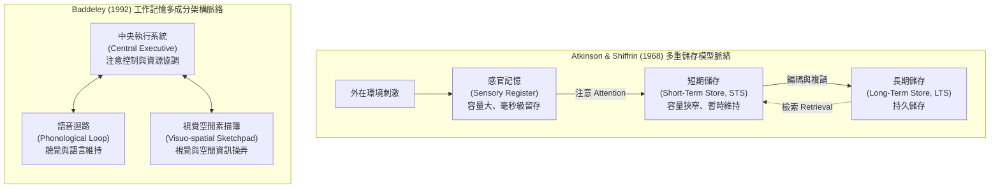
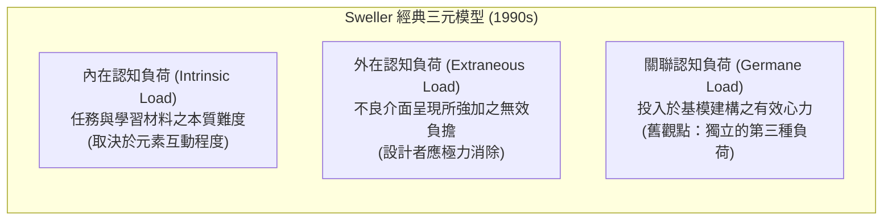
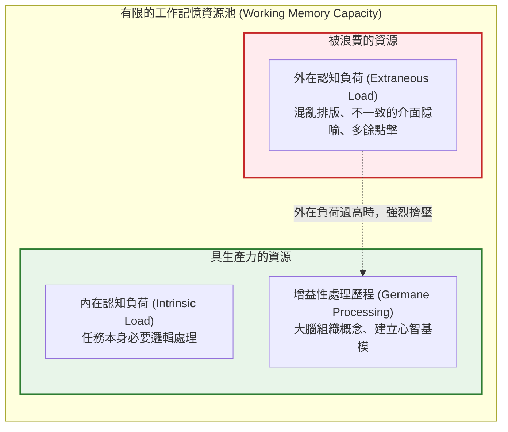
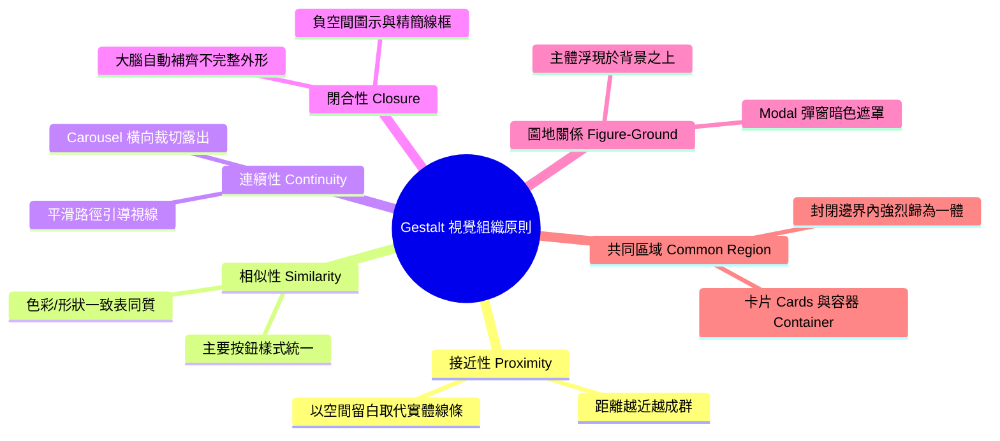

# 03｜認知負荷與 Gestalt 視覺法則：大腦資訊處理與視覺組織機制

> [!abstract] 核心摘要 (TL;DR)
> 在 [[02_Mental_Models_and_Norman_Principles|前一篇]] 中，我們探討了心智模型與微觀互動原則如何讓介面「易於理解與操作」。然而，當畫面上湧入大量資訊時，大腦會迅速面臨**工作記憶（Working Memory）容量狹窄**的生理瓶頸。本篇深入拆解**認知負荷理論（Cognitive Load Theory, CLT）**的學理演進，剖析內在負荷、外在負荷與增益性處理歷程（Germane Processing）的相互關聯，並系統化引入百年經典的 **Gestalt（格式塔）知覺組織法則**。我們將闡明接近性、相似性、連續性、閉合性、圖地關係及共同區域原則如何作為大腦的高效解碼捷徑，化繁為簡，消除介面中的視覺噪音。

## 關鍵術語索引 (Glossary)
* **工作記憶 (Working Memory)**：個體在執行複雜認知任務（如理解、推理與決策）時，用以暫時保存並主動操弄資訊的有能資源系統，其容量與持續時間均極度有限。
* **基模 (Schema)**：儲存於長期記憶中的認知架構，能將多個離散的資訊元素組織、打包為單一意義單元，並透過自動化處理大幅減輕工作記憶負擔。
* **內在認知負荷 (Intrinsic Cognitive Load)**：由學習材料或任務本質之複雜度所決定的認知負擔，主要取決於必須同時處理的資訊元素互動程度（Element Interactivity）。
* **外在認知負荷 (Extraneous Cognitive Load)**：由不良的介面呈現、混亂的排版結構或不必要的認知干擾所強加給大腦的額外負擔，屬於設計者應極力消除的無效消耗。
* **增益性處理歷程 (Germane Processing)**：工作記憶資源主動投入於基模建構、知識整合與深度理解的有效心理處理歷程。
* **資訊組塊 (Chunking)**：將零散的個別資訊元素，依據既有知識或空間規律重新編碼、歸納為少數具備語意結構之單位的心理策略。
* **格式塔知覺組織法則 (Gestalt Laws of Perceptual Organization)**：描述人類視覺感知系統如何自發地將視野中離散的刺激組織為穩定、連續且結構化之整體的先驗組織原則。
* **共同區域 (Common Region)**：當若干元素被明確劃定在同一個封閉邊界或背景底色內部時，視覺系統傾向將其強烈知覺為同一從屬群組的原則。

---

## 1. 為什麼看到排版混亂的畫面會「心累」？大腦的認知瓶頸

日常生活中，我們都有過這樣的體驗：打開某些老舊的行政申報或報稅網頁，迎面而來的是數十個沒有邊距的文字框、閃爍的跑馬燈與五顏六色的按鈕，哪怕任務只是填寫姓名電話，我們也會在短短數秒內感到煩躁、視線渙散甚至想立刻關閉分頁；相對地，使用設計良好的現代 App 時，即使處理的是複雜的理財或專案管理，畫面依然讓人感到井然有序、操作清晰。

### 1.1 認知疲勞的本質：工作記憶的超載現象
**[情境示例]** 設想一個極端混亂的假設情境：某線上報稅表單，在單一螢幕中塞入上百個密集表格欄位，所有字體大小與顏色毫無區分，重要警告與次要說明交錯混雜。此時使用者所感受到的「心累」，並非個人意志力不足，而是大腦在生理機制上出現了**工作記憶超載（Cognitive Overload）**：
* 人的眼睛每一次注視（Fixation），視網膜都會接收大量光影訊號並傳送至大腦中樞；
* 如果畫面缺乏結構與視覺階層，大腦皮層就必須調用龐大的意識資源，逐一分析每個點狀元素的相對關係；
* 當湧入的資訊流超越了大腦瞬時處理與暫存的極限，認知系統便會產生資訊瓶頸，導致理解效率驟降、操作錯誤率急遽上升。

### 1.2 介面設計的第一定律：尊重有限的認知配額
從認知人因工程的角度審視，數位介面的核心價值從來不是「在螢幕上塞入盡可能多的功能」，而是**在使用者極度有限的工作記憶配額內，精準管理其注意力與心理能量**。好的 UI 排版並非單純的視覺裝飾，它實質上是大腦資訊輸入階段的「預處理器」——透過合理的視覺分組與層次，替大腦過濾雜訊，引導眼球平順移動。

---

## 2. 人類資訊處理模型與工作記憶限制

要深入理解介面為何會讓人產生認知負擔，必須回到認知心理學對人類記憶與心智機制的基礎模型。

### 2.1 記憶模型的演進：從多重儲存到工作記憶
在認知心理學史上，人類如何處理與儲存資訊經歷了重要的理論深化，必須嚴格區分兩個不同脈絡的核心模型：

1. **Atkinson & Shiffrin (1968) 多重儲存模型 (Multi-store Model)**：
   * **[文獻事實]** Atkinson 與 Shiffrin 提出了記憶的結構分期：環境刺激首先短暫進入感官記憶（Sensory Register），若獲得注意（Attention）則轉入容量極其有限的短期儲存（Short-Term Store, STS）；透過複誦等控制歷程，資訊進一步被編碼寫入長期儲存（Long-Term Store, LTS）。在此架構中，長期儲存被視為相對持久的知識儲存庫，個體透過檢索將知識調回短期儲存使用。
2. **Baddeley (1986, 1992) 工作記憶模型 (Working Memory Model)**：
   * **[文獻事實]** Alan Baddeley 批評傳統「短期儲存」概念過於被動與單一，進而提出多成分的「工作記憶（Working Memory）」架構。
   * 在其 1992 年發表於《Science》的架構中，工作記憶被定義為一個**在執行複雜認知活動時，同時負責資訊暫時維持（Maintenance）與主動操弄（Manipulation）的有能系統**。它主要由負責注意分配與資源協調的**中央執行系統（Central Executive）**，以及兩個附屬的子系統構成：負責處理語言與聲音的**語音迴路（Phonological Loop）**，與負責操弄圖像及空間關係的**視覺空間素描簿（Visuo-spatial Sketchpad）**。（註：整合不同感官代碼的情節緩衝器 Episodic Buffer 為 Baddeley 於 2000 年後續擴充之第四成分）。
   * **對 UI 的啟示**：視覺介面主要佔用的是使用者的「視覺空間素描簿」與「中央執行系統」的注意資源。當介面排版混亂時，中央執行系統必須疲於奔命地過濾視覺雜訊，進而排擠了用來理解內容或做決策的寶貴資源。
3. **基模（Schema）的關鍵角色**：
   * 在長期記憶中，知識並非零碎孤立堆放，而是組織成網絡化的結構，稱為**基模（Schema）**。基模能將多個相關的屬性與概念封裝為單一高層次的知識單元。例如：一位熟練的司機看到「倒三角形紅色標誌」時，腦中即時激活「讓行」基模，完全不需要在工作記憶中逐字拼讀標誌上的幾何特徵。介面設計若能呼應使用者的既有基模，便能極大程度地釋放工作記憶。

---

### 2.2 米勒定律 (Miller's Law) 的真實科學意涵與組塊機制

在互動設計界，George Miller 的名字幾乎無人不知，但他於 1956 年發表的經典論文常年遭受廣泛的簡化與誤讀。

#### 1. 概念定義與理論背景
* **[文獻事實]** George A. Miller (1956) 在其論文《The Magical Number Seven, Plus or Minus Two: Some Limits on Our Capacity for Processing Information》中，主要探討了兩項獨立但相關的認知心理學議題：
  1. **一維絕對判斷的資訊容量（Absolute Judgment）**：當要求受試者僅依據單一維度（如音高、響度、鹽分濃度）辨識刺激時，人類的通道容量（Channel Capacity）極限大約在 2.5 bits 上下，換算約為 7 個互不混淆的類別。
  2. **短期記憶的廣度（Immediate Memory Span）**：短期記憶的限制並不取決於資訊位元數（Bits），而是取決於能夠維持的**資訊組塊數量（Number of Chunks）**，大約落在 \(7 \pm 2\) 的範圍。
* **資訊組塊 (Chunking)**：指個體利用過往經驗或既有知識，將數個離散的資訊片段重新組織、編碼成一個有意義之整體的認知歷程。

#### 2. Cowan (2001) 的現代容量修正：神秘的數字 4
* **[文獻事實]** 認知心理學家 Nelson Cowan (2001) 在《Behavioral and Brain Sciences》發表的靶子論文中，對短期記憶容量進行了系統性重新檢驗。
* **研究條件與任務差異**：Cowan 指出，Miller (1956) 的 \(7 \pm 2\) 廣度往往包含了受試者在未受限環境下自發採用的心智複誦、語意聯想與長期記憶先驗知識等組塊策略。當研究者**在嚴格受控條件下（例如阻止主動心智複誦、防止利用外部先驗知識進行二次組塊、或採用不可預測的突然回憶任務時）**測量純粹注意力焦點所能同時維持的工作記憶純容量（Pure capacity），發現其極限**大約落在 4 個組塊（範圍約在 3 到 5 個之間）**。
* **學術界定**：Cowan 的研究並非全盤推翻 Miller，而是釐清了「包含策略輔助的短期記憶表現（約 7 個組塊）」與「無策略輔助下的純工作記憶容量（約 4 個組塊）」在實驗條件上的本質區分。這項研究進一步證實：人類未經深度輔助的心智工作檯比想像中更為脆弱，介面設計更不應過度依賴使用者的腦力暫存。

#### 3. 生活化解釋：電話號碼的編碼記憶
* **[情境示例]** 當我們試圖記住一串隨機數字時，若呈現為連續無空格的狀態（如 `0912345678`），這十個獨立數字會立刻塞滿並壓垮工作記憶；但若依照習慣將其分組為三個組塊（`0912 - 345 - 678`），大腦便只需暫存三個組塊單位，記憶難度瞬間降低。

#### 4. 介面實際應用：格式化輸入與階層導覽
* **表單欄位自動組塊**：銀行帳號、信用卡號（`XXXX - XXXX - XXXX - XXXX`）與身分證字號，在輸入時自動插入間距與連字符，降低使用者的核對與校對負擔。
* **資訊階層卡片化**：長篇設定清單不會一股腦全部攤開，而是依主題拆分為「帳號安全」、「外觀偏好」、「通知設定」等 3 至 4 個獨立區塊。

#### 5. 常見誤解：打破「UI 選單不得超過 7 個項目」的迷思
* **[分析與推論]** 初學者最常犯的教條主義錯誤，是誤以為「Miller 說記憶容量是 7，所以網頁導覽列（Navigation Bar）絕不能放超過 7 個選項」。
* **根本的認知差異**：Miller 測量的是**「無提示下的短期主觀回憶（Recall）」**，即受試者必須完全憑腦袋默記；然而，UI 介面上的選單屬於**「視覺線索輔助下的辨識（Recognition）」**——所有選項都清清楚楚呈現在螢幕上，使用者並不需要把它們全部背下來，只需要用眼睛進行視覺掃描與語意辨識。只要分類邏輯清晰、視覺編排得宜，電商導覽列包含 10 到 12 個項目完全符合易用性，硬性砍至 7 個以內反而會破壞分類的自然完整性。

---

## 3. 認知負荷理論 (CLT) 的深度解構與演進

在了解了工作記憶的瓶頸之後，人機互動與教學心理學家進一步將大腦在執行任務時承載的總心力進行了系統化分類，這便是由 John Sweller 等人開創的**認知負荷理論（Cognitive Load Theory, CLT）**。

### 3.1 經典三元模型 (Sweller, 1988)
**[文獻事實]** John Sweller 在 1988 年提出 CLT 初始理論，後續在 1990 年代逐步發展出經典的「三元負荷模型」：

1. **內在認知負荷 (Intrinsic Cognitive Load)**：
   * **定義**：任務或學習材料本身所具有的固有難度。
   * **決定因素**：由資訊內容本身的「**元素互動程度（Element Interactivity）**」決定。若一項任務的多個元素可以獨立逐一學習（例如背英文字母，A 與 B 不互相影響），內在負荷較低；若多個元素彼此高度牽連、必須同時在大腦中運算才能理解（例如理解微積分極限概念，或在金融後台同時設定五組聯動風控參數），內在負荷就極高。
2. **外在認知負荷 (Extraneous Cognitive Load)**：
   * **定義**：由資訊呈現方式、介面排版結構或無效互動流程所額外引發的認知消耗。
   * **特質**：這類負荷對達成核心任務毫無實質幫助，完全屬於「視覺與操作雜訊」（例如：字體過小難以辨識、按鈕位置飄忽不定、缺少必要的圖示提示、跳出干擾性彈窗）。
3. **關聯認知負荷 (Germane Cognitive Load, 早期經典觀點)**：
   * **定義**：在早期三元架構中，Germane Load 被界定為學習者或操作者主動將注意力引導至「建構基模（Schema Acquisition）」與「促成自動化（Automation）」的有效心理努力。

---

### 3.2 理論的現代修正：Germane Load 的典範轉移
**[文獻事實]** 依據專案規範與學術嚴謹性，必須清楚指出：在 2010 年代後，CLT 學界經歷了一次關鍵的典範轉移。
* 在重要理論專著 *Cognitive Load Theory* (Sweller, Ayres, & Kalyuga, 2011) 及相關同儕審查論文中，學者們嚴肅反思了 Germane Load 的概念重複問題：若一個材料的內在難度是固定的，所謂投入建構基模的心力，本質上只是對該材料內在元素的處理歷程，並非獨立存在的另一種「負荷實體」。
* **現代雙成分與增益歷程觀點**：
  * 學界將 Germane Load 重新定義並正名為「**增益性認知處理歷程（Germane Processing）**」。
  * 實質的認知負荷主要由**內在負荷**與**外在負荷**構成；而工作記憶的有限總容量，則是由「處理無效干擾的外在負荷」與「致力於基模理解的增益性處理歷程」相互爭奪。
  * **注意邊界**：
    1. 不可將此概念模型簡化為放之四海皆準的固定數學等式；它所表達的是認知資源配置的動態權衡關係。
    2. 增益性處理歷程（Germane Processing）代表個體主動投入心力進行基模建構的「心理歷程」，然而它**並非必然保證產生良好的學習或操作成效**；實際效果仍受到使用者的先驗知識、動機水平、專注度以及任務本身的合理性所制約。

---

### 3.3 UI 設計的 CLT 三大調控準則
基於現代認知負荷架構，UI/UX 設計師的使命可以精確總結為三項策略：

1. **極小化外在認知負荷 (Minimize Extraneous Load)**：
   * 移除與任務無關的裝飾性雜訊；維持一致的版面配置、對齊方式與交互隱喻；確保文字具備充足對比度，讓使用者不必費力辨識字元。
2. **適度調控與釋放內在認知負荷 (Manage Intrinsic Load)**：
   * 內在負荷雖然由任務本質決定，但設計師可以透過**漸進式揭露（Progressive Disclosure）**，將高元素互動度的複雜任務拆解為線性步驟（如購物結帳的「填寫地址 → 選擇運送 → 確認付款」），避免一次將全部變數攤在使用者眼前。
3. **支持與引導增益性處理歷程 (Support Germane Processing)**：
   * 提供清晰的資訊視覺化、反饋機制與概念提示，協助使用者快速在大腦中拼湊出系統運作架構，順暢建立心智基模。

---

## 4. Gestalt 心理學：大腦的視覺組織與分組本能

既然降低外在認知負荷的關鍵在於讓介面具備良好的視覺結構，那麼人類大腦究竟是如何本能地將雜亂的光影訊號組織成結構的？答案正是 **Gestalt（格式塔 / 完形）心理學**。

### 4.1 緣起與「好形態原則」
**[文獻事實]** 20 世紀初，Max Wertheimer (1923) 與 Kurt Koffka (1935) 等德國心理學家創立了格式塔學派，提出著名格言：「**整體大於（且相異於）其部分之和（The whole is greater than the sum of its parts）**」。
* **好形態法則 (Law of Prägnanz)**：人類大腦在接收視覺刺激時，具備天生的組織傾向，會自發地以最簡潔、對稱、規則且穩定的方式，將繁雜的視野構建為結構化的整體形態。
* 在數位介面中，使用者不是先看到 50 個個別圖示再逐一運算其關係，而是藉由格式塔法則在數十毫秒內自動完成「視覺分群（Visual Grouping）」。

---

### 4.2 六大核心視覺組織原則的五步解構

#### 1. 接近性原則 (Law of Proximity)
* **概念定義與理論**：Wertheimer (1923) 提出，在其他條件相同下，彼此空間距離較近的元素，大腦會優先將其視為同一個關聯群組。
* **生活化解釋**：排隊搭車時，站得貼近的兩個人會被旁人自然判定為同行的同伴；站得較遠的則被視為互不相識的陌生人。
* **介面實際應用**：
  * **表單欄位的親疏間距**：輸入框標籤（Label）與該輸入框的垂直距離，必須**顯著小於**該輸入框與下一個欄位標籤的距離；否則使用者在視覺掃描時會產生歸屬混淆。
  * **以留白與空間距離取代繁冗線條**：利用不同尺階的外邊距（Margin），便能創造乾淨的層級區隔。
* **常見誤解**：以為必須在每個項目之間畫上實體隔線；過多的格線反而會引入新的外在視覺雜訊。

#### 2. 相似性原則 (Law of Similarity)
* **概念定義與理論**：具有相同或相近視覺屬性（如形狀、顏色、尺寸、方向或紋理）的元素，會被大腦自動歸類為具備相同功能或性質的集合。
* **生活化解釋**：運動會場上，穿著紅色運動服的選手會被一眼認出屬於同一隊伍，穿藍色運動服的屬於另一隊。
* **介面實際應用**：
  * **操作元件樣式一致性**：頁面上所有「主要行動按鈕（Primary Actions）」採用統一的品牌主色與圓角；不可點擊的狀態標籤（Badges）絕不採用與可點擊按鈕完全相同的造型。
  * **超連結顏色辨識**：文章內的文字連結維持統一的色彩或下劃線特徵。
* **常見誤解**：同一畫面上為了花俏而替同等級按鈕配置紅、橙、綠等多種色彩，破壞了相似性歸類。

#### 3. 連續性原則 (Law of Continuity)
* **概念定義與理論**：視覺焦點傾向沿著平滑、連續的直線或曲線移動，大腦會將位於平滑軌跡上的元素解讀為連貫的單一實體，優先於突然轉折或中斷的線條。
* **生活化解釋**：高速公路上的白色分道虛線，雖然由一段段分開的油漆塊構成，但駕駛眼中看到的是一條持續導引視線的前進路線。
* **介面實際應用**：
  * **橫向捲動卡片邊緣截斷露出（Carousel Peeking）**：在手機螢幕邊緣故意只露出下一張卡片的 15% 寬度；這個視覺上的斷裂與連續排列，直觀地向大腦暗示「水平方向尚有未完內容，可沿該方向滑動探索」，同時兼具視覺連續性與可操作提示功能。
* **常見誤解**：將卡片邊界剛好切齊螢幕邊緣，導致畫面看起來處於靜態結束狀態，阻斷了使用者的瀏覽連續性。

#### 4. 閉合性原則 (Law of Closure)
* **概念定義與理論**：當面對一個不完整或有缺口的幾何圖形時，知覺系統傾向自動填補空白缺口，將其感知為一個封閉、完整的幾何圖形。
* **生活化解釋**：世界自然基金會（WWF）的熊貓標誌，雖然頭部與背部有大片白色空白且未以黑線封閉，但人眼會自動在腦中勾勒出完整的熊貓輪廓。
* **介面實際應用**：
  * **極簡圖示（Icons）設計**：漢堡選單的三條橫線、分享圖示的開放節點，利用留白形成簡約意象。
* **重要學術界定**：**Closure 與下述的 Common Region 是截然不同的概念**。Closure 是大腦「自動補齊缺口以想像出封閉圖形」的內部知覺歷程；而 Common Region 是外部介面已經提供了「實體封閉邊界或底色」來圈定元素。不可混為一談。

#### 5. 圖地關係 (Figure-Ground Organization)
* **概念定義與理論**：Koffka (1935) 系統性論述的知覺機制。人的視野會自發分化為具有明確輪廓與焦點意義的「主體（Figure）」，以及處於主體後方、缺乏定型的「背景（Ground）」。主體通常較小、對比鮮明且形狀完整，背景則較大且均質。
* **生活化解釋**：著名的「魯賓之杯（Rubin's Vase）」錯覺圖——定睛看中央白色區域時它是一只杯子（Figure），視線轉移至黑色區域時則變成兩張對視的人臉。
* **介面實際應用**：
  * **彈出式視窗與半透明遮罩（Modal Dialog & Scrim）**：在呼出對話框時，底層網頁以 50% 黑色半透明遮罩（Backdrop Scrim）壓暗或套用高斯模糊，強制將原本的網頁內容降為均質背景（Ground），促使焦點對話框脫穎而出成為鮮明主體（Figure）。
  * **卡片懸停陰影（Elevation / Drop Shadow）**：利用陰影營造 Z 軸高度，提示該卡片浮現於底板之上。
* **常見誤解**：彈窗背景不加遮罩或對話框顏色與背景完全同色，造成圖地混淆。

#### 6. 共同區域原則 (Law of Common Region)
* **概念定義與理論**：
  * **[文獻事實]** 認知心理學家 Stephen E. Palmer (1992) 在《Cognitive Psychology》發表的論文中正式確立此原則。
  * 其實證研究表明：當元素被放置在同一個明確繪製的封閉邊界（Enclosure）或具備共同背景底色的區域內部時，會被強烈知覺為同一集合。
* **與接近性之競爭**：Palmer 的實驗證實，共同區域所產生的分組強度極高，在許多視覺條件下能有效克服並壓倒單純的「空間接近性」。
* **介面實際應用**：
  * **卡片式設計（Card UI）**：將標題、內文、縮圖與「閱讀更多」按鈕封裝在一個帶有淺灰底色或細邊框的白色卡片容器內。哪怕卡片內的標題與按鈕垂直距離較遠，使用者依然能毫不費力地認定它們屬於同一則文章。
* **常見誤解**：以為只能靠拉開距離來分組；當版面空間有限時，加上微弱的底色容器（Common Region）往往是最省空間且強效的組織手法。

---

### 4.3 視覺線索的共振與競爭：不存在固定的強弱排行榜
**[分析與推論]** 初學者常問：「接近性跟相似性到底誰比較強？」在真實的視覺感知中，**Gestalt 原則並不存在放之四海皆準的固定絕對強弱排行榜**。
* **多線索協同 (Synergy)**：當接近性、相似性與共同區域同向強化時（例如：同組功能距離近、顏色相同且包在同一個底色框內），介面的層級會變得堅不可摧，大腦解讀速度最快。
* **線索競爭 (Conflict)**：當線索產生矛盾時，大腦會陷入短暫的知覺遲疑。例如：兩個按鈕在空間上緊挨在一起（接近性強），但一個被塗成紅色、另一個塗成灰色，且紅色按鈕與三公分外的另一個紅色圖示具有相同顏色（相似性強）。此時大腦究竟該依距離分組還是依顏色分組？這類視覺衝突正是引發外在認知負荷的典型來源。優秀設計師的任務在於消除線索矛盾，維持一致的視覺指引。

---

## 5. 三款熱門 App 的認知負荷與 Gestalt 實踐觀察

延續前兩篇建立的觀察環境，我們在相同受控情境下，深入檢驗 Google Maps、Notion 與 Duolingo 在具體介面中如何調控認知負荷並實踐格式塔組織原則。

### 5.1 Google Maps：多層圖資的圖地分化與共同區域組塊

#### 1. 實際可觀察介面特徵
* **[介面觀察]**（基於 iOS 行動應用程式於 2026 年 11 月 22 日之導航與探索模式觀察）：
  * **圖地關係的分層渲染**：地圖底圖中的一般道路、建築物塊與綠地均採用低飽和度的淺灰、米白與淡綠色呈現，整體構成穩定的背景（Ground）；在開啟導航時，規劃路線以高飽和度、高對比的鮮豔天藍色粗線覆蓋於圖資上方，即時塞車路段則以紅色線條標記，在視覺上強烈浮現為前景主體（Figure）。
  * **底部導航狀態的共同區域容器**：螢幕底部彈出的剩餘時間、抵達時刻、剩餘里程以及醒目的紅色「結束導航」按鈕，均被嚴密包裹在同一個懸浮的白色圓角矩形卡片容器內。
  * **POI 圖示的相似性分組**：餐飲類點位採用橘色圓形圖示、大眾運輸點位採用藍色矩形圖示，同類設施維持一致的色彩與象形符號特徵。

#### 2. 對應理論解析與分析推論
* **對應原則**：**Figure-Ground (圖地關係)**、**Common Region (共同區域)** 與 **Extraneous Load 抑制**。
* **[分析與推論]** 導航情境通常伴隨駕駛或行走的動態環境，使用者的注意力主要集中於實體路況。Google Maps 透過極致的低飽和底圖壓制次要資訊，確保導航藍線成為唯一焦點（圖地對比），大幅減少大腦過濾環境雜訊所需的外在認知負荷；底部的卡片容器則精確利用共同區域原則，將行車關鍵數據打包為單一清晰的資訊組塊，方便使用者在安全餘裕內迅速完成資訊辨識。

---

### 5.2 Notion：空白畫面的外在負荷消除與階層接近性

#### 1. 實際可觀察介面特徵
* **[介面觀察]**（Desktop Web 版個人工作區，2026 年 11 月 22 日畫面狀態）：
  * **預設編輯區的極簡留白**：建立新頁面時，畫面中央主要區域呈現大面積空白畫布，頂部不設厚重的多層次固定工具列，預設僅保留「Page Title（頁面標題）」與淺灰色引導佔位文字「Press 'space' for AI, '/' for commands...」。
  * **區塊間距的接近性層級**：段落內的文字行距（Line-height）較小；相鄰文字區塊之間的垂直間距稍大；而不同大標題（H1、H2）上方的留白空間則顯著大於下方內文的間距。
  * **縮排連續性**：子清單或折疊列表（Toggle list）展開時，內容向右縮排，左側形成清晰的垂直對齊邊緣。

#### 2. 對應理論解析與分析推論
* **對應原則**：**Proximity (接近性)**、**Continuity (連續性)** 與 **Manage Intrinsic Load**。
* **[分析與推論]** Notion 藉由隱藏所有進階排版選單，在初始狀態將外在認知負荷壓降至極低水準；大標題上方留白較大、下方留白較小的排版，嚴格遵循接近性原則，使標題與其下屬內文自然形成緊密語意群組，無需依賴任何多餘的分隔線；垂直縮排則利用空間連續性清晰標明資訊的從屬架構，輔助使用者的長期記憶知識結構化輸出。

---

### 5.3 Duolingo：微型組塊 (Micro-chunking) 與注意力聚焦

#### 1. 實際可觀察介面特徵
* **[介面觀察]**（基於 iOS App 於 2026 年 11 月 22 日版本之基礎詞彙排序與選擇練習題型）：
  * **單一畫面單一任務**：在日常練習的答題過程中，螢幕中央預設只呈現當前的一道題目，畫面無法上下長捲動，徹底隔絕跨題目間的視覺干擾。
  * **單字選項的實體詞塊化**：句子拼組題型中，待選的單詞被逐一封裝在各自具備實體陰影與圓角外框的「獨立詞塊（Chips）」中，詞塊彼此保留均等間距。
  * **頂部橫向進度指示條**：螢幕頂部設置了一條貫穿左右的淺灰色槽軌，隨著作答進度，高飽和度鮮綠色進度塊由左向右平滑填滿。

#### 2. 對應理論解析與分析推論
* **對應原則**：**Chunking (資訊組塊)**、**Common Region (共同區域)** 與 **Support Germane Processing**。
* **[分析與推論]** 語言學習涉及文法、字彙與發音，本質上具備較高的內在認知負荷（高元素互動度）。Duolingo 的單一題目限制，本質上是一種「微型組塊（Micro-chunking）」策略——將龐大的語言知識拆解為單次只需消耗極低注意力的小單元；待選詞塊透過共同區域與陰影封裝，降低字元拼讀阻力；而頂部的進度條則提供了明確的目標達成回饋，引導學習者在低焦慮的情境下持續投入有效的增益性處理歷程（Germane Processing）。

---

## 6. 好介面 vs. 壞介面：視覺組織與認知負荷對比分析

為了將理論落實於日常設計決策，我們以實際開發中最容易出錯的場景，進行好壞介面的具體對比。

### 6.1 視覺噪音的成因：格式塔衝突 (Gestalt Conflicts)
在拙劣的介面中，最常見的問題不是缺乏設計元素，而是**設計元素之間的組織訊號互相矛盾**：
* **接近性與語意脫鉤**：表單的確認按鈕與輸入框貼得太近，卻與取消按鈕分置在螢幕兩端。
* **相似性誤導**：不可點擊的狀態標籤（如「審核中」）被設計成與「確認送出」完全相同的藍色膠囊按鈕，引發使用者反覆無效點擊。

### 6.2 Do's & Don'ts 實務對照表

| 設計維度 | 推薦做法 (Do) | 警訊做法 (Don't) | 對應認知與 Gestalt 原則 |
| :--- | :--- | :--- | :--- |
| **表單垂直間距** | 標籤緊鄰對應輸入框，欄位與欄位間距維持標籤間距的 2 倍以上。 | 標籤上下留白完全等距，導致肉眼無法判斷標籤屬於上方還是下方。 | **接近性 (Proximity)** 降低辨識外在負荷 |
| **卡片內容組織** | 相關圖文包裝在同一個微弱底色卡片容器內，不同卡片間拉開留白。 | 不使用容器，而在畫面上到處畫黑色實體粗隔線，線條橫跨全螢幕。 | **共同區域 (Common Region)** 避免線條雜訊 |
| **按鈕階層建立** | 全頁僅有一個高飽和主按鈕（Primary），其餘採用幽靈按鈕或文字按鈕。 | 單一畫面上同時出現 4 個相同顏色、相同大小的圓角矩形按鈕。 | **相似性 (Similarity)** 避免中央執行系統決策遲疑 |
| **長列表與橫向滑動** | Carousel 橫向滑動卡片在螢幕邊界刻意裁切露出下一張的 15%。 | 卡片寬度剛好貼齊螢幕兩側，右側無任何露出，缺少滑動指引。 | **連續性 (Continuity)** 提供自明性探索線索 |
| **複雜流程拆解** | 超過 10 欄位的複雜表單，採用分步精靈（Step Wizard）漸進呈現。 | 將 30 個設定開關與輸入框一股腦全部攤平在單一無捲動限制頁面。 | **調控內在負荷 (CLT)** 守護有限工作記憶容量 |

---

## 7. 實務檢核清單與設計反思 (Checklist & Reflection)

在交付介面設計稿或驗收前端畫面時，可運用以下清單逐一檢視其認知負荷與視覺組織架構。

### 7.1 認知負荷與格式塔原則檢驗清單 (Checklist)

- [ ] **1. 工作記憶容量守護 (Working Memory)**：
  - [ ] 畫面是否避免要求使用者在心智中死記上一頁的資訊以填寫當前頁面？
  - [ ] 面對複雜資訊輸入時（如信用卡、電話、帳號），系統是否主動提供自動分組格式化？
- [ ] **2. 接近性與間距層級 (Proximity & Hierarchy)**：
  - [ ] 標籤與對應控制項的距離，是否顯著小於群組之間的間距？
  - [ ] 版面上的邏輯分組是否以「留白間距與層級」為主導，而非依賴過度堆砌的實體隔線？
- [ ] **3. 共同區域與容器化 (Common Region)**：
  - [ ] 彼此具有密切關聯的圖文資訊，是否被合理收納在同一個卡片容器或背景色塊內部？
- [ ] **4. 相似性與操作階層 (Similarity)**：
  - [ ] 具備相同功能權重的元件（如主按鈕），是否在色彩、字體與圓角上維持嚴格一致？
  - [ ] 純展示性的狀態標籤，是否明確與可操作按鈕維持視覺差異，避免引發假意符（False Signifiers）？
- [ ] **5. 圖地分化清晰度 (Figure-Ground)**：
  - [ ] 彈出層、側邊抽屜選單與對話框出現時，背景是否施加適度的半透明暗色遮罩以襯托主體？
- [ ] **6. 漸進式揭露 (Progressive Disclosure)**：
  - [ ] 面對高元素互動度（高內在負荷）的複雜任務，是否將流程拆解為階段性步驟，避免視覺過載？

---

### 7.2 初學者反思題 (Self-Reflection)
> 💡 **「去線條化」視覺測試**：  
> 請試著將你當前設計稿中的**所有邊框（Borders）、底部分隔線（Dividers）與陰影完全隱藏**。  
> 僅僅依靠**文字尺寸、留白間距（Proximity）與背景底色（Common Region）**，你所規劃的內容群組與閱讀階層是否依然一目了然？如果拿掉線條後畫面瞬間崩潰為無法辨識的一團混亂，這代表你過度依賴實體線條來掩蓋結構間距的失衡，需要重新調整格式塔間距系統。

---

## 8. 總結與銜接下一篇：從靜態感知走向動態操作

在本篇中，我們建立了人機介面的資訊組織規律：
1. 人類的認知資源是極度珍貴且狹窄的，工作記憶在無輔助下僅能維持約 4 個組塊；
2. 優秀的設計必須極力消除混亂排版所造成的**外在認知負荷**，並透過漸進式架構調控**內在認知負荷**；
3. **Gestalt 知覺組織法則**是大腦的解碼加速器，透過接近性、相似性、共同區域與圖地分化，零散的像素得以凝聚為有意義的視覺群組。

### 邁向下一篇的思考提問
然而，當畫面透過格式塔法則組織得井井有條、使用者清楚看懂了資訊之後，互動的下一步往往是**動手操作**：
* 使用者伸出手指點擊螢幕上的按鈕時，移動時間受哪些物理與幾何條件限制？
* 為什麼手機 App 的核心操作列總是固定在螢幕最下方（或由拇指輕鬆觸及的熱區）？
* 當選單中的選項數量由 2 個增加到 8 個時，大腦做出選擇決策的時間是如何增長的？

要解答人體運動效率與決策速度的數學規律，我們必須從靜態的視覺組織邁向動態的行為心理學與操作人因工程。

> 👉 **下一篇導引**：[[04_Interaction_Efficiency_and_Behavior|04｜操作效率、互動設計與行為心理：費茲定律與席克定律的實務應用]]  
> 我們將深入拆解人機互動史上最著名的兩大數學模型——**費茲定律（Fitts's Law）** 與 **席克定律（Hick's Law）**，探討目標尺寸、點擊距離與選項決策時間的量化關係，揭示流暢操作背後的物理工程學。

---

## 參考文獻與資料來源 (References)

本文之理論界定、歷史演進與核心原則均依循以下經註冊之學術與專業來源（詳細書目與摘要請參閱 `[[sources/sources_index|資料來源索引庫]]`）：

1. **[[sources/sources_index#SRC-11|SRC-11]] George A. Miller (1956)**  
   * **書目資訊**：Miller, G. A. (1956). The magical number seven, plus or minus two: Some limits on our capacity for processing information. *Psychological Review*, 63(2), 81–97.
   * **永久連結 / DOI**：[https://doi.org/10.1037/h0043158](https://doi.org/10.1037/h0043158)
   * **引用定位**：第 2.2 節一維絕對判斷之通道容量（約 2.5 bits）與短期記憶組塊（Chunking）概念。
   * **資料限制**：受版權保護未存原始全文，依據公開摘要與認知心理學標準共識核對；明確澄清其不可作為 UI 選單項目的絕對限制。

2. **[[sources/sources_index#SRC-12|SRC-12]] John Sweller (1988)**  
   * **書目資訊**：Sweller, J. (1988). Cognitive load during problem solving: Effects on learning. *Cognitive Science*, 12(2), 257–285.
   * **永久連結 / DOI**：[https://doi.org/10.1207/s15516709cog1202_4](https://doi.org/10.1207/s15516709cog1202_4)
   * **引用定位**：第 3.1 節認知負荷理論（CLT）開創之作。闡述解題過程中的手段目的分析對工作記憶的消耗，確立基模建構之核心地位。
   * **資料限制**：受版權保護未存原始全文，依據論文核心理論核對。

3. **[[sources/sources_index#SRC-13|SRC-13]] John Sweller, Paul Ayres, & Slava Kalyuga (2011)**  
   * **書目資訊**：Sweller, J., Ayres, P., & Kalyuga, S. (2011). *Cognitive Load Theory*. New York: Springer.
   * **永久連結 / DOI**：[https://doi.org/10.1007/978-1-4419-8126-4](https://doi.org/10.1007/978-1-4419-8126-4) (ISBN: 978-1-4419-8125-7)
   * **引用定位**：第 3.2 節認知負荷理論的重要演進。記錄 Germane Load 典範轉移為增益性處理歷程（Germane Processing）與現代雙成分觀點。
   * **資料限制**：重要理論專著（非最新專著），受版權保護未存全文，依據目錄與理論文獻核對。

4. **[[sources/sources_index#SRC-14|SRC-14]] Richard C. Atkinson & Richard M. Shiffrin (1968)**  
   * **書目資訊**：Atkinson, R. C., & Shiffrin, R. M. (1968). Human memory: A proposed system and its control processes. In K. W. Spence & J. T. Spence (Eds.), *The Psychology of Learning and Motivation* (Vol. 2, pp. 89–195). Academic Press.
   * **永久連結 / DOI**：[https://doi.org/10.1016/s0079-7421(08)60422-3](https://doi.org/10.1016/s0079-7421(08)60422-3)
   * **引用定位**：第 2.1 節經典多重儲存模型（感官記憶、短期儲存、長期儲存）。
   * **資料限制**：受版權保護未存全文，依據學術界公認架構核對，並注意與 Baddeley 模型保持概念區分。

5. **[[sources/sources_index#SRC-15|SRC-15]] Alan Baddeley (1992)**  
   * **書目資訊**：Baddeley, A. (1992). Working memory. *Science*, 255(5044), 556–559.
   * **永久連結 / DOI**：[https://doi.org/10.1126/science.1736359](https://doi.org/10.1126/science.1736359)
   * **引用定位**：第 2.1 節工作記憶多成分模型（中央執行系統、語音迴路、視覺空間素描簿）。
   * **資料限制**：同儕審查綜述，受版權保護未存全文，依據論文核心主張核對。

6. **[[sources/sources_index#SRC-16|SRC-16]] Nelson Cowan (2001)**  
   * **書目資訊**：Cowan, N. (2001). The magical number 4 in short-term memory: A reconsideration of mental storage capacity. *Behavioral and Brain Sciences*, 24(1), 87–114.
   * **永久連結 / DOI**：[https://doi.org/10.1017/s0140525x01003922](https://doi.org/10.1017/s0140525x01003922)
   * **引用定位**：第 2.2 節工作記憶容量之現代實證修正。指出在排除主動複誦與組塊輔助之嚴格條件下，純容量約為 4 個組塊。
   * **資料限制**：受版權保護未存全文，依據公開摘要核對。

7. **[[sources/sources_index#SRC-17|SRC-17]] Max Wertheimer (1923)**  
   * **書目資訊**：Wertheimer, M. (1923). Untersuchungen zur Lehre von der Gestalt. II. *Psychologische Forschung*, 4(1), 301–350.
   * **永久連結 / DOI**：[https://doi.org/10.1007/BF00410640](https://doi.org/10.1007/BF00410640)
   * **引用定位**：第 4.1、4.2 節格式塔知覺組織法則本源（接近性、相似性、良好連續性、閉合性）。
   * **資料限制**：德文開創經典，依據英譯學術文獻共識核對。

8. **[[sources/sources_index#SRC-18|SRC-18]] Kurt Koffka (1935)**  
   * **書目資訊**：Koffka, K. (1935). *Principles of Gestalt Psychology*. New York: Harcourt, Brace and Company. (現代重印版 ISBN: 9780415209625)
   * **引用定位**：第 4.1、4.2 節格式塔好形態原則（Law of Prägnanz）與圖地關係（Figure-Ground Organization）。
   * **資料限制**：經典專著無 DOI，依據出版資訊與知覺理論核對。

9. **[[sources/sources_index#SRC-19|SRC-19]] Stephen E. Palmer (1992)**  
   * **書目資訊**：Palmer, S. E. (1992). Common region: A new principle of perceptual grouping. *Cognitive Psychology*, 24(3), 436–447.
   * **永久連結 / DOI**：[https://doi.org/10.1016/0010-0285(92)90014-S](https://doi.org/10.1016/0010-0285(92)90014-S)
   * **引用定位**：第 4.2 節共同區域原則（Common Region）之實證發現與卡片式容器應用，並明確與閉合性（Closure）區分。
   * **資料限制**：受版權保護未存全文，依據同儕審查論文公開摘要核對。
