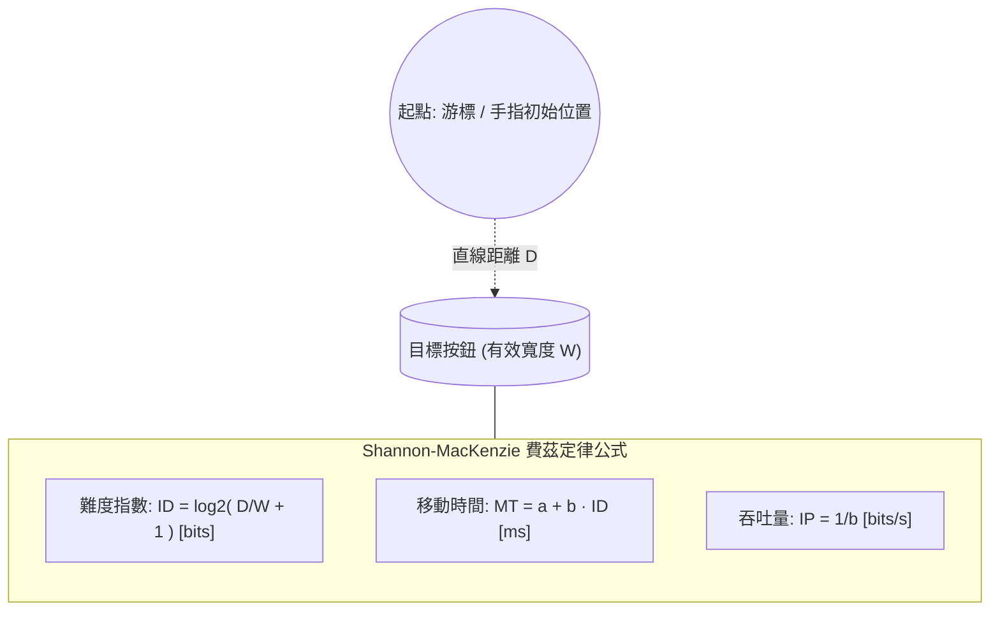
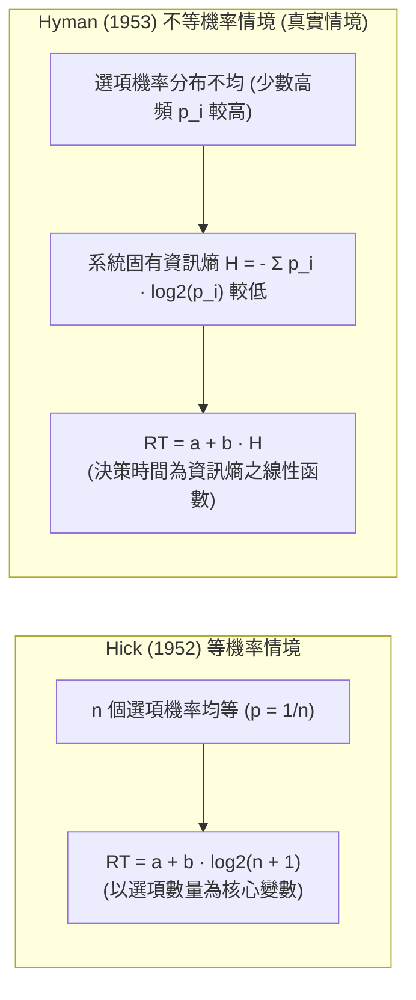
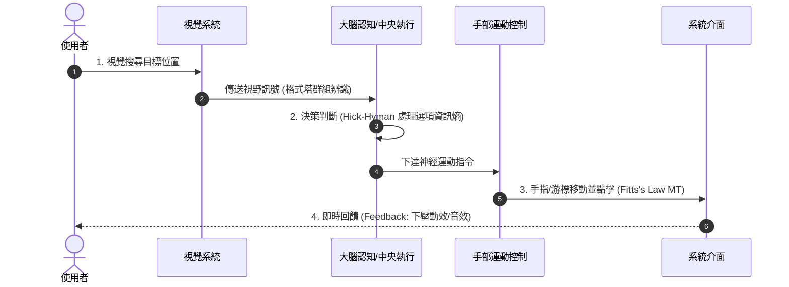

# 04｜操作效率、互動設計與行為心理：費茲定律與席克定律的實務應用

> [!abstract] 核心摘要 (TL;DR)
> 前三篇分別確立了 UX 的多維範疇（[[01_UI_vs_UX_Essence|第 01 篇]]）、心智模型與意符指引（[[02_Mental_Models_and_Norman_Principles|第 02 篇]]），以及大腦工作記憶的視覺組織法則（[[03_Cognitive_Load_and_Gestalt|第 03 篇]]）。當使用者看懂介面後，下一個核心考驗是：**動手操作時是否迅速、流暢且不易出錯？** 本篇從人因工程與行為心理學切入，深入拆解兩大經典數學模型：預測人體運動目標獲取時間的 **費茲定律（Fitts's Law）** 與預測選項決策時間的 **席克－海曼定律（Hick-Hyman Law）**。我們將嚴格解析其數學公式版本、適用邊界與變數意義，並對照 Apple 與 Google 官方觸控規範，揭示優秀產品如何藉由幾何佈局、熱區擴展與漸進揭露，打造極致順手的操作體驗。

## 關鍵術語索引 (Glossary)
* **費茲定律 (Fitts's Law)**：人因工程中描述人體運動控制目標獲取時間的數學模型，指出移動時間由目標距離與目標寬度的相對比例（難度指數）決定。
* **難度指數 (ID, Index of Difficulty)**：在費茲定律中，量化目標選取任務困難程度的數值，單位為位元（Bits）。
* **吞吐量 / 表現指數 (IP / Throughput, Index of Performance)**：衡量使用者或輸入設備在特定情境下每秒傳輸運動資訊能力的指標，單位為 bits/second。
* **席克定律 (Hick's Law)**：認知心理學中描述個體在面對多個均等選擇時，做出決策的反應時間與選項數量呈對數關係的數學模型。
* **席克－海曼定律 (Hick-Hyman Law)**：將席克定律拓展至選項出現機率不均等的情境，指出反應時間是刺激選項資訊熵（Information Entropy, \(H\)）的線性函數。
* **資訊熵 (Information Entropy, \(H\))**：資訊理論中量化系統不確定性的指標，反映使用者面對一組具備不同機率之選項時所需處理的心智資訊量。
* **有效寬度 (Effective Width, \(W\))**：在互動介面中，目標沿著游標或手指移動方向的可觸發點擊區域（Hit Target），不必然等於外觀可見之視覺尺寸。
* **螢幕邊界魔力 (Magic Edges / Magic Corners)**：在桌面滑鼠操作中，螢幕邊緣與四個角落因為游標無法越過物理邊界，其有效寬度在數學上趨近於無限大，具備極高的獲取效率。

---

## 1. 為什麼有些介面操作起來特別順手？從認知理解邁向物理操作

在探討介面設計時，初學者常將精力完全投注在視覺配色與文案說明上。然而在真實使用情境中，使用者經常會遇到另一種令人沮喪的挫折：
* 在行進中的公車上，想點擊畫面角落一個極小的「叉叉」按鈕關閉廣告，卻連續誤觸三次旁邊的橫幅；
* 在外送 App 的購物車中，底部的「送出訂單」按鈕寬大飽滿，單手拇指輕輕一按就能精準送出；
* 打開某個設定頁面，面對密密麻麻完全未經分類的 30 個核取方塊，眼睛反覆游移了 5 秒鐘依然無法做出決定。

### 1.1 操作效率與整體體驗的因果鏈結
**[分析與推論]** 一款產品就算資訊結構再清晰（符合格式塔法則）、概念隱喻再準確（符合心智模型），如果**每次物理點擊都容易誤觸、每次選單抉擇都需要遲疑數秒**，這種微小的「操作摩擦力（Interaction Friction）」在頻繁的日常使用中會不斷累積，最終演變為嚴重的操作挫折與流失率。

人機互動的執行過程本質上是一條完整的生理與心智鏈結：大腦首先透過視覺組織看懂畫面，接著依據當前意圖在多個選項中做決策（席克定律），最後調動手部肌肉將輸入工具（游標或手指）移動至特定螢幕目標上進行點擊（費茲定律）。唯有讓這兩階段的消耗都降至最低，才能達成使用者口中所謂「行雲流水、特別順手」的體驗。

---

## 2. 費茲定律 (Fitts's Law)：人體運動目標獲取的物理模型

在人機互動（HCI）領域，費茲定律是地位最崇高、被引用最頻繁的人體運動學模型。**必須嚴格界定：費茲定律是人體運動時間的預測模型，關注操作效率與互動區域之尺寸與距離，絕非習慣養成或行為改變理論。**

### 2.1 理論起源與 Shannon-MacKenzie 現代公式版本
1. **理論起源 (Fitts, 1954)**：
   * **[文獻事實]** 心理學家 Paul M. Fitts 在 1954 年發表於《Journal of Experimental Psychology》的經典論文中，將 Claude Shannon 的資訊理論引入人類運動系統的研究。
   * Fitts 的原始實驗是讓受試者拿著手動金屬觸控筆，在兩塊不同寬度（\(W\)）、相隔不同距離（\(A\), Amplitude）的金屬目標板之間進行高速來回點擊。Fitts 發現：人體完成動作的時間，完全取決於目標寬度與距離的相對比例。
2. **MacKenzie (1992) 的現代公式標準化（Shannon-MacKenzie Formulation）**：
   * **[文獻事實]** 在原始 Fitts (1954) 公式中，難度指數定義為 \(ID = \log_2(2A/W)\)。然而，在現代人機互動研究中，當目標寬度極大或距離極近（\(W > 2A\)）時，此公式會計算出非理性的負值 \(ID\)。
   * 人機互動權威學者 I. Scott MacKenzie (1992) 在發表於《Human–Computer Interaction》的綜述論文中，正式推廣並確立了符合夏農定理第一公式形態的現代標準公式：

\[
ID = \log_2 \left(\frac{D}{W} + 1\right)
\]

\[
MT = a + b \cdot \log_2 \left(\frac{D}{W} + 1\right)
\]

* **公式變數嚴格定義**：
  * **\(MT\) (Movement Time)**：完成該次指向與點擊動作所需的平均移動時間（通常以毫秒或秒為單位）。
  * **\(D\) (Distance)**：起點（游標當前位置或手指懸空位置）到目標中心點的直線距離（或物理振幅）。
  * **\(W\) (Width)**：目標沿著**運動方向**測得的有效尺寸（Tolerance / Effective Width）。
  * **\(ID\) (Index of Difficulty)**：難度指數，單位為位元（Bits），數值越大代表該點擊任務越困難、越耗時。
  * **\(a\)**：經驗截距參數（Intercept），代表包含設備點擊延遲、啟動反應等非運動時間。
  * **\(b\)**：經驗斜率參數（Slope），代表每增加 1 bit 難度所需的額外時間；其倒數 \(1/b\) 即為**吞吐量（Throughput / IP, Index of Performance）**，衡量輸入設備的人因效率。

---

### 2.2 費茲定律的五步解構

1. **概念定義**：
   * 指向並點擊一個目標所需的時間，與「抵達目標的距離（\(D\)）」成正比，與「目標的寬度（\(W\)）」成反比。
2. **理論基礎**：
   * 人類的運動神經控制由兩階段構成：首先是快速、粗略的「彈道式大幅移動（Ballistic Phase）」，隨後是依賴視覺閉環回饋進行微調修正的「精確逼近階段（Homing Phase）」。目標越小或越遠，後者微調修正的次數呈幾何級數增加，消耗大量時間。
3. **生活化解釋**：
   * 試著在十公尺外將一顆網球投進一個直徑三公尺的塑膠大水桶（大 \(W\)，低 \(ID\)），你幾乎看都不用看就能輕鬆扔進；但如果要求你站在一公尺外將同一顆網球扔進一個直徑只比球大一公分的玻璃瓶口（極小 \(W\)，高 \(ID\)），你必須屏氣凝神反覆微調幾秒鐘，稍有偏差就會砸中瓶頸彈開。
4. **介面實際應用**：
   * **底部主要操作列（Bottom App Bar）**：在智慧型手機中，由於單手握持時拇指自然落於螢幕下半部，將「立即購買」或「送出」按鈕做成橫跨全螢幕的寬扁按鈕（極小 \(D\)、極大 \(W\)），大幅壓低 \(ID\)，使用者完全無需眼睛對準即可單手盲按。
   * **邊界與角落的無限寬度（Magic Corners）**：在 PC 桌面系統（如 macOS 頂部選單列或 Windows 底部開始鍵），因為滑鼠游標無法甩出物理螢幕邊界，使用者只需用力將游標往角落甩，螢幕邊界會將游標強制卡住。在數學上，目標沿運動方向的有效寬度 \(W\) 趨近於 \(\infty\)，使難度指數 \(ID \to \log_2(0 + 1) = 0\)，成為點擊速度最快的位置。
5. **常見誤解**：
   * **誤以為按鈕越大越好，盲目放大到極端**：依據對數特性，當按鈕寬度達到一定閾值後，再繼續放大所能節省的移動時間已微乎其微（邊際效益遞減），反而會嚴重擠壓介面的資訊留白與內容呈現。
   * **混淆滑鼠與觸控螢幕的邊角特性**：在觸控螢幕上，使用者的手指可以隨意點擊螢幕任何位置，實體邊界不再具有「卡住游標」的物理阻擋特性；相反地，智慧型手機的四個最極端角落往往是單手拇指最難伸展觸及的「運動死角」。

---

### 2.3 觸控介面人因工程：Apple HIG 與 Material Design 規範對照

在行動裝置時代，人機互動從「滑鼠指針」轉移為「人體肉質指尖」。由於指尖與玻璃接觸時會產生約 8 至 10 毫米的扁平接觸橢圓（Fingerprint contact patch），且手指本身會遮擋下方視線（Occlusion），作業系統官方制定了嚴格的最小目標規範。

| 規範維度 | Apple Human Interface Guidelines (SRC-24) | Google Material Design (SRC-25) | 人因工程學理依據 |
| :--- | :--- | :--- | :--- |
| **官方建議最小觸控目標** | **44 × 44 points (pt)** | **48 × 48 density-independent pixels (dp)** | 對應成人指尖接觸面（約 7–10 mm 物理尺寸） |
| **視覺與熱區分離 (Hit Target)** | 強烈建議視覺圖示（如 24pt）可小於點擊區，透過 Padding 補足至 44pt | 允許 24dp 圖示搭配無形外距，達成 48dp 最小交互區 | 保持介面視覺精緻，同時最大化費茲定律的有效寬度 \(W\) |
| **元件間距防誤觸約束** | 建議在獨立觸控元件周遭保留適當安全留白 | 明確建議相鄰獨立目標間保留 **至少 8 dp 間距** | 防止指尖邊緣誤觸相鄰控制項，形成物理空間約束 |

---

## 3. 席克－海曼定律 (Hick-Hyman Law)：選項數量與決策時間

費茲定律解決的是「動手點擊」的物理效率，而席克－海曼定律解決的則是點擊之前的「大腦決策」耗時：**當畫面出現多個可操作選項時，使用者需要花費多少時間做出選擇？**

### 3.1 理論起源：從 Hick (1952) 到 Hyman (1953) 的資訊熵擴展

1. **Hick (1952) 的等機率對數公式**：
   * **[文獻事實]** 英國心理學家 W. E. Hick (1952) 在《Quarterly Journal of Experimental Psychology》發表經典實驗，測試受試者在面對不同數量（1 到 10 個）均等亮起的訊號燈時，按下一對應鍵盤的選擇反應時間（Choice Reaction Time）。
   * Hick 發現反應時間並不隨選項數量線性成長，而是呈現對數關係：

\[
RT = a + b \log_2(n + 1)
\]

* **變數說明**：
  * \(RT\)：總反應時間（Reaction Time）。
  * \(n\)：可供選擇的等機率選項數量。
  * \(+1\)：代表在做出一項具體選擇前，大腦需要先判斷「是否有事件發生」的不確定性初始狀態。
  * \(a, b\)：個體與情境經驗常數。

2. **Hyman (1953) 的不等機率與資訊熵模型**：
   * **[文獻事實]** Ray Hyman (1953) 在《Journal of Experimental Psychology》發表的論文中進一步指出：在真實世界中，選項被選取的機率鮮少均等。
   * Hyman 證實選擇反應時間是**刺激訊號所含資訊熵（Information Entropy, \(H\)）**的精準線性函數：

\[
H = \sum_{i=1}^{n} p_i \log_2\left(\frac{1}{p_i}\right) = -\sum_{i=1}^{n} p_i \log_2 p_i
\]

\[
RT = a + b \cdot H
\]

* **關鍵學理洞見與設計效果區分**：
  * 當各個選項被選取的先驗機率 \(p_i\) 完全均等時（\(p_i = 1/n\)），系統的資訊熵達到最大理論值 \(H = \log_2 n\)，此時模型回歸經典 Hick 等機率公式。
  * **不等機率的本質**：在真實使用情境中，使用者對某些選項的需求頻率通常遠高於其他選項（例如搜尋引擎中極少數熱門關鍵字佔了高比例的點擊）。這種機率分布的不均勻，使得系統本身的資訊熵 \(H = -\sum p_i \log_2 p_i\) 自然顯著低於完全等機率狀態，因此平均決策時間 \(RT\) 原本就較短。
  * **「高頻前置」的真實設計機制**：**必須嚴肅澄清，單純在介面上調整選項的物理排列順序（如將高頻項目置頂），並不會直接改變該系統既有的統計機率分布，因而不會在數學上直接降低資訊熵本身**。將高頻項目放置於顯眼或靠前位置，其真正的設計價值在於**大幅加速使用者的視覺搜尋（Visual Search）歷程，並縮短眼球移動與認知比對時間**。若進一步結合智慧預設（Smart Defaults）或依情境大幅過濾掉無關選項，則實質上縮減了當前決策的選項集合，進而提升整體決策與操作效率。

---

### 3.2 席克定律的五步解構

1. **概念定義**：
   * 一個人做出決策所需的時間，隨著可供選擇的選項數量呈對數增加。
2. **理論基礎**：
   * 大腦在面對多個選項時，心智搜尋歷程類似於資訊理論中的「二分法搜尋（Subdivided Elimination）」——每增加一倍選項，大腦只需多進行一次二分篩選，因此反應時間呈 \(\log_2\) 對數成長而非線性爆發。
3. **生活化解釋**：
   * 走進一家只賣「牛肉麵、排骨麵、乾麵」3 種餐點的街邊老店，你通常 3 秒鐘就能決定點什麼；但走進一家菜單厚達 12 頁、密密麻麻印著 120 道各國料理的複合式餐廳，你往往會盯著菜單沉思 5 分鐘依然難以抉擇（這在心理學上亦稱為選擇過載與分析癱瘓）。
4. **介面實際應用**：
   * **漸進式揭露 (Progressive Disclosure)**：複雜軟體在初始畫面只呈現最核心的 3 到 4 個主要分類，點進特定分類後再呈現次級選項，將龐大的單層資訊拆解為多次低負荷的快速決策。
   * **智慧預設與高頻前置 (Smart Defaults & Recents)**：在搜尋介面中，系統主動提供「最近搜尋紀錄」或「熱門關鍵字」；社群分享面板將常用聯絡人置頂突顯。這項設計的實質效益在於**加速視覺搜尋辨識，減少使用者在一長串選項中來回掃描與比對的時間**，而非在數學上直接改變系統背後的固有統計機率分布。若能進一步依情境預先過濾掉無關選項，便能直接縮小當前決策的選項規模。
5. **常見誤解與理論適用限制**：
   * **誤解：選項越少就一定越好，所有選單都要砍到最少**：若為了一味減少單頁選項，把原本兩層的清楚選單拆成八層冗長的步驟，使用者反而會因「點擊深度過深（Excessive Clicks）」與迷航而崩潰。
   * **適用邊界嚴格限制**：席克定律**只適用於選項清晰、使用者無需花費額外時間閱讀長篇文字的簡單刺激－反應情境**。如果每個選項都是一段長達 200 字的合約條款，或者需要深度邏輯推理的專業決策，主導決策時間的將是複雜的認知問題解決與閱讀理解歷程，席克定律的對數公式便不再適用。

---

## 4. 操作效率與使用者行為：流暢人機互動的系統設計

將費茲定律（目標獲取）與席克定律（選擇決策）結合後，我們可以推導出更宏觀的操作流程優化架構。

### 4.1 視覺搜尋、決策與動作執行的全流程協調
使用者在介面上的每一個微觀動作，都可以拆解為三個依序進行的子階段：

1. **視覺搜尋階段 (Visual Search)**：依賴良好的 Gestalt 視覺分組與對比，讓目標在視野中脫穎而出；
2. **認知決策階段 (Cognitive Decision)**：藉由合理分類與高頻前置抑制 Hick-Hyman 決策時間；
3. **物理執行階段 (Motor Execution)**：透過充足的有效寬度 \(W\) 與適當的操作距離 \(D\) 保障費茲定律的高效率。

---

### 4.2 減少不必要的操作摩擦力與防錯機制
銜接 [[02_Mental_Models_and_Norman_Principles|第 02 篇]] 所探討的 Norman 核心原則，操作效率的極致並非盲目追求單純的「手速」，而是**避免無效操作與大幅降低出錯成本**：
* **結合 Constraints 消除無效路徑**：當表單尚未填寫完畢時，透過禁用（Disabled）或提示狀態限制無效提交，避免使用者盲目點擊後再遭遇報錯彈窗；
* **非破壞性操作的就地回退（Undo Over Confirmation）**：傳統桌面軟體在刪除項目時，總會彈出「您確定要刪除嗎？」的二次確認彈窗，依據 Hick 定律強加了一次無謂的心智決策；現代優秀產品（如 Gmail、Notion）採用「直接刪除並在底部浮現 Toast 提示提供『復原（Undo）』按鈕」——正常操作毫不卡頓，出錯時依然能隨時挽回。

---

## 5. 三款熱門 App 的互動效率與定律實踐觀察

延續本系列專案建立的觀察環境，我們深入檢驗 Google Maps、Notion 與 Duolingo 在具體介面設計中如何實踐費茲定律與席克－海曼定律。

### 5.1 Google Maps：單手拇指熱區與導航關鍵操作

#### 1. 實際可觀察介面特徵
* **[介面觀察]**（基於 iOS 行動應用程式於 2026 年 11 月 22 日之導航與探索模式觀察）：
  * **底部全寬「開始導航」按鈕**：在搜尋完目的地並完成路徑規劃後，螢幕底部中央呈現一個橫跨螢幕大半寬度、高飽和度深藍底白字的「開始（Start）」圓角按鈕，按鈕高度顯著高於標準 44pt。
  * **導航中的結束與靜音操作**：在進入即時導航模式後，畫面最常被緊急使用的「結束導航（叉叉按鈕）」被放置於左下角卡片內部，尺寸寬大；而較次要的「路線詳細清單」、「沿途搜尋加油站」則收納於右下角抽屜式上滑卡片中。
  * **搜尋類別的高頻水平膠囊標籤**：首頁地圖頂部搜尋列下方，水平排列了「餐廳」、「咖啡」、「加油站」、「飯店」等圓角膠囊按鈕，向右可滑動探索更多次要類別。

#### 2. 對應理論解析與分析推論
* **對應原則**：**Fitts's Law (費茲定律)**、**Hick-Hyman Law (席克－海曼定律)**。
* **[分析與推論]** 
  * 底部全寬的「開始導航」按鈕，精確鎖定了單手握持手機時拇指最容易觸及的自然弧形運動熱區（距離 \(D\) 極小），搭配超大有效寬度（\(W\) 極大），使 \(ID = \log_2(D/W + 1)\) 降至極低水準，確保使用者即使在行色匆匆時也能精準一鍵啟動；
  * 頂部搜尋膠囊將日常生活中常用的「餐廳、咖啡、加油站」等類別直接展示於首頁，使需要這些類別的使用者能夠在最前層快速進行視覺定位，省去點開多層分類清單進行搜尋的比對成本。

---

### 5.2 Notion：斜線指令與就地浮動工具列

#### 1. 實際可觀察介面特徵
* **[介面觀察]**（Desktop Web 版個人工作區，2026 年 11 月 22 日編輯畫面）：
  * **文字反白的就地浮動工具列 (Inline Toolbar)**：在頁面中用滑鼠選取一段文字時，加粗、斜體、超連結等文字格式設定列，會瞬間**精準浮現於被選取文字的正上方 5 像素處**，而非固定在螢幕最頂端視窗邊緣。
  * **斜線指令（Slash Command `/`）**：在空行輸入 `/` 鍵時，各類區塊類型選單（標題、待辦清單、表格、程式碼區塊）立即在游標輸入點就地展開，並支援鍵盤關鍵字模糊過濾（例如輸入 `/h1` 直接定位大標題）。

#### 2. 對應理論解析與分析推論
* **對應原則**：**Fitts's Law (距離 D 的極小化)**、**Hick-Hyman Law (搜尋過濾)**。
* **[分析與推論]**
  * 傳統文書處理軟體（如早期特定桌面軟體版本）將格式工具列固定在視窗頂端，使用者在選取文字後，游標需從文字處跨越視窗距離移動至頂端；Notion 將浮動工具列直接呈現於被選取文字上方，大幅縮短了游標的物理位移距離，從人因工程角度顯著降低了移動時間；
  * 斜線指令則讓雙手維持在鍵盤打字區域，無須切換至滑鼠操作；鍵盤即時文字過濾則讓使用者透過直接輸入關鍵字迅速定位目標區塊，避免在多層選單中逐一搜尋。

---

### 5.3 Duolingo：單手盲按熱區與防誤觸確認

#### 1. 實際可觀察介面特徵
* **[介面觀察]**（基於 iOS App 於 2026 年 11 月 22 日版本之日常練習單元）：
  * **底部全寬高對比「檢查」按鈕**：在單選或拼字練習中，核心驗證動作「檢查（Check）」始終固定佔據螢幕底部整塊安全區域，寬度貼齊螢幕兩側邊距，垂直厚度飽滿，高度超過 50pt。
  * **作答完成後的下一步切換**：點擊檢查後，底部彈出綠色（答對）或紅色（答錯）回饋面板，原本的檢查按鈕在相同幾何位置無縫轉換為「繼續（Continue）」按鈕。
  * **單字選項的大間距詞塊**：句子拼組題型中的各個待選單字，其觸控方塊四周均保留了至少 8pt 的安全留白外距。

#### 2. 對應理論解析與分析推論
* **對應原則**：**Fitts's Law (大尺寸與就地切換)**、**Material / HIG 觸控間距約束**。
* **[分析與推論]**
  * 「檢查」與「繼續」按鈕共用螢幕底部的同一幾何區域，使使用者在答題與推進流程時，拇指無需在大範圍螢幕區域間來回大幅位移，有助於維持操作連貫性；按鈕的寬大尺寸亦提供了較充裕的觸發寬容度；
  * 待選詞塊之間的留白間距，落實了人體工學的防誤觸約束，降低使用者連續點按時誤選相鄰單字的機率。

---

## 6. 好介面 vs. 壞介面：操作效率與決策負擔對比分析

為了使理論轉化為具體的工程與設計準則，我們整理出實務上最關鍵的互動效率對照表。

### 6.1 互動摩擦力的典型元兇
* **過小的點擊熱區**：視覺圖示只有 16×16px，程式碼未配置外距 Padding，使用者必須像穿針引線一樣小心翼翼對準才能點中；
* **遙遠的關聯操作**：在畫面最底部填寫完表單，主要送出按鈕卻孤懸在頂部導航列右上角，游標必須跨越整座螢幕；
* **單層巨型選單**：下拉選單攤開後塞滿 60 個沒有分組、沒有排序的選項，強迫使用者逐行閱讀。

### 6.2 Do's & Don'ts 實務對照表

| 設計維度 | 推薦做法 (Do) | 警訊做法 (Don't) | 對應理論定律 |
| :--- | :--- | :--- | :--- |
| **行動端核心按鈕** | 主要 CTA 按鈕橫跨底部全寬，高度維持 48–56dp，緊鄰拇指自然活動熱區。 | 將主要確認按鈕做成極小的膠囊置於右上角，單手操作必須改換握姿。 | **Fitts's Law** 最小化 \(D\)，最大化 \(W\) |
| **小圖示熱區處理** | 視覺上為 20×20pt 的關閉圖示，利用擴展 Padding 將點擊熱區加大為 44×44pt 以上。 | 視覺多大、點擊範圍就多大，16px 的叉叉按鈕造成使用者頻繁誤觸背景。 | **Apple HIG (SRC-24)** 解耦視覺與有效寬度 |
| **多選項選單設計** | 超過 15 個項目的分類，先以 4–5 個高階主題分類收納，並提供即時搜尋輸入框。 | 單一原生下拉選單（Dropdown）塞入 50 個選項，強迫使用者長距離滑動滾輪盲目尋找。 | **Hick-Hyman Law** 分層控制選項規模與搜尋負擔 |
| **操作確認機制** | 刪除與歸檔操作直接執行，並在螢幕邊緣浮現帶有「復原 (Undo)」按鈕的輕量提示。 | 每次刪除一筆日常項目，都跳出高模態彈窗強迫使用者點擊「確認 / 取消」。 | **Hick's Law** 消除不必要的心智中斷 |
| **桌面端快捷選單** | 善用螢幕頂部、底部與四個角落放置全域控制項，或提供就地右鍵內容選單。 | 將常用功能放置在浮動視窗的內部中央邊界，游標滑過容易甩過頭（Overshoot）。 | **Fitts's Law** 利用邊界的物理阻擋特性 |

---

## 7. 實務檢核清單與設計反思 (Checklist & Reflection)

在審查原型或驗收產品介面時，可運用以下檢驗清單逐一排查操作效率問題。

### 7.1 操作效率與行為設計檢驗清單 (Checklist)

- [ ] **1. 費茲定律與目標尺寸 (Fitts's Law - Size)**：
  - [ ] 行動端所有可點擊元件（按鈕、圖示、連結）的最小熱區是否達到 Apple 44pt 或 Google 48dp 規範？
  - [ ] 高頻核心操作（如「結帳」、「下一步」）是否具備足夠飽滿的尺寸，支援盲按操作？
- [ ] **2. 操作距離與拇指熱區 (Fitts's Law - Distance)**：
  - [ ] 常用動作是否配置於使用者當前操作起點的就近位置（如浮動工具列、底部操作列）？
  - [ ] 單手操作環境下，高頻點擊元件是否避開了單手拇指難以伸展的對角線遠端死角？
- [ ] **3. 席克定律與決策負荷 (Hick's Law - Choice)**：
  - [ ] 畫面上同時呈現的平鋪選項數量是否受到克制？是否透過漸進揭露分層呈現？
  - [ ] 長篇選單是否提供智慧搜尋、關鍵字過濾或「最近使用」前置功能，以壓低資訊熵？
- [ ] **4. 防誤觸與空間約束 (Constraints & Spacing)**：
  - [ ] 獨立按鈕之間是否保留了至少 8dp 的安全間距，防止手指邊緣誤觸相鄰項目？
  - [ ] 具備嚴重破壞性後果的操作（如「刪除帳號」），是否在空間位置或樣式上與常規按鈕形成鮮明區隔？
- [ ] **5. 操作回饋即時性 (Feedback)**：
  - [ ] 使用者點擊按鈕後，是否在合理時間內（視覺微動效、背景變色、震動）感知到已被系統接收？

---

### 7.2 初學者反思題 (Self-Reflection)
> 💡 **單手行動操作體驗測試**：  
> 請試著拿起你的手機，**僅使用非慣用手（例如平時慣用右手者改用左手），在站立走動時單手操作你所設計的產品原型**。  
> 你的大拇指是否能夠毫不費力地觸及最關鍵的核心按鈕？當你試圖點擊關閉按鈕或切換分頁時，是否發生了手滑誤觸或必須換手輔助的窘況？這個簡單的物理測試，能立刻無情揭露費茲定律在距離（\(D\)）與寬度（\(W\)）上的設計缺陷。

---

## 8. 總結與銜接下一篇：從單點操作走向全域旅程

在本篇中，我們建立了人機互動的運動與決策工程學：
1. **費茲定律（Shannon-MacKenzie 公式）** 揭示了點擊時間是距離與有效寬度的對數比值，告訴我們在行動端應擴展點擊熱區並善用拇指熱區；
2. **席克－海曼定律** 揭示了決策時間與選項數量及資訊熵的對數關係，指引我們善用漸進揭露與高頻前置來加速大腦決策；
3. 好體驗不僅在於「看得懂」，更在於「動作執行的摩擦力降到最低」。

### 邁向下一篇的思考提問
然而，單個按鈕的點擊順手、單個選單的決策迅速，依然只是局部的互動點。當一個系統包含幾百個頁面、幾千條資訊時：
* 我們該如何規劃宏觀的**資訊架構（Information Architecture, IA）**，才能讓使用者不迷航？
* 導覽列（Navigation）究竟該採用底部標籤頁（Bottom Tabs）、側邊抽屜（Navigation Drawer）還是階層樹狀架構？
* 使用者從進入 App 到達成最終目標的**端到端流程（User Flow）**該如何梳理？

要解答這些宏觀架構與跨頁面導引的系統規律，我們將在模組二中正式跨入資訊架構與旅程設計的領域。

> 👉 **下一篇導引**：[[05_Information_Architecture_and_Flow|05｜資訊架構、導覽設計與使用者旅程：打造不迷航的數位地圖]]  
> 我們將探討資訊架構的核心模式（扁平化 vs. 階層化）、現代行動導覽設計的優缺點取捨，以及如何繪製專業的使用者流程圖（User Flow），引導使用者在複雜的數位世界中暢行無阻。

---

## 參考文獻與資料來源 (References)

本文之理論模型、公式推導與設計規範均依循以下經註冊之學術與專業來源（詳細書目與摘要請參閱 `[[sources/sources_index|資料來源索引庫]]`）：

1. **[[sources/sources_index#SRC-20|SRC-20]] Paul M. Fitts (1954)**  
   * **書目資訊**：Fitts, P. M. (1954). The information capacity of the human motor system in controlling the amplitude of movement. *Journal of Experimental Psychology*, 47(6), 381–391.
   * **永久連結 / DOI**：[https://doi.org/10.1037/h0055392](https://doi.org/10.1037/h0055392)
   * **引用定位**：第 2.1 節費茲定律理論本源。確立人體運動系統之資訊通道容量模型與難度指數（ID）概念。
   * **資料限制**：經典實驗論文，未存原始全文，依據心理學文獻共識核對；公式部分於後續由 MacKenzie (1992) 在 HCI 領域進行了標準化修正。

2. **[[sources/sources_index#SRC-21|SRC-21]] I. Scott MacKenzie (1992)**  
   * **書目資訊**：MacKenzie, I. S. (1992). Fitts' law as a research and design tool in human-computer interaction. *Human–Computer Interaction*, 7(1), 91–139.
   * **永久連結 / DOI**：[https://doi.org/10.1207/s15327051hci0701_3](https://doi.org/10.1207/s15327051hci0701_3)
   * **引用定位**：第 2.1 節現代 HCI 費茲定律公式標準化（Shannon-MacKenzie 擴展公式 \(MT = a + b \log_2(D/W + 1)\)）及吞吐量（Throughput / IP）之定義。
   * **資料限制**：同儕審查權威綜述，受版權保護未存全文，依據其核心模型核對。

3. **[[sources/sources_index#SRC-22|SRC-22]] W. E. Hick (1952)**  
   * **書目資訊**：Hick, W. E. (1952). On the rate of gain of information. *Quarterly Journal of Experimental Psychology*, 4(1), 11–26.
   * **永久連結 / DOI**：[https://doi.org/10.1080/17470215208416600](https://doi.org/10.1080/17470215208416600)
   * **引用定位**：第 3.1 節席克定律本源。確立等機率選項數量與選擇反應時間之對數關係：\(RT = a + b \log_2(n + 1)\)。
   * **資料限制**：同儕審查經典論文，未存全文，依據實驗理論核對。

4. **[[sources/sources_index#SRC-23|SRC-23]] Ray Hyman (1953)**  
   * **書目資訊**：Hyman, R. (1953). Stimulus information as a determinant of reaction time. *Journal of Experimental Psychology*, 45(3), 188–196.
   * **永久連結 / DOI**：[https://doi.org/10.1037/h0056940](https://doi.org/10.1037/h0056940)
   * **引用定位**：第 3.1 節席克－海曼定律之不等機率擴展。證實反應時間為資訊熵（\(H = -\sum p_i \log_2 p_i\)）之線性函數。
   * **資料限制**：同儕審查實證論文，未存全文，依據文獻核對。

5. **[[sources/sources_index#SRC-24|SRC-24]] Apple Human Interface Guidelines: Inputs - Touch**  
   * **書目資訊**：Apple Inc. (2024 / 持續維護). *Human Interface Guidelines: Touch*. Apple Developer Documentation.
   * **永久連結**：[https://developer.apple.com/design/human-interface-guidelines/inputs/touch/](https://developer.apple.com/design/human-interface-guidelines/inputs/touch/)
   * **引用定位**：第 2.3 節、第 6.2 節 Apple 官方觸控規範：最小觸控目標 44×44 pt 與視覺尺寸／點擊熱區解耦原則。
   * **資料限制**：官方公開線上設計規範。

6. **[[sources/sources_index#SRC-25|SRC-25]] Google Material Design: Accessibility - Touch targets**  
   * **書目資訊**：Google LLC (2024 / 持續維護). *Material Design: Accessibility - Touch targets*. Material.io.
   * **永久連結**：[https://m3.material.io/foundations/accessible-design/accessibility-basics#touch-targets](https://m3.material.io/foundations/accessible-design/accessibility-basics#touch-targets)
   * **引用定位**：第 2.3 節、第 6.2 節 Google 官方設計系統規範：最小觸控目標 48×48 dp 與 8dp 安全間距規範。
   * **資料限制**：官方公開線上設計系統。
