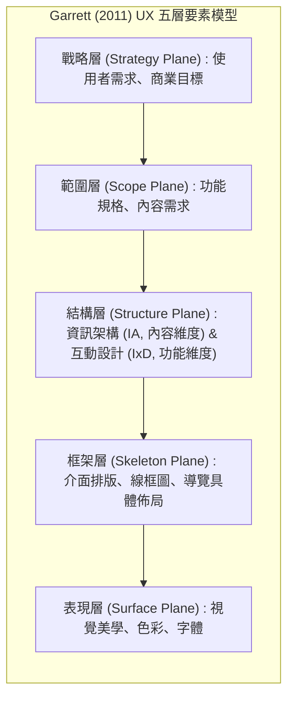
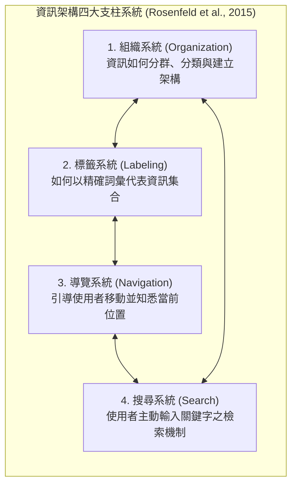
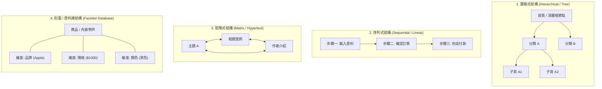
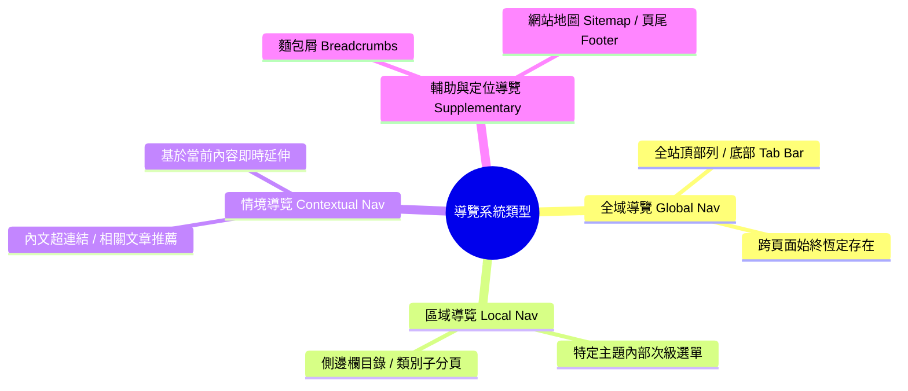
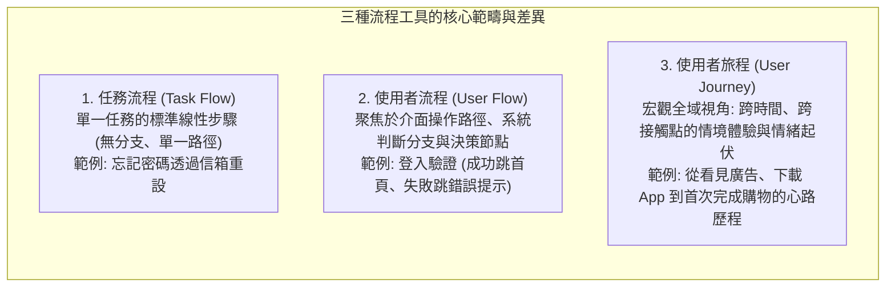
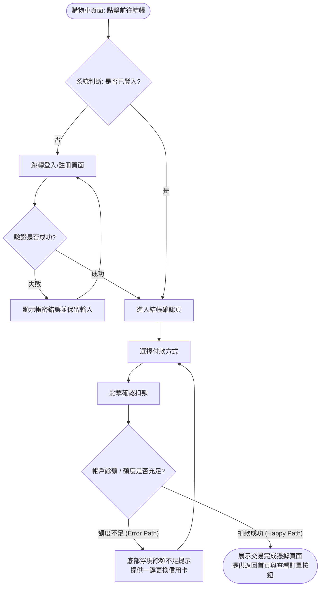

# 05｜資訊架構、導覽設計與使用者旅程：打造不迷航的數位地圖

> [!abstract] 核心摘要 (TL;DR)
> 在前四篇基礎模組中，我們解構了使用者如何理解介面（[[02_Mental_Models_and_Norman_Principles|心智模型]]）、大腦如何處理視覺資訊（[[03_Cognitive_Load_and_Gestalt|認知負荷與格式塔]]），以及微觀點擊與決策效率（[[04_Interaction_Efficiency_and_Behavior|費茲與席克定律]]）。然而，當產品擴充至數十個模組、數千個頁面時，局部的順手已不足以支撐全局體驗。本篇正式邁入模組二，深入探討**資訊架構（Information Architecture, IA）**的四大支柱系統（組織、標籤、導覽、搜尋），嚴格釐清 **IA 與導覽設計**、**User Flow 與 User Journey**，以及 **Card Sorting 與 Tree Testing** 的學理與方法界限。我們將透過資訊覓食理論（Information Foraging）解析「資訊氣味（Information Scent）」，揭示如何為龐大的數位世界繪製清晰的地圖，讓使用者始終清楚「我在哪裡、能去哪裡、如何到達」。

## 關鍵術語索引 (Glossary)
* **資訊架構 (IA, Information Architecture)**：共享資訊環境的結構化設計，聚焦於如何組織、標籤、導覽與搜尋內容，以支持可用性與可尋性。
* **可尋性 (Findability)**：一項內容或資訊能夠被使用者順暢發現、檢索並定位的容易程度；資訊若無法被找到，實質上等同於不存在。
* **資訊氣味 (Information Scent)**：使用者在資訊環境中穿梭時，依據介面上的連結文字、圖示或摘要等近端線索，對該路徑能否引導至目標內容所做出的價值評估與直覺感知。
* **導覽系統 (Navigation Systems)**：引導使用者在資訊空間中移動、穿梭於不同層級，並即時告知其當前位置的具體介面機制。
* **使用者流程 (User Flow)**：使用者為達成特定操作目標，在系統中依序經歷的一連串操作步驟、頁面跳轉與決策分支路徑。
* **使用者旅程 (User Journey)**：站在使用者全域視角，描述其在完整情境中達成宏觀目標時，所經歷的多階段接觸點、心理預期、情緒波動與痛點。
* **卡片分類法 (Card Sorting)**：一種前期探索性使用者研究方法，讓參與者依據自身心智模型將資訊卡片分群並命名，用以發掘分類邏輯。
* **樹狀測試 (Tree Testing)**：一種無 UI 視覺干擾的驗證性測試方法，在簡化的純文字階層架構中，量化檢驗既有選單分類與標籤的可尋性。

---

## 1. 為什麼使用者會在 App 裡迷路？從微觀操作邁向宏觀尋路

日常生活中，我們經常面臨這樣的窘境：打開某家銀行的網銀 App 或大型綜合電商平台，介面中的每顆按鈕都設計得精緻漂亮，點擊反應也符合費茲定律的標準尺寸；然而，當你想找「申請信用卡電子帳單」或「退貨退款進度」時，點進「會員中心」找不到、點進「信用卡服務」找不到、點進「客服中心」依然找不到。你在五個層級選單之間反覆來回跳轉，最終挫折地放棄操作。

### 1.1 功能豐富不等於資訊組織良好
**[情境示例]** 許多產品團隊在擴充業務時，常誤以為「只要把新功能做出來、在畫面上加個按鈕」就算完成交付。當功能從 10 個膨脹到 100 個時，若缺乏頂層規劃，產品就會演變為一座混亂的「數位迷宮」：
* 選單層級過深，重要功能被埋在第 4 層抽屜選單內；
* 標籤命名採用內部工程或組織架構術語（例如將帳單設定命名為「帳戶歸戶參數維護」），讓一般使用者望文生畏；
* 流程缺乏出口與返回錨點，使用者「進得去卻出不來」。

### 1.2 尋路行為 (Wayfinding) 與三大空間自問
**[文獻事實]** 資訊架構權威 Peter Morville (2005) 在其著作《Ambient Findability》中指出，人類在數位環境中的瀏覽本質上是一種**尋路（Wayfinding）行為**。當使用者在 App 或網站中穿梭時，大腦隨時隨地都在尋求三個基本問題的解答：
1. **我在哪裡？ (Where am I?)** —— 系統是否提供了清晰的當前位置信號？
2. **這裡有什麼？ (What is here?)** —— 當前頁面呈現的內容與功能架構為何？
3. **我能去哪裡？以及如何到達？ (Where can I go? And how do I get there?)** —— 介面提供了哪些路徑通往下一個目標？

如果介面無法給出清楚的回應，使用者就會陷入「迷航（Disorientation）」。這清楚說明：**優秀的 UI 不僅要讓單一按鈕易於點擊，更必須為整體系統建立一張條理分明、符合心智模型的「數位地圖」**。

---

## 2. 資訊架構 (Information Architecture, IA)：結構層的核心支柱

在 Jesse James Garrett (2011) 經典的 UX 五層要素模型中，**資訊架構被精確界定為「結構層（Structure Plane）」在內容導向維度上的核心支柱**。Garrett 將產品劃分為五個相互疊加的抽象層次（戰略層、範圍層、結構層、框架層、表現層），並在結構層中區分了面向軟體功能的「互動設計（Interaction Design）」與面向資訊內容的「資訊架構（Information Architecture）」。資訊架構並非孤立存在的單一層次，它向上指導了框架層的版面排版與導覽具體佈局，向下落實了範圍層所界定的內容需求。

### 2.1 資訊架構四大核心系統 (Rosenfeld et al., 2015)
**[文獻事實]** 資訊架構學術巨著《Information Architecture: For the Web and Beyond》（通稱「北極熊書」）的作者 Louis Rosenfeld, Peter Morville 與 Jorge Arango (2015) 確立了 IA 的四大基本支柱系統。**必須嚴格界定：這四大系統是資訊架構的核心組成維度與有機生態，絕非設計師必須依序執行的線性工作步驟**：

1. **組織系統 (Organization Systems)**：探討內容如何分群與歸類。包含分類維度（主題、時間、受眾、地理）與總體架構型態。
2. **標籤系統 (Labeling Systems)**：如何用文字符號代表複雜的內容集合。包含選單名稱、分類標籤、超連結錨點文字。
3. **導覽系統 (Navigation Systems)**：在介面中提供跳轉路徑與空間指示，讓使用者能在不同階層間穿梭自如。
4. **搜尋系統 (Search Systems)**：提供輸入檢索、自動完成、篩選與排序機制，協助具備明確目標的使用者快速直達內容。

---

### 2.2 四大經典資訊組織模式 (Organization Structures)
在組織系統中，資訊如何相互連結決定了系統的底層骨架：

1. **層級式組織 (Hierarchical Structure)**：
   * **特質**：由單一根節點（如首頁）自上而下分支展開的樹狀結構（Tree），是多數 App 與網站最經典的架構。
   * **深度與廣度的權衡 (Depth vs. Breadth Trade-off)**：
     - *分類過深（Too Deep）*：選單多達 5 到 6 層，使用者需要點擊多次才能到達目標，中途極易迷航；
     - *分類過淺（Too Broad）*：首頁平鋪了 40 個並列分類，依據席克定律，使用者一眼望去產生嚴重的認知過載；
     - *黃金法則*：在多數情境下，**適度偏向「淺而廣」並配合良好的視覺分組**，其易用性通常優於層級極深的架構。
2. **序列式組織 (Sequential Structure)**：
   * **特質**：嚴格按照時間、因果或邏輯步驟進行的一維線性路徑（如購物結帳、註冊開戶嚮導、新手導覽）。
   * **適用場景**：任務具備高度依賴性，後一步必須以前一步為前提。
3. **矩陣式組織 (Matrix / Hypertext Structure)**：
   * **特質**：內容之間透過超連結自由網狀穿梭，允許使用者自選探索路徑（如維基百科、知識庫）。
   * **限制**：高度自由但極度容易失去方向感，使用者不易建立全局心智地圖。
4. **刻面 / 資料庫式組織 (Faceted / Database Structure)**：
   * **特質**：內容物件具備多維度的「中繼資料（Metadata，如作者、日期、標籤、規格）」，使用者可自由組合篩選條件（Faceted Search）進行動態檢索（如電商商品列表、Notion 資料庫）。

---

## 3. 導覽系統設計 (Navigation Design)：讓數位空間可被穿梭

**學術界線嚴格釐清：資訊架構（IA）是無形的抽象組織邏輯，而導覽設計（Navigation Design）則是將該邏輯實體化為介面控制元件的具體呈現。** 兩者緊密相關，但絕不可畫上等號。

### 3.1 導覽系統的四大維度分類 (Rosenfeld et al., 2015)

1. **全域導覽 (Global Navigation)**：
   * 貫穿整個產品所有頁面的頂層導覽架構，通常呈現為行動端的「底部標籤列（Bottom Tab Bar）」或桌面端的「頂部固定導航列（Header Nav）」。
   * **核心守則**：項目必須維持高度克制（行動端建議 3 至 5 個核心入口），且在所有頁面中維持位置與圖示的一致性。
2. **區域導覽 (Local Navigation)**：
   * 存在於特定主分類底下的次級導覽機制（如電商「服飾館」底下的「男裝、女裝、童裝」二級分頁，或後台系統的左側樹狀側邊欄）。
3. **情境導覽 (Contextual Navigation)**：
   * 嵌入在具體內容流之中的跳轉線索（如文章內的「相關閱讀推薦」、「購買過此商品的人也買了」）。它呼應使用者的即時閱讀心流，延伸探索路徑。
4. **輔助與定位導覽 (Supplementary & Wayfinding Navigation)**：
   * **麵包屑導覽 (Breadcrumbs)**：呈現階層路徑（如 `首頁 > 3C配件 > 手機殼 > iPhone系列`），它不僅讓使用者隨時看清自己的層級深度，更提供了一鍵跳回上一層的平順回退路徑。

---

### 3.2 手機端 vs. 桌面端導覽形式的適應與取捨

人機互動的物理載體直接決定了導覽的最佳形式：

| 導覽元件形式 | 適用裝置環境 | 優勢與特質 | 潛在劣勢與風險 |
| :--- | :--- | :--- | :--- |
| **底部標籤列 (Bottom Tabs)** | 行動智慧型手機 | 符合拇指自然熱區（費茲定律），高頻入口一目了然，空間常駐。 | 項目受限於螢幕寬度（僅容納 3–5 個），無法容納過多平行模組。 |
| **漢堡選單 (Hamburger Menu)** | 行動端二級功能 / 響應式網頁 | 節省寶貴螢幕空間，收納大量次要或低頻設定項目。 | **「看不見就等於不存在」**；核心功能若深埋於漢堡選單內，使用率會雪崩式下跌。 |
| **樹狀側邊欄 (Tree Sidebar)** | 桌面端大螢幕 (Web / Desktop) | 可容納深層結構（如 Notion 頁面樹、IDE 專案目錄），隨時展開折疊。 | 佔據橫向水平空間，在窄螢幕或行動端必須折疊收納。 |
| **頂部水平選單 (Top Mega Menu)** | 桌面端大型電商 / 門戶網站 | 滑鼠懸停時展開大面積二級與三級分類，一次性展示資訊廣度。 | 在觸控螢幕上缺乏「Hover（懸停）」狀態，無法直接無縫移植至行動端。 |

---

## 4. 標籤系統、搜尋與資訊氣味 (Information Scent)

有了分類與導覽按鈕後，決定使用者是否願意點擊的關鍵，在於**標籤文字的準確性**。

### 4.1 標籤系統 (Labeling Systems)：講使用者的語言
**[文獻事實]** 標籤是使用者與資訊架構對話的第一接觸點。初學者常犯的致命錯誤，是使用「系統內部工程術語」或「組織部門職掌」來為按鈕命名：
* **錯誤的系統視角**：在政府網站上將申請補助命名為「社會救助第 2 條款線上申辦入口」；
* **正確的使用者視角**：依據使用者心理目標命名為「申請急難救助金」。
* **標籤的一致性 (Consistency)**：全站應統一採用一致的詞性與語意。例如：導覽列若採用「動詞＋名詞」（「尋找餐廳」、「預約行程」），就不應突然跳出一個單純名詞（「會員」）。

---

### 4.2 資訊覓食理論 (Information Foraging) 與資訊氣味
**[文獻事實]** 認知科學家 Peter Pirolli 與 Stuart K. Card (1999) 在《Psychological Review》發表了開創性的**資訊覓食理論（Information Foraging Theory）**。
* **生物覓食類比**：在自然界中，肉食動物會依據空氣中殘留的氣味線索，評估獵物是否在前方、以及追捕獵物所需的體能消耗；在數位介面中，**人類本質上就是「資訊覓食者（Informavores）」**。
* **資訊氣味 (Information Scent)**：
  * 使用者在介面上掃描時，會依據按鈕標籤、連結錨點文字與伴隨的圖示等「近端線索（Proximal Cues）」，在心中快速評估：「如果我點擊這個連結，能找到我想要的內容嗎？」
  * **強烈的資訊氣味 (Strong Scent)**：標籤詞彙精準對齊使用者的心理預期（例如在租屋 App 看到「捷運周邊房源」）。使用者毫不遲疑立刻點擊。
  * **微弱或模糊的資訊氣味 (Weak Scent)**：標籤使用抽象晦澀的行銷詞彙（如「探索无限可能」、「尊榮專區」）。使用者不知道裡面放了什麼，大腦產生遲疑甚至直接跳離。
  * **誤導性氣味 (False Scent)**：點進標記為「免費下載」的連結，結果跳出強制收費註冊頁面。這會瞬間摧毀產品的可信度（Credibility）。

---

### 4.3 搜尋與瀏覽的互補共生
使用者尋找資訊主要有兩種類型：**瀏覽型（Browsers，無明確關鍵字，依賴導覽探索）** 與 **檢索型（Searchers，目標明確，直奔搜尋列）**。兩者並非互相排斥，而是動態切換：
* **搜尋失敗的補救設計 (Zero Results State)**：當搜尋「完全無相應結果」時，拙劣的介面只拋出一句冰冷的「查無結果」；良好的設計會進行容錯處理（模糊拼寫糾正「您是不是要找...」），並主動推薦相近熱門類別或熱門商品，引導使用者重新銜接回瀏覽導覽系統。

---

## 5. 使用者流程 (User Flow) 與使用者旅程 (User Journey)：動態路徑解構

**學術界線嚴格釐清：User Flow、Task Flow 與 User Journey 著重的維度截然不同，不可混為一談。**

### 5.1 User Flow 的核心架構：Happy Path 與 Error Paths
使用者流程（User Flow）是互動設計師梳理介面邏輯的關鍵工具。它必須同時涵蓋主幹路徑與分支情境：
* **黃金路徑 (Happy Path)**：使用者在毫無任何操作錯誤或系統異常的情境下，順暢達成目標的最短理想路徑。
* **錯誤路徑 (Error Paths & Edge Cases)**：當使用者輸入錯誤密碼、網路斷線、商品庫存不足或取消操作時，系統該如何導引其安全回退或修正。

#### 實際 User Flow 範例：行動支付結帳驗證流程

---

## 6. 資訊架構與流程的驗證方法：Card Sorting 與 Tree Testing

**學術界線嚴格釐清：設計方法不是固定的線性裝飾，不可宣稱所有專案都必須依序執行這些工具；更不可將 Card Sorting（前期探索使用者分類心智）與 Tree Testing（後期驗證既有階層可尋性）的研究目的顛倒。**

### 6.1 卡片分類法 (Card Sorting)：探索使用者分類心智
**[文獻事實]** 依據 Nielsen Norman Group (2019) 的專業方法論，卡片分類法是發掘使用者心智模型中如何對內容進行分群的有效質性/量化工具：
1. **開放式卡片分類 (Open Card Sorting)**：參與者自由將卡片分組，並**自己為每個組別命名**。最適合於產品開發初期，用於發掘使用者自發的語彙與分類模式。
2. **封閉式卡片分類 (Closed Card Sorting)**：分類名稱已由團隊預先固定，參與者僅負責將卡片指派到既定類別中。用於檢驗現有分類是否能被使用者理解。
3. **混合式卡片分類 (Hybrid Card Sorting)**：預設部分分類，但允許參與者在認為不適當時自建新類別。
* **執行避坑要點**：嚴格防範「**關鍵字匹配偏誤（Keyword Matching）**」——若卡片上寫「退換貨政策」、「退換貨申請」，使用者會不假思索依字面「退換貨」三個字堆在一起；卡片文字必須採用中立的語義描述。

---

### 6.2 樹狀測試 (Tree Testing)：無 UI 干擾的階層可尋性驗證
**[文獻事實]** 依據 Nielsen Norman Group (2014) 的定義，樹狀測試專門用於**在完全剝除排版、圖示、按鈕與色彩干擾的情境下，僅憑純文字樹狀結構（Text-only Tree）檢驗資訊架構的可尋性**：
* **核心價值**：在投入昂貴的 UI 視覺設計與程式碼開發之前，提前以極低成本驗證導覽標籤與層級是否合理。
* **量化指標**：
  * **任務成功率 (Success Rate)**：受試者最終是否在正確的分類節點找到目標？
  * **直接度 (Directness)**：受試者是一次直達目標，還是在樹狀節點中反覆迷航回退（迂迴路徑）？
  * **完成時間 (Time on Task)**：在特定分類中做出選擇所需的時間。

---

## 7. 三款熱門 App 的資訊架構與導覽實踐觀察

延續前四篇的統一觀察維度，我們深入檢視 Google Maps、Notion 與 Duolingo 如何在具體介面中組織資訊與導引使用者旅程。

### 7.1 Google Maps：雙層空間切換與情境式資訊架構

#### 1. 實際可觀察介面特徵
* **[介面觀察]**（基於 iOS 行動應用程式於 2026 年 11 月 22 日之介面狀態）：
  * **全域與情境導覽的動態共生**：
    * 在首頁預設的「探索模式」下，底部固定常駐五個核心標籤頁（「探索」、「路線」、「已儲存」、「貢獻」、「最新動態」），屬於標準全域導覽（Global Navigation）；
    * 當使用者在地圖上選取特定地點（POI）或開啟即時導航時，底部的五個全域標籤頁瞬間平滑下沉隱藏，取而代之的是由底部向上浮現的「地點詳細卡片」或「即時行車指示卡」，介面動態切換為高度聚焦的情境導覽（Contextual Navigation）。
  * **空間導覽與文字搜尋的雙通道互補**：頂部搜尋列允許明確關鍵字檢索，底圖手勢拖曳允許自由地理探索；兩者數據即時聯動。

#### 2. 對應理論解析與分析推論
* **對應原則**：**Global vs. Contextual Nav**、**Findability (可尋性)**。
* **[分析與推論]** 地圖 App 面臨最嚴峻的 IA 挑戰：使用者既需要瀏覽全局，又需要在特定任務中保持高度專注。Google Maps 透過「全域導覽的動態隱退」解決了空間競爭——在規劃階段提供全域入口，在操作階段收攏為情境卡片，防止使用者在駕駛或行走時被無關的全域分頁分散注意力。

---

### 7.2 Notion：多層次階層架構與多維資料庫

#### 1. 實際可觀察介面特徵
* **[介面觀察]**（Desktop Web 版個人工作區，2026 年 11 月 22 日介面狀態）：
  * **多層次階層架構（類似資料夾的頁面組織方式）**：左側側邊欄以純文字縮排呈現多層次樹狀架構（Hierarchical Tree）。在 Notion 中，任何 Page 本身既是內容載體，也能容納其他子頁面（Sub-page），形成類似傳統檔案夾的階層式組織方式；然而兩者並不完全相同——Notion 的頁面本身即具備文字與區塊編輯功能，並非傳統作業系統中僅作為純容器的實體資料夾。
  * **頂部麵包屑導覽 (Breadcrumbs)**：在任何深層頁面頂部，始終清晰顯示當前路徑（如 `工作區名稱 / 專案計畫 / 2026Q4 / 會議記錄`），每一節點均可點擊跳轉。
  * **資料庫的多刻面視圖 (Faceted Views)**：同一組底層資料庫內容，可自由以「表格（Table）」、「看板（Board）」、「行事曆（Calendar）」與「時間軸（Timeline）」進行刻面切換。

#### 2. 對應理論解析與分析推論
* **對應原則**：**Hierarchical vs. Faceted Structure**、**Wayfinding (尋路與麵包屑)**。
* **[分析與推論]** Notion 賦予使用者極高的自訂架構自由度，但也因此帶來了潛在的層級混亂風險。頂部麵包屑導覽為深度巢狀結構提供了最強效的空間定位座標（解答「我在哪裡」），使使用者無論嵌套多深都能一秒返回父層級；而多維資料庫視圖則展現了極致的刻面組織，讓不同職能角色能依據各自的心智模型檢視同一組數據。

---

### 7.3 Duolingo：關卡路徑與單向任務流

#### 1. 實際可觀察介面特徵
* **[介面觀察]**（基於 iOS App 於 2026 年 11 月 22 日版本之學習主畫面與單元練習觀察；特定題型、複習模式或新舊版介面可能存在呈現差異）：
  * **垂直關卡路徑**：在當前標準學習主畫面中，捨棄了早期版本或其他學習軟體常見的多平行分面選單（如獨立的單字庫、文法庫），改以一條垂直貫穿、蜿蜒向下的關卡節點路徑呈現。
  * **當前位置的主體突顯**：當前應進行的關卡節點以高飽和彩色立體圓形呈現，並標註「開始」浮動氣泡；已完成的節點轉為金色或打勾標記，未解鎖的節點呈現鎖定灰色。
  * **全域底部導覽的極簡分流**：底部固定 5 個 Tab（學習路徑、字母練習、個人檔案、排行榜、任務寶箱），各功能職能界線相對分明。

#### 2. 對應理論解析與分析推論
* **對應原則**：**Sequential Structure (序列式架構)**、**消除決策摩擦力**。
* **[分析與推論]** 語言學習在傳統上是龐大且非線性的知識網絡，極易引發學習者的選擇癱瘓。Duolingo 在結構層做出了策略性取捨——將複雜的語言網絡轉化為序列式關卡路徑。使用者在開啟 App 時能依據視覺線索明確辨識出當前進度與下一步操作，在特定日常學習情境下有效減輕了尋路與選擇的心智負擔。

---

## 8. 常見問題、實務檢核與總結

在資訊架構與流程設計中，不良的結構往往比不良的視覺更具破壞性。以下總結實務上最嚴重的六大典型陷阱與防範準則。

### 8.1 資訊架構六大常見設計缺陷
1. **內部視角標籤 (Internal Jargon)**：直接以公司組織部門或資料庫代碼作為導覽選單名稱；
2. **無底深淵層級 (Bottomless Pit)**：為了追求「首頁簡潔」，把所有內容層層套疊至第 5 層以下；
3. **分類相互重疊 (Overlapping Categories)**：在同一個商城選單中，同時出現「特價商品」、「熱銷商品」、「男性服飾」與「運動用品」，使用者想買特價運動褲時不知該點哪一個；
4. **孤島盲道 (Dead Ends)**：使用者完成某項操作後，頁面未提供返回主流程的按鈕，只能強制重啟 App；
5. **資訊氣味斷裂 (Broken Scent)**：導覽標籤寫著「線上專人諮詢」，點進去卻是一個冷冰冰的常見問題留言表單；
6. **假性線性流程 (Rigid Sequential Traps)**：在長篇表單中強制要求使用者一步步進行，卻不允許中途暫存或跨步驟修改先前資料。

---

### 8.2 Do's & Don'ts 實務對照表

| 設計維度 | 推薦做法 (Do) | 警訊做法 (Don't) | 對應 IA 理論依據 |
| :--- | :--- | :--- | :--- |
| **導覽標籤命名** | 採用通用、直觀的使用者日常詞彙（如「訂單查詢」）。 | 採用內部研發或行政術語（如「核心交易數據履歷追蹤」）。 | **Labeling Systems** 建立強烈資訊氣味 |
| **層級深度控制** | 優先保持架構扁平（2 至 3 層以內），輔以合理的組塊分組。 | 將目錄拆分成 6 層樹狀結構，使用者點擊 5 次才能看到內容。 | **Depth vs. Breadth** 降低尋路認知負擔 |
| **空間位置反饋** | 在導覽列與麵包屑中明確高亮「當前所在位置」（Active State）。 | 點進子頁面後導覽列毫無狀態變化，使用者產生空間迷航。 | **Wayfinding** 回答「我在哪裡」 |
| **全域導覽克制** | 行動端底部 Tab Bar 嚴格維持在 3 到 5 個互斥的核心高頻入口。 | 在底部塞入 7 個細小圖示，或隨意在不同分頁更換 Tab 項目。 | **Global Navigation** 保持全域空間穩定性 |
| **流程錯誤處理** | 流程分支提供清晰的 Error Path 與替代出口，支援就地復原。 | 操作出錯時拋出死胡同，強迫使用者從第一步完全重來。 | **User Flow Design** 保障流程容錯性 |

---

### 8.3 資訊架構檢核清單 (Checklist)

- [ ] **1. 組織與分類 (Organization)**：
  - [ ] 產品的主要分類方式是否符合目標使用者的直覺心智模型，而非公司的組織架構？
  - [ ] 同一層級的分類之間是否維持互相獨立且互斥（MECE 原則），避免定義重疊？
- [ ] **2. 導覽與尋路 (Navigation & Wayfinding)**：
  - [ ] 使用者在任何子頁面中，能否在一秒內看清「我目前在哪個層級與位置」？
  - [ ] 是否提供了順暢的回退機制（如全域返回鍵、麵包屑、取消按鈕），無死胡同頁面？
- [ ] **3. 標籤與氣味 (Labeling & Information Scent)**：
  - [ ] 連結與按鈕標籤是否準確傳達了點擊後的預期內容，避免抽象模稜兩可的行銷黑話？
- [ ] **4. 搜尋與容錯 (Search & Fallback)**：
  - [ ] 搜尋系統是否具備錯字容錯提示？當搜尋查無結果時，是否有替代引導路徑？
- [ ] **5. 使用者流程完整度 (User Flow Completeness)**：
  - [ ] 關鍵任務流程是否完整繪製了 Happy Path 以及所有可能的 Error Paths？

---

### 8.4 初學者反思題 (Self-Reflection)
> 💡 **「閉眼尋路」思維測試**：  
> 請隨機挑選一位完全沒有參與過你專案的局外朋友，將產品原型打開並置於某個**第 3 層的深層頁面**，然後問他：  
> 1. *「你現在覺得自己位於這款 App 的什麼地方？」*  
> 2. *「如果你想回到剛才的主選單，你會怎麼做？」*  
> 3. *「如果要在這裡找一筆特定資料，你的視線會第一時間看哪裡？」*  
> 如果他在 3 秒內無法指出自己相對於首頁的空間座標，這代表你所規劃的導覽系統缺乏清晰的路標指示，需要重新梳理資訊架構。

---

## 9. 總結與銜接下一篇：當好設計走向對立面

在本篇中，我們建立了產品的宏觀骨架：
1. **資訊架構（IA）** 是數位世界的骨骼，透過組織、標籤、導覽與搜尋四大系統，化混亂為秩序；
2. **資訊氣味（Information Scent）** 驅動了使用者的點擊決策，清晰的標籤是最好的導引；
3. **使用者流程（User Flow）** 必須兼顧黃金路徑與錯誤防護，確保任務無死角。

### 邁向下一篇的思考提問
到目前為止，我們學習的都是「如何打造好用、順手、不迷航的正面設計準則」。然而，在現實商業競爭的殘酷世界中，設計有時會被刻意反向利用：
* 為什麼有些 App 訂閱流程只要一鍵，退訂卻被藏在第 6 層選單並用模糊標籤百般刁難？
* 為什麼免費試用結束前從不主動提醒，卻在半夜偷偷自動續費扣款？
* 介面上刻意利用視覺誤導、欺騙性意符與認知陷阱誘騙點擊的手法，在學術上該如何定義與診斷？

要看懂什麼是真正的好設計，我們必須具備識別「壞設計」與「邪惡設計」的批判眼光。在模組三的第一篇中，我們將深入剖析設計反模式與暗黑模式。

> 👉 **下一篇導引**：[[06_Design_Anti_Patterns_and_Dark_Patterns|06｜好設計 vs 壞設計：反直覺介面診斷與暗黑模式]]  
> 我們將系統化拆解常見的易用性反模式（Anti-patterns）、定罪操控使用者的暗黑模式（Dark Patterns / Deceptive Design），並從認知倫理的角度探討設計師的專業底線。

---

## 參考文獻與資料來源 (References)

本文之理論模型、分類架構與方法論均依循以下經註冊之學術與專業來源（詳細書目與摘要請參閱 `[[sources/sources_index|資料來源索引庫]]`）：

1. **[[sources/sources_index#SRC-26|SRC-26]] Louis Rosenfeld, Peter Morville, & Jorge Arango (2015)**  
   * **書目資訊**：Rosenfeld, L., Morville, P., & Arango, J. (2015). *Information Architecture: For the Web and Beyond* (4th ed.). Sebastopol, CA: O'Reilly Media.
   * **標準書號**：ISBN: 978-1491911686
   * **引用定位**：第 2.1、2.2 節資訊架構定義、四大核心支柱系統（組織、標籤、導覽、搜尋）與組織架構模式。
   * **資料限制**：經典專業專著，受版權保護未存原始全文，依據專著出版目錄與權威框架核對。

2. **[[sources/sources_index#SRC-27|SRC-27]] Peter Morville (2005)**  
   * **書目資訊**：Morville, P. (2005). *Ambient Findability: What We Find Changes Who We Become*. Sebastopol, CA: O'Reilly Media.
   * **標準書號**：ISBN: 978-0596007652
   * **引用定位**：第 1.2 節可尋性（Findability）與數位空間尋路（Wayfinding）三大核心自問。
   * **資料限制**：經典專著，受版權保護未存全文，依據出版資訊與書目核對。

3. **[[sources/sources_index#SRC-28|SRC-28]] Jesse James Garrett (2011)**  
   * **書目資訊**：Garrett, J. J. (2011). *The Elements of User Experience: User-Centered Design for the Web and Beyond* (2nd ed.). Berkeley, CA: New Riders.
   * **標準書號**：ISBN: 978-0321683687
   * **引用定位**：第 2 章 UX 五層要素模型，精確確立資訊架構位於「結構層（Structure Plane）」之定位。
   * **資料限制**：受版權保護未存全文，依據經典五層模型核對。

4. **[[sources/sources_index#SRC-29|SRC-29]] Peter Pirolli & Stuart K. Card (1999)**  
   * **書目資訊**：Pirolli, P., & Card, S. (1999). Information foraging. *Psychological Review*, 106(4), 643–675.
   * **永久連結 / DOI**：[https://doi.org/10.1037/0033-295X.106.4.643](https://doi.org/10.1037/0033-295X.106.4.643)
   * **引用定位**：第 4.2 節資訊覓食理論（Information Foraging）與資訊氣味（Information Scent）之認知心理學本源。
   * **資料限制**：同儕審查開創性期刊論文，受版權保護未存全文，依據論文核心理論核對。

5. **[[sources/sources_index#SRC-30|SRC-30]] Nielsen Norman Group (2019)**  
   * **書目資訊**：Nielsen Norman Group (NN/g). (2019 / 持續維護). *Card Sorting: Pushing Users Beyond Terminology to Categories*. NN/g Articles.
   * **永久連結**：[https://www.nngroup.com/articles/card-sorting-pushing-users/](https://www.nngroup.com/articles/card-sorting-pushing-users/)
   * **引用定位**：第 6.1 節卡片分類法（Card Sorting）之研究目的、開放/封閉/混合分類及文字匹配偏誤避坑規範。
   * **資料限制**：專業機構研究文章，非同儕審查論文。

6. **[[sources/sources_index#SRC-31|SRC-31]] Nielsen Norman Group (2014)**  
   * **書目資訊**：Nielsen Norman Group (NN/g). (2014 / 持續維護). *Tree Testing: Fast, Iterative Evaluation of Menu Labels and Categories*. NN/g Articles.
   * **永久連結**：[https://www.nngroup.com/articles/tree-testing/](https://www.nngroup.com/articles/tree-testing/)
   * **引用定位**：第 6.2 節樹狀測試（Tree Testing）之研究目的、無 UI 階層檢驗特性與可尋性評估指標。
   * **資料限制**：專業機構研究文章，非同儕審查論文。
