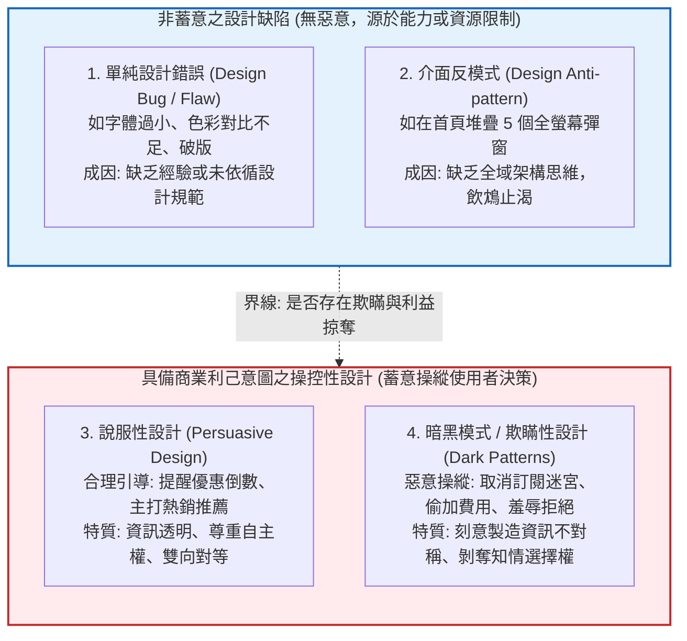
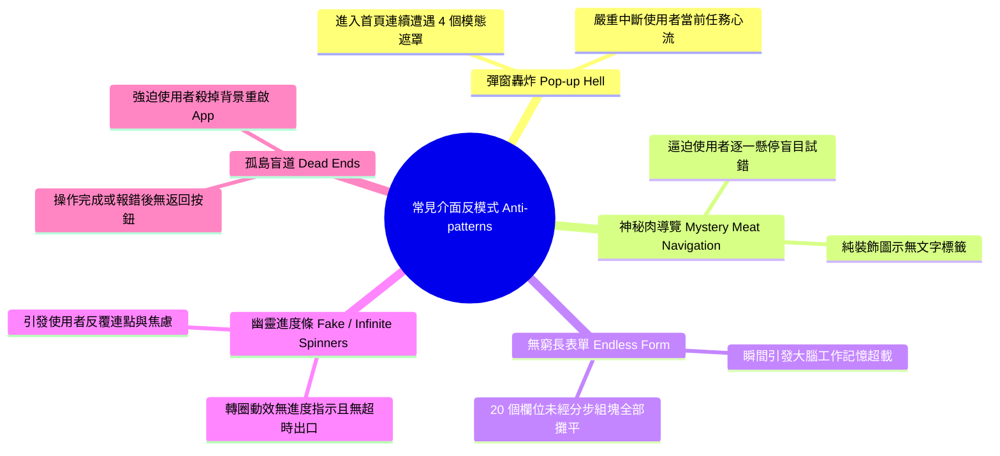
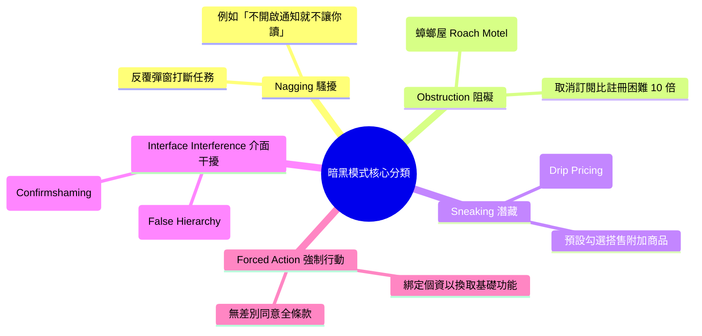
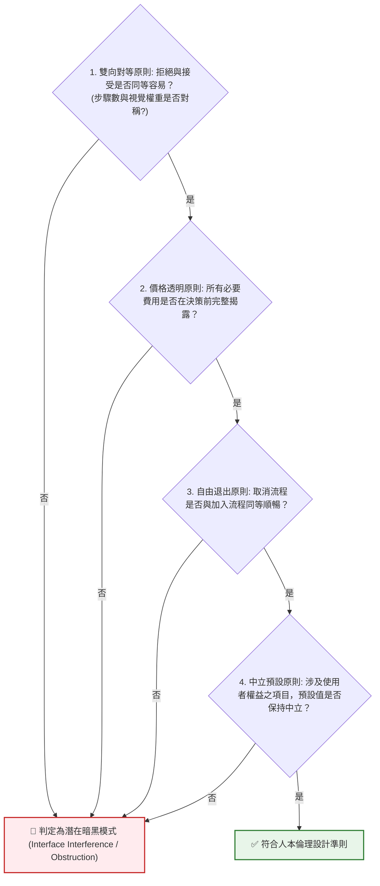

# 06｜好設計 vs. 壞設計：介面反模式與暗黑模式

> [!abstract] 核心摘要 (TL;DR)
> 在前五篇中，我們建立了打造優秀產品的正面設計法則——從心智模型對齊、認知負荷降低、操作效率極大化，到清晰的資訊架構。然而，在真實世界的數位產品中，我們經常遇到令人費解甚至憤怒的介面：為什麼免費試用只要點一下，取消訂閱卻得打國際電話？為什麼拒絕按鈕被刻意設計成低對比文字，甚至伴隨情緒勒索詞彙？本篇正式跨入模組三（設計評估與診斷），深入探討**介面反模式（Design Anti-patterns）**與**暗黑模式（Dark Patterns / Deceptive Design）**的本質區別。我們將系統化梳理學界奠基分類（Gray et al., 2018）與大規模電商實證研究（Mathur et al., 2019），剖析介面背後利用認知偏誤與資訊不對稱的心理操控機制，並檢視歐盟《數位服務法》（DSA）與美國聯邦貿易委員會（FTC）的執法界限，為設計者確立專業倫理底線。

## 關鍵術語索引 (Glossary)
* **設計錯誤 / 易用性瑕疵 (Usability Flaw / Mistake)**：由於設計者經驗不足、技術限制或對使用者情境缺乏理解，無意間導致的介面操作不順或理解困難。
* **介面反模式 (Design Anti-pattern)**：一種在表面上看似能解決問題、且被廣泛重複採用，但長期而言實質弊大於利、且存在公認更佳解決方案的慣用拙劣設計結構。
* **暗黑模式 / 欺瞞性設計 (Dark Patterns / Deceptive Patterns)**：由 Harry Brignull (2010, 2023) 開創並定義的概念，指數位介面經過蓄意精心設計，利用人類認知捷徑與心理偏誤，誘導或強迫使用者做出符合商業利益、但實質違背其真實意願或自身利益之決策的操控性手法。
* **騷擾 (Nagging)**：透過反覆彈出中斷性視窗或請求，打斷使用者正常任務流，意圖迫使其妥協接受特定設定的設計模式。
* **阻礙 (Obstruction)**：刻意在特定操作（如取消訂閱、刪除帳號）路徑中設置高昂摩擦力、繁瑣流程或迂迴死路的策略（俗稱蟑螂屋 Roach Motel）。
* **介面干擾 (Interface Interference)**：利用視覺層級不對稱、誤導性意符或預設選項，刻意操縱資訊的顯眼度以掩蓋關鍵事實的手法。
* **確認羞辱 (Confirmshaming)**：在拒絕選項中使用帶有道德譴責、負罪感或自我貶低的心理勒索文案，操縱情緒以誘使使用者點擊接受。
* **滴灌定價 (Drip Pricing / Hidden Fees)**：在結帳流程初始僅展示低廉基礎價格，隨後逐層強制附加未預期之服務費或處理費的定價欺瞞手法。

---

## 1. 為什麼有些 App 不好用？設計錯誤、反模式與暗黑模式的本質邊界

當使用者在手機或網頁上感到操作受阻時，往往會統稱「這個 App 設計得好爛」。然而，從人機互動與設計倫理的專業視角審視，**介面「不好用」背後有著本質完全不同的四種成因層次，絕對不可混為一談**：



### 1.1 四大成因層次的精確定義
1. **單純的易用性瑕疵 (Usability Flaws)**：
   * 例如按鈕尺寸小於 Apple HIG 的 44pt，導致手指誤觸；或是輸入框未配置正確的虛擬鍵盤類型。這類問題源於開發團隊的專業疏漏，其背後**不存在損害使用者以謀利的惡意動機**。
2. **介面反模式 (Design Anti-patterns)**：
   * 某些結構被團隊廣泛採用，表面上看似「完成了主管交辦的 KPI」（例如在使用者開啟 App 的第一秒，同時彈出更新提示、定位權限、通知權限與每日簽到彈窗），但實際上徹底破壞了操作流暢度，提升了外在認知負荷。
3. **正當的說服性設計 (Persuasive Design)**：
   * 商業公司自然希望提升銷售額，透過優雅的視覺動效突顯熱門商品、在購物車適度提示免運門檻，只要**資訊揭露完全真實透明、拒絕路徑同等順暢**，屬於合法的商業說服。
4. **暗黑模式 / 欺瞞性設計 (Dark Patterns / Deceptive Design)**：
   * 介面被**蓄意工程化**以剝奪使用者的自由意志。設計者利用心理學規律，讓使用者「在不知情中買了不想買的保險」、「想退訂卻找不到按鈕」，這種犧牲使用者福祉來榨取商業指標的手法，正是本篇的核心剖析對象。

---

## 2. 什麼是 Design Anti-pattern？常見介面反模式診斷

在軟體工程中，「反模式（Anti-pattern）」是指一種被反覆使用、表面看似有助於解決當前問題，但實際上會帶來嚴重負面後果的方案。在 UI/UX 領域，反模式主要體現在**違反前述心理學規律的拙劣介面慣性**。

### 2.1 典型介面反模式剖析



1. **彈窗地獄 (Pop-up Hell)**：
   * **問題現象**：使用者剛打開一款新聞 App，還沒讀到任何一行字，畫面上連續跳出「授權追蹤廣告」、「開啟推播通知」、「獲取地理位置」以及「全螢幕促銷輪播圖」。
   * **學理診斷**：嚴重違反 [[03_Cognitive_Load_and_Gestalt|認知負荷理論]]。強行向使用者的工作記憶注入無效雜訊，打斷了使用者的初始任務意圖，引發極度反感。
2. **神秘肉導覽 (Mystery Meat Navigation, MMN)**：
   * **問題現象**：導覽列上排列著五個極其前衛、抽象的幾何符號，完全沒有任何文字標籤（Labeling）。使用者完全看不出這些符號代表什麼，必須將游標逐一移上去懸停摸索，或者一個個點開碰運氣。
   * **學理診斷**：違反 [[02_Mental_Models_and_Norman_Principles|意符（Signifier）]] 原則與 [[05_Information_Architecture_and_Flow|資訊氣味（Information Scent）]]。介面缺乏自明性線索，逼迫大腦進行高成本的盲目試錯。
3. **無提示死路 (Dead Ends & Silent Failures)**：
   * **問題現象**：當使用者在離線狀態下點擊「同步資料」時，按鈕毫無動靜；或者跳出「錯誤代碼 0x8004」後，彈窗底下只有一個「確定」按鈕，點擊後停留在原處，既沒有說明錯誤原因，也沒有提供「重試」或「返回上一頁」的途徑。
   * **學理診斷**：違反 Norman 的 Feedback 與 Constraints 溝通原則。系統未能在評估鴻溝（Gulf of Evaluation）中提供解讀依據，使用者陷入完全失控的無助感。

---

## 3. 什麼是 Dark Patterns？術語流變與權力不對等

### 3.1 術語流變：從 Dark Patterns 到 Deceptive Patterns
**[文獻事實]** 梳理自 2010 年迄今的理論與實踐演進：
1. **Harry Brignull (2010) 的開創**：
   * 英國 UX 設計師兼獨立研究者 Harry Brignull 在 2010 年建立了著名網站 `darkpatterns.org`，首次正式提出「Dark Patterns」一詞，將其定義為：「**不是出於疏忽或懶惰，而是經過深思熟慮精心策劃的介面，旨在誘騙使用者做出違背其自身意願的行為（例如購買保險或註冊訂閱）。**」
2. **術語深化與國際監管轉向 (Brignull, 2023; OECD, 2022)**：
   * 到了 2020 年代，隨著各國反壟斷與消費者保護機構介入，學界與業界開始反思「Dark」一詞在語義上的模糊性與包容性隱憂；
   * 在其 2023 年出版的權威專著中，Harry Brignull 正式倡議並採用更加精準、具備法律定罪意義的術語：**Deceptive Patterns（欺瞞性設計 / 詐欺模式）**；
   * 經濟合作暨發展組織（OECD, 2022）與歐盟《數位服務法》（DSA）亦全面將此類行為定性為「扭曲消費者知情選擇權的欺瞞性商業實踐」。

---

### 3.2 結構性核心：設計者與使用者之間的權力不對等
**[分析與推論]** 為什麼暗黑模式能輕易得逞？其本質在於雙方存在巨大的**「資訊與架構控制權不對等」**：
* **全知 vs. 盲目**：軟體平台背後擁有龐大的使用者行為資料庫、A/B 測試儀表板與熱圖分析工具，清楚知道哪種按鈕顏色、哪種延遲時機最能擊潰使用者的防禦心理；而使用者面對的只有當前螢幕上呈現出來的有限像素；
* **規則制定者優勢**：介面的代碼是由平台編寫的。平台可以輕易讓「同意」按鈕變成橫跨全寬的發光巨型按鈕，同時把「拒絕」按鈕縮小成 10 像素、埋入第二層設定頁面、並偽裝成純文字。這種對幾何架構的絕對掌控，構成了數位掠奪的溫床。

---

## 4. 常見暗黑模式經典分類 (Gray et al., 2018 框架)

**[文獻事實]** 人機互動學術界對暗黑模式最權威、引用最廣泛的分類體系，是由 Colin M. Gray 等人於 2018 年發表於 ACM CHI 頂級會議的論文《The Dark (Patterns) Side of UX Design》所確立的五大核心原語。結合 Brignull (2023) 與 FTC (2022) 的實務調查，深入解構以下主要策略：



### 4.1 五大核心原語與實務衍生型態解構

#### 1. 阻礙 (Obstruction) —— 典型代表：蟑螂屋 (Roach Motel)
* **概念定義**：在特定的退出路徑中人為製造高昂的操作摩擦力，使「取消服務、退訂或刪除帳號」的難度遠高於「加入服務」。
* **生活化解釋**：就像捕蟑盒一樣，進去非常容易，想出來卻比登天還難。
* **介面具體表現**：
  * 使用者只需在 App Store 點擊一次臉部辨識（Face ID）即可開通月費訂閱；但當想取消續費時，App 內完全沒有提供取消按鈕，而是用一段模糊文字指示使用者必須在週一至週五上班時間撥打特定客服電話，或強制跳轉至外部瀏覽器進行多達 8 步的隱藏選單點擊。

#### 2. 介面干擾 (Interface Interference) —— 視覺不對稱與確認羞辱
* **概念定義**：利用視覺階層、格式塔原則或文字排版，刻意扭曲各選項在視覺上的顯眼度，誘導使用者選取符合商業者利益的選項。
* **衍生型態 A：視覺預選不對稱 (Preselection & Visual Asymmetry)**：
  * 在 Cookie 授權彈窗中，「接受全部追蹤」按鈕採用飽滿的高對比藍色實心按鈕；而「僅接受必要 Cookie」則被做成極小、低對比度的灰色文字，甚至藏在摺疊選單內。
* **衍生型態 B：確認羞辱 (Confirmshaming)**：
  * 在使用者試圖關閉促銷彈窗時，確認按鈕寫著「領取八折優惠」，而拒絕按鈕則被惡意編寫為「**不用了，我不在乎省錢**」或「**算了，我寧可讓肌膚繼續衰老**」。透過在文案中注入道德羞恥感與負罪感，操縱使用者的情緒反應。

#### 3. 潛藏 (Sneaking) —— 滴灌定價與偷偷夾帶
* **概念定義**：刻意隱藏、延遲揭露或偽裝與使用者直接相關的重要交易資訊。
* **衍生型態 A：滴灌定價 (Drip Pricing / Hidden Costs)**：
  * 在機票或訂房網站首頁搜尋時，房間標價顯示為「每晚 $1,000」；當使用者一路花費 15 分鐘填寫姓名、護照與聯絡資料抵達最後刷卡步驟時，總價突然暴增至 $1,600，額外跳出了未曾預告的「清潔費」、「設施服務費」與「處理手續費」。
* **衍生型態 B：偷夾商品 (Sneak into Basket)**：
  * 購買主要商品時，結帳清單中被系統預設勾選了「加價 $50 購買延長保固」或「愛心捐款」，若使用者稍不留神便會一同刷卡結帳。

#### 4. 騷擾 (Nagging) —— 頑固的彈窗勒索
* **概念定義**：當使用者明確拒絕某項請求後，系統依然在後續操作中反覆彈出相同的請求視窗，破壞使用者的操作流暢度，直到使用者妥協為止。
* **介面具體表現**：每次開啟 App 時均強制彈出「您尚未開啟推播通知，請立刻前往設定開啟」，且彈窗的拒絕選項只提供「稍後提醒我」，完全不提供「不再詢問」的永久拒絕通道。

#### 5. 強制行動 (Forced Action) —— 夾帶綁架
* **概念定義**：強迫使用者必須完成某一項與其當前核心目標完全無關的附帶行為，否則拒絕提供基礎服務。
* **介面具體表現**：僅僅是為了使用一款手電筒 App，軟體卻強制要求使用者必須先註冊帳號、提供通訊錄權限與追蹤權限，否則無法開啟閃光燈。

---

## 5. 暗黑模式背後的心理機制：大腦為何屢屢中招？

暗黑模式絕非隨意的視覺塗鴉，它的殺傷力在於**精準利用了人類大腦演化而來的心理捷徑與認知弱點**。

### 5.1 雙系統思維與認知捷徑的利用 (Kahneman System 1)
**[實證研究事實]** 依據行為經濟學與 OECD (2022) 的報告：
* 人腦為了節省珍貴的葡萄糖能量，在日常處理海量資訊時，高度依賴自動化、快速且不費力的**「系統一（System 1 直覺思維）」**，鮮少主動調用高能耗的「系統二（System 2 邏輯思維）」；
* 暗黑模式刻意營造出「順理成章」的視覺外表（例如藍色醒目按鈕通常代表『下一步』），誘使使用者的系統一依循直覺條件反射快速點擊，在系統二尚未啟動審查之前，欺瞞操作已經完成。

### 5.2 五大深層行為偏誤的機制拆解

| 心理偏誤與機制 | 行為心理學原理解析 | 暗黑模式如何精準收割 |
| :--- | :--- | :--- |
| **現狀偏誤 / 預設效應<br>(Default Effect)** | 人類面對複雜抉擇時，傾向維持現狀或接受預先設定好的選項，因為改變預設需要付出額外的認知精力。 | 系統在安裝或結帳時，將「訂閱電子報」、「自動續費」與「授權全域個資」設定為**預設已勾選（Pre-ticked Boxes）**。 |
| **損失趨避<br>(Loss Aversion)** | 心理學證實，人在面對「損失」時產生的痛苦強度，大約是獲得同等收益快樂強度的 2 至 2.5 倍。 | 倒數計時器（Countdown Timer）與確認羞辱文案（「您即將放棄本年度唯一一次升級機會！」），放大錯失恐懼（FOMO）。 |
| **沉沒成本謬誤<br>(Sunk Cost Fallacy)** | 個體在某項任務中已經投入的時間、心力或金錢越多，就越難以半途而廢。 | **滴灌定價 (Drip Pricing)** 刻意把附加費用藏在最末頁。使用者因為前面已填寫 10 分鐘表單，即便發現加價也往往咬牙買單。 |
| **稀缺性偏誤<br>(Scarcity Bias)** | 當某種資源被標註為數量稀少或時間有限時，大腦會本能地賦予其更高的主觀價值。 | **虛假庫存提示**：在訂房或購物網站上固定閃爍「🔥 僅剩最後 1 間！」、「當前有 48 人正在瀏覽此商品」（實證顯示常為隨機腳本）。 |
| **操作摩擦力不對稱<br>(Friction Asymmetry)** | 依據[[04_Interaction_Efficiency_and_Behavior|費茲定律與席克定律]]，增加距離、縮小尺寸或增加決策步驟，能顯著拉長操作時間並引發操作阻斷。 | **刻意不對稱工程**：加入服務只需 1 步（點擊大按鈕，高效率），退出服務需要 8 步（在微小文字間尋找連結，高摩擦力阻絕）。 |

---

## 6. 真實案例與實證研究分析

### 6.1 Mathur et al. (2019) 大規模電商實證研究之量化發現
**[實證研究事實]** 普林斯頓大學 Arunesh Mathur 等學者對全球約 1.1 萬個購物網站（涵蓋約 5.3 萬個商品頁面）進行了大規模自動化測量與分析，發表於頂級期刊 ACM CSCW：
* **量化普及度**：在約 1.1 萬個受檢網站中，研究團隊共辨識出 1,818 個暗黑模式實例，分布於 1,254 個購物網站中，**存在暗黑模式的網站比例約為 11.1%**；
* **主要表現類型**：
  - **急迫感手法（Urgency）**：常見做法為自動倒數計時器（Countdown timers），營造限時搶購氛圍；研究進一步分析發現部分計時器在時間歸零後會自動重置，純屬前端腳本邏輯而非真實促銷期限；
  - **稀缺性手法（Scarcity）**：以低庫存提示或高度搶手訊息為代表；
  - **其他常見模式**：包括預選核取方塊（Pre-selected options）、社會證明提示等。
* **學術結論**：暗黑模式在商業電商中並非極少數個案，而是呈現高度系統化、模組化工具包普及的嚴峻趨勢。

---

### 6.2 跨情境案例對照分析

#### 案例一：串流服務訂閱與退訂之操作摩擦力不對稱
* **[文獻案例]**（依據 FTC 2022 調查報告與業界訴訟實務記錄）：
  * **開通流程**：使用者在手機 App 點擊「免費試用 30 天」，系統直接調用作業系統免密碼指紋/臉部支付，前後耗時不到 3 秒；
  * **退訂障礙 (Roach Motel)**：當使用者試圖在 App 內取消時，帳號設定頁面中完全找不到任何「取消訂閱」按鈕，僅有一行極小的灰色文字寫著「請至網頁版管理帳戶」；登入網頁版後，使用者必須穿過 4 層下拉選單，連續經歷 3 次「挽留挽回頁面（包含展示即將失去的特權與降價促銷）」，最後強制要求點擊文字對比極低的確認連結。

#### 案例二：Cookie 授權橫幅 (Cookie Consent Banners) 的視覺不對稱
* **[介面觀察]**（基於跨國網頁瀏覽時遭遇之普遍典型版面結構）：
  * 畫面中央彈出強制遮罩，標題寫著「我們重視您的隱私」；
  * 右下角是一個巨大、高飽和綠色背景的「**全部接受 (Accept All)**」按鈕；
  * 拒絕選項則被拆解為深埋於左下角的無底色文字連結「**自訂偏好設定 (Manage Settings)**」；使用者若點進去，面對的是數十個預設已開啟的合作第三方廣告商勾選框，缺乏「一鍵全拒」按鈕。

---

## 7. 如何辨識與改善暗黑模式？設計倫理診斷與重構

要消除暗黑模式，設計團隊必須具備自我審查的實務工具。

### 7.1 暗黑模式自我審查之七大黃金檢驗提問 (Ethical Diagnostic)



1. **資訊真實性**：介面上顯示的倒數時間、庫存數字與瀏覽人數，是否為後端資料庫的客觀真實反映，而非隨機跳動的前端腳本？
2. **雙向對等性 (Symmetry)**：使用者拒絕一項提議所需的點擊次數與注意力，是否與接受該提議完全對等？
3. **退訂平權 (Easy to Cancel)**：取消一項長期訂閱的步驟，是否能像當初開通訂閱一樣在相同載體上順暢完成？
4. **預設中立性**：涉及付費附加服務、長期續約或敏感個資追蹤的選項，是否保持預設未勾選？
5. **情緒尊重度**：拒絕按鈕的文案是否客觀中立（如「先不要」、「取消」），絕不使用道德譴責或自我羞辱詞彙？
6. **流程即時性**：在免費試用期即將結束並開始收取高額年費的前幾天，系統是否主動透過 Email 或推播給予明確提醒？
7. **無多餘阻礙**：當使用者選擇退出時，系統是否乾脆俐落地執行指令，而非強制彈出多道情緒勒索的挽留迷宮？

---

### 7.2 改造實例：壞設計 vs. 負責任的倫理設計

#### 場景：雲端空間訂閱到期與續費管理

```carousel
```markdown
### ❌ 典型的暗黑模式 (Dark Pattern)
* **特徵**：
  * 「取消訂閱」按鈕隱藏在個人資料設定深層選單；
  * 點擊後跳出哭泣卡通吉祥物圖案，標題大字標註：「你真的要拋棄我們嗎？失去備份後果自負！」；
  * 「繼續放棄」按鈕使用低對比灰色細字，「保留訂閱」按鈕使用醒目高飽和藍色；
  * 點擊繼續後，強制要求填寫 5 道題目的必填問卷，否則無法點擊最終確認鍵。
```
<!-- slide -->
```markdown
### ✅ 負責任的以人為本設計 (Ethical Design)
* **特徵**：
  * 在「帳戶與方案」頂層清晰標註「管理訂閱」；
  * 點擊後呈現客觀狀態說明：「您的方案將於 2026 年 12 月 31 日到期，取消後在此日期前仍可正常使用」；
  * 提供兩個尺寸與視覺完全對稱的按鈕：左側「保留方案」、右側「確認取消」；
  * 點擊確認取消後，立即彈出 Toast 提示「已為您成功取消自動續訂」，並提供明確的「復原（Undo）」通道。
```
````

---

## 8. 法律監管界線與設計師的專業責任

面對暗黑模式的泛濫，全球立法機構在近年來已從「道德呼籲」邁向「法規重罰」。

### 8.1 全球代表性法律規範架構（截至 2026 年現狀）
**[官方產品規範 / 法規事實]** 必須嚴謹釐清不同法規的管轄邊界，不得將局部法律混充為全球統一法規：
1. **歐盟《數位服務法》(Digital Services Act, DSA) 第 25 條 (SRC-37)**：
   * **適用範圍**：在歐盟單一市場營運之線上平台（Online Platforms）。
   * **明文禁令**：嚴禁平台設計、組織或營運會「欺瞞或操控」使用者的介面，禁止任何「實質扭曲或損害使用者做出自由且知情決策能力」的架構；明確打擊視覺不對稱突出、反覆騷擾彈窗以及取消障礙迷宮。
   * **法規定位**：作為一般性安全網，與歐盟專門之《不公平商業行為指令》(UCPD) 及《通用資料保護條例》(GDPR) 形成互補。
2. **美國聯邦貿易委員會 (FTC) 執法架構 (SRC-36)**：
   * 依據《聯邦貿易委員會法》第 5 條（禁止不公平或欺騙性商業行為），FTC 對採用滴灌定價、偽裝廣告與阻礙取消訂閱（ROSCA 法案執法）的科技公司頻繁提起法律訴訟並處以巨額罰款。

---

### 8.2 商業轉換率 (CRO) 與長期使用者價值的權衡
**[分析與推論]** 為什麼許多團隊明知故犯？因為暗黑模式在短期數據（A/B 測試）上非常有效——預設勾選保險能讓本週營收增加 15%，把取消按鈕藏起來能讓本月流失率下降 10%。
* **短期的蜜糖，長期的毒藥**：暗黑模式是以**透支品牌信任度（Credibility）與使用者商譽**為代價換取短期 KPI；
* 當使用者察覺自己被欺騙時，會產生強烈的「被剝奪感」與「背叛感」，隨之而來的是在社群媒體的負面公關風暴、主動向監管機構投訴、高昂的信用卡爭議退款（Chargeback）手續費，以及永久性的品牌拋棄。
* **真正頂尖的設計**，追求的是「透過提供不可替代的實質價值留住使用者」，而非「透過將門鎖死不讓使用者離開」。

---

## 9. 總結與銜接下一篇：用科學方法驗證設計品質

在本篇中，我們建立了檢驗介面好壞的批判性視野：
1. 我們釐清了無意疏忽的**設計瑕疵**、架構不當的**介面反模式**，與蓄意掠奪的**暗黑模式**之間的本質界線；
2. 剖析了以 Colin M. Gray 五大原語為代表的欺瞞策略，理解其背後如何操弄認知捷徑與心理偏誤；
3. 確立了雙向對等、價格透明與自由退出的設計倫理準則。

### 邁向下一篇的思考提問
然而，在日常產品開發中，設計團隊該如何客觀證明自己的介面究竟是「好用」還是「難用」？
* 我們該如何避免陷入「我覺得好看 vs. 你覺得不好用」的主觀審美爭論？
* 專家評估介面時，有哪些歷史悠久、受實證檢驗的「啟發式評估準則（Heuristics）」可以遵循？
* 當我們要邀請真實使用者進行測試時，測試樣本需要多少人？易用性測試的受控實驗該如何標準化設計與執行？

要擺脫主觀猜測、建立具備科學說服力的設計評估體系，我們必須進入模組三的下一核心主題：易用性評估與測試方法。

> 👉 **下一篇導引**：[[07_Usability_Testing_and_Heuristics|07｜易用性測試與設計迭代：用科學驗證直覺]]  
> 我們將深入探討 Jakob Nielsen 的十大易用性啟發式原則（Heuristic Evaluation）、放聲思考法（Think Aloud Protocol），以及如何以小樣本測試精準抓出介面中 85% 的關鍵體驗缺陷。

---

## 參考文獻與資料來源 (References)

本文之理論模型、實證數據與法規依據均依循以下經註冊之學術與專業來源（詳細書目與摘要請參閱 `[[sources/sources_index|資料來源索引庫]]`）：

1. **[[sources/sources_index#SRC-32|SRC-32]] Harry Brignull (2023)**  
   * **書目資訊**：Brignull, H. (2023). *Deceptive Patterns: Exposing the Tricks Tech Companies Use to Control You*. Testimonium Ltd.
   * **標準書號**：ISBN: 978-1739014704
   * **引用定位**：第 3.1 節暗黑模式創始定義，術語由 Dark Patterns 演進為 Deceptive Patterns 之脈絡與經典詐術源流。
   * **資料限制**：經典業界專著，受版權保護未存原始全文，依據出版資訊與官方概念庫核對。

2. **[[sources/sources_index#SRC-33|SRC-33]] Colin M. Gray et al. (2018)**  
   * **書目資訊**：Gray, C. M., Kou, Y., Battles, B., Hoggatt, J., & Toombs, A. L. (2018). The Dark (Patterns) Side of UX Design. In *Proceedings of the 2018 CHI Conference on Human Factors in Computing Systems* (Paper No. 534, pp. 1–14). ACM.
   * **永久連結 / DOI**：[https://doi.org/10.1145/3173574.3174108](https://doi.org/10.1145/3173574.3174108)
   * **引用定位**：第 4 章暗黑模式五大核心原語分類體系（Nagging, Obstruction, Sneaking, Interface Interference, Forced Action）。
   * **資料限制**：同儕審查頂級會議論文，受版權保護未存全文，依據 ACM 官方核心論文分類核對。

3. **[[sources/sources_index#SRC-34|SRC-34]] Arunesh Mathur et al. (2019)**  
   * **書目資訊**：Mathur, A., Acar, G., Friedman, M., Lucherini, E., Mayer, J., Chetty, M., & Narayanan, A. (2019). Dark Patterns at Scale: Findings from a Crawl of 11K Shopping Websites. *Proceedings of the ACM on Human-Computer Interaction*, 3(CSCW), Article 81, 1–32.
   * **永久連結 / DOI**：[https://doi.org/10.1145/3359183](https://doi.org/10.1145/3359183)
   * **引用定位**：第 6.1 節大規模電商暗黑模式實證測量量化數據（1.1 萬網站爬蟲發現 1,254 個實例，佔比 11.1%）。
   * **資料限制**：同儕審查實證期刊論文，受版權保護未存全文，依據論文公開摘要核對。

4. **[[sources/sources_index#SRC-35|SRC-35]] OECD (2022)**  
   * **書目資訊**：OECD. (2022). *Dark commercial patterns* (OECD Digital Economy Papers, No. 336). Paris: OECD Publishing.
   * **永久連結 / DOI**：[https://doi.org/10.1787/44f5e846-en](https://doi.org/10.1787/44f5e846-en)
   * **引用定位**：第 3.1、5.1 節消費者福祉、行為經濟學雙系統認知偏誤分析與國際政策架構。
   * **資料限制**：國際組織官方公開政策報告全文。

5. **[[sources/sources_index#SRC-36|SRC-36]] Federal Trade Commission (FTC) (2022)**  
   * **書目資訊**：Federal Trade Commission (FTC). (2022). *Bringing Dark Patterns to Light: An FTC Staff Report*. FTC Reports.
   * **永久連結**：[https://www.ftc.gov/reports/bringing-dark-patterns-light](https://www.ftc.gov/reports/bringing-dark-patterns-light)
   * **引用定位**：第 4.1、6.2、8.1 節美國聯邦執法實務重點：偽裝廣告、滴灌定價、訂閱取消迷宮之案例與規範。
   * **資料限制**：美國聯邦政府官方公開調查報告全文。

6. **[[sources/sources_index#SRC-37|SRC-37]] European Union Digital Services Act (DSA) Article 25 (2022)**  
   * **書目資訊**：European Parliament and Council of the European Union. (2022). Regulation (EU) 2022/2065 (Digital Services Act), Article 25. *Official Journal of the European Union*, L 277, 1–102.
   * **永久連結**：[https://eur-lex.europa.eu/eli/reg/2022/2065/oj](https://eur-lex.europa.eu/eli/reg/2022/2065/oj)
   * **引用定位**：第 8.1 節歐盟法律明文禁止線上平台欺瞞操控介面之核心條款與管轄邊界。
   * **資料限制**：歐盟官方公報公開法規全文，明確界定其適用範圍為歐盟境內線上平台服務。
