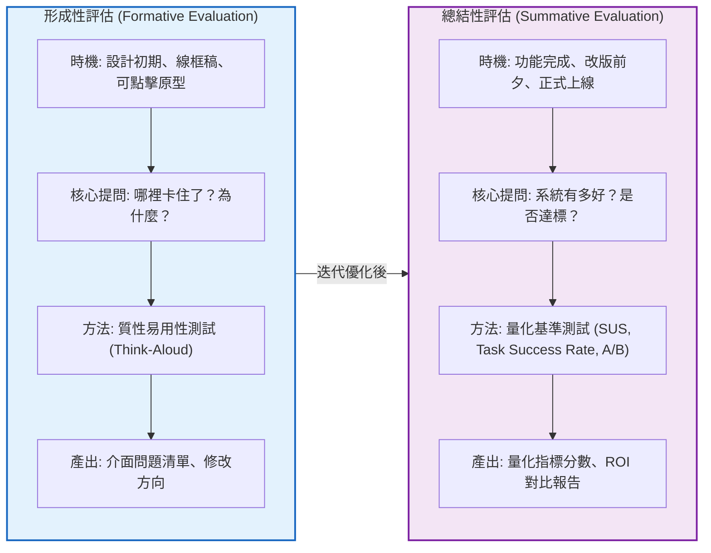
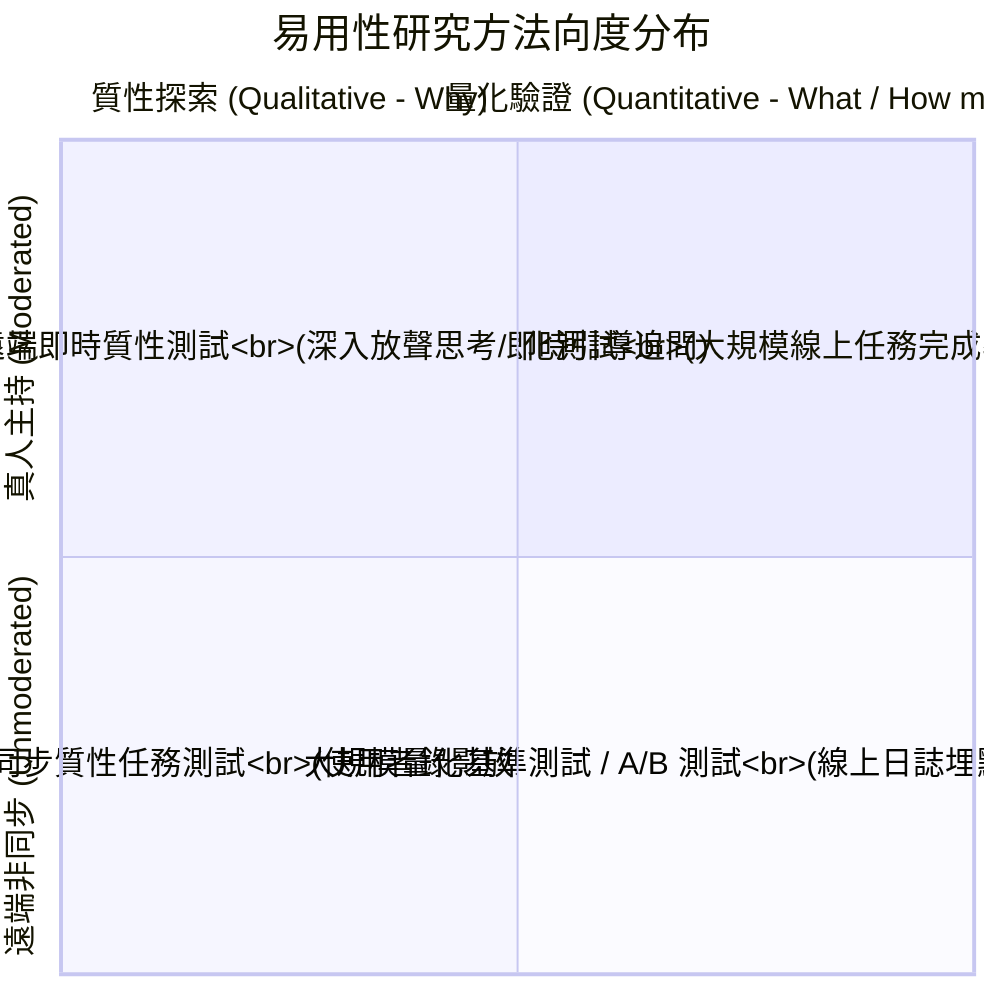
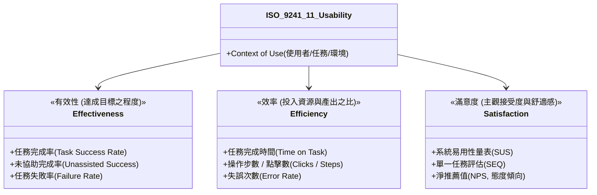
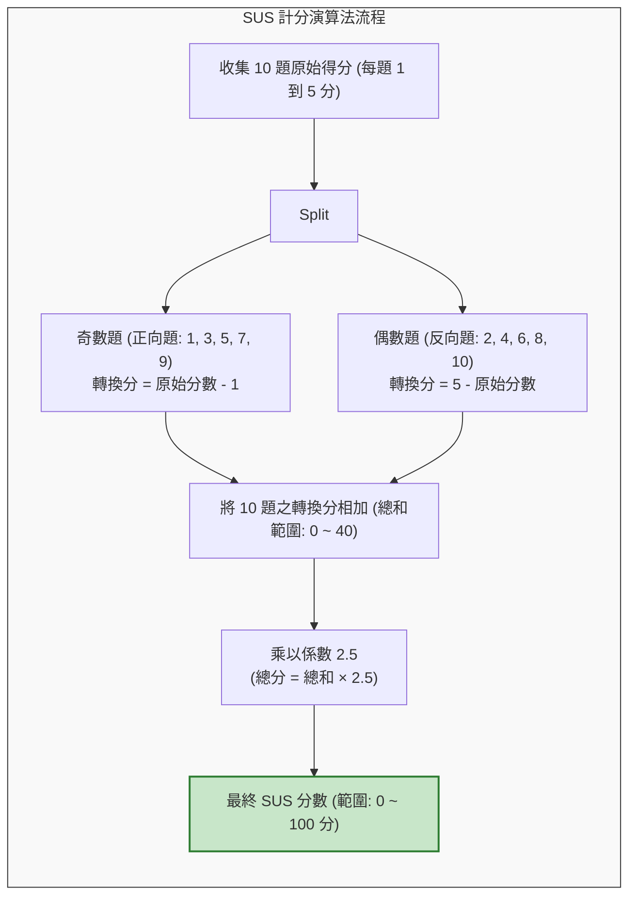
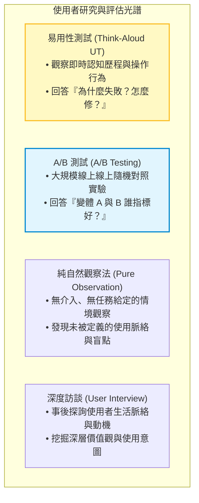
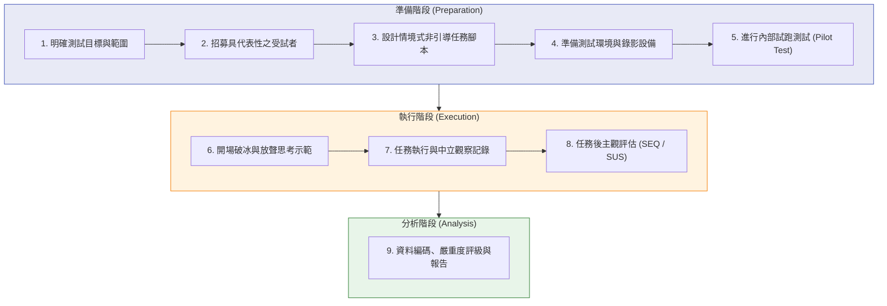
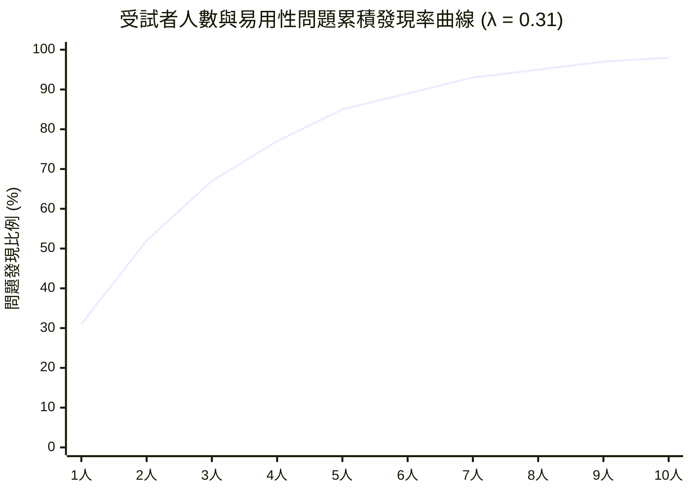

# 07｜易用性測試與啟發式評估：驗證設計的科學方法

> 「你不是你的使用者。（You are not your user.）」—— 人機互動設計領域核心箴言

---

## 核心摘要 (TL;DR)

1. **設計者認知盲區**：任何設計師、工程師或產品經理，一旦親手參與產品建構，其腦中已內建完整的「系統運作模型」，無法再以白紙般的心智模型體會新使用者的困惑。驗證設計良窳絕不能依賴內部團隊的直覺辯論，必須藉助具備科學實證基礎的**易用性評估方法**。
2. **易用性三大度量維度**：依據 [[sources/sources_index#SRC-02|ISO 9241-11]] 標準，易用性並非主觀的「好不好看」，而是由**有效性（Effectiveness，任務完成率）**、**效率（Efficiency，任務完成時間與操作步數）**與**滿意度（Satisfaction，主觀評分如 SUS）**所構成的量化與質性綜合指標。
3. **質性與量化驗證方法**：
   - **易用性測試（Usability Testing）**：透過**放聲思考法（Think-Aloud Protocol）**觀察真實使用者在執行特定任務時的即時認知卡點與行為，診斷「*為什麼會失敗*（Qualitative Why）」。
   - **A/B 測試（A/B Testing）**：藉由大規模隨機對照實驗（RCT）精確測量不同介面變體的指標差異，回答「*哪一個版本表現更好*（Quantitative What）」，但無法單獨解釋行為背後的心理原因。
4. **啟發式評估（Heuristic Evaluation）**：由 3–5 位具備專業知識的專家，依據 Jakob Nielsen 十大原則獨立審查介面缺陷。它屬於低成本、高效率的「專家評審法」，能快速掃除顯著的規則性硬傷，但**絕不能等同或完全取代真人使用者測試**。
5. **破除「5 人測試神話」**：Nielsen & Landauer (1993) 的數學模型表明，在平均發現率 $\lambda \approx 0.31$ 的假設下，5 位使用者可發現約 85% 的顯著問題；但此模型成立的前提是**多輪迭代（Iterative Testing）**與使用者高度同質。對於複雜領域系統、多樣化客群或定量基準測試，5 人遠不足以作為全域不變的黃金定律。

---

## 關鍵術語索引 (Glossary)

| 術語（繁體中文 / 英文） | 定義與學理意涵 |
| :--- | :--- |
| **易用性測試<br>(Usability Testing)** | 一種透過邀請具代表性的目標使用者，在受控或自然情境下執行預先規劃之典型任務，藉以觀察其真實操作行為、記錄障礙並評估產品可用性的實證研究方法。 |
| **形成性評估 vs. 總結性評估<br>(Formative vs. Summative Evaluation)** | **形成性評估**在產品開發初期與中期持續進行，目的在於快速診斷設計缺陷並指導迭代方向；**總結性評估**在產品成熟或上線後進行，目的在於對標基準線（Benchmark）量化整體效能與驗收成果。 |
| **放聲思考法<br>(Think-Aloud Protocol)** | 奠基於認知心理學（Ericsson & Simon, 1993），要求受試者在操作介面時將當下腦中注意到的線索、疑惑與決策即時口語化，反映即時工作記憶之內容。 |
| **啟發式評估<br>(Heuristic Evaluation)** | 由 Nielsen & Molich (1990) 提出的非正式折衷專家評審法，由數位具經驗的評估者依據公認的互動原則（Heuristics）獨立檢查介面，診斷是否違反易用性規範。 |
| **系統易用性量表<br>(System Usability Scale, SUS)** | 由 John Brooke (1996) 提出的 10 題 5 點李克特量表，經特定公式轉換為 0–100 的複合量度分值，用以標準化衡量使用者對系統的主觀滿意度。 |
| **嚴重度評級<br>(Severity Rating)** | 用以衡量易用性問題緊急程度的評級系統（通常分為 0–4 分），綜合考量問題發生的**頻率（Frequency）**、**影響程度（Impact）**與**持久性（Persistence）**。 |

---

## 1. 為什麼設計不能只靠直覺？從設計者偏差到科學驗證

當產品團隊討論一個按鈕該放哪裡、流程該如何排布時，會議室中往往充滿了不同角色的「我認為」、「我覺得」與「依照我的使用習慣」。然而，依賴個人直覺做設計決策，是介面產生嚴重易用性災難的主要根源。

### 1.1 設計者認知偏差：知識的詛咒與虛假共識效應

在人機互動與認知心理學中，設計團隊先天面臨兩大強大的認知偏誤：

1. **知識的詛咒（Curse of Knowledge）**：  
   **[實證研究事實]** 一旦一個人充分掌握了某項知識或系統邏輯，他就很難想像「完全不知道這項資訊的人」是如何思考的。設計師與軟體工程師每天面對產品介面長達數月，腦中早已建立起深厚的**系統實作模型（System Implementation Model）**；當他們看著介面時，所有圖示的意義、階層關係與操作路徑都是顯而易見的。但初次接觸產品的外部使用者，僅能透過零散的視覺意符（Signifiers）建構模糊的[[02_Mental_Models_and_Norman_Principles|心智模型（Mental Model）]]。
2. **虛假共識效應（False-Consensus Effect）**：  
   **[實證研究事實]** 人類有一種認知傾向，容易過度高估「其他人與自己擁有相同偏好、理解能力與行為模式」的程度。設計團隊成員常直覺認為：「既然我找這個按鈕只要 1 秒，使用者肯定也能一眼看見。」然而真實世界的使用者在年齡、科技素養、注意力分配以及使用情境（如邊走路邊單手滑手機）上，與坐在辦公室專注檢視螢幕的團隊有著巨大鴻溝。

> [!IMPORTANT]
> **「你不是你的使用者」絕非謙詞，而是認知科學的硬性事實。**  
> 產品團隊唯有透過結構化的觀察與測試，將客觀真實的使用者行為帶回設計決策現場，才能打破自我認知的封閉迴圈。

---

### 1.2 評估的兩大類型：形成性評估 vs. 總結性評估

在軟體與產品生命週期中，易用性評估依其目標與所處階段，嚴格區分為兩大範疇：



* **形成性評估（Formative Evaluation，做中學、做中改）**：
  - **核心目標**：診斷出具體的介面設計缺陷，探索使用者操作卡點的心理原因，用以指導後續介面迭代。
  - **樣本規模**：通常採小樣本（小至 3–5 位使用者），快速進行、多次迭代。
  - **資料特徵**：高度依賴質性資料（使用者抱怨、困惑表情、迷失的操作路徑）。
* **總結性評估（Summative Evaluation，成效驗收與對標）**：
  - **核心目標**：評估現有產品相較於前一版本或競爭對手，是否達到預先設定的易用性門檻（如任務完成率 > 90%）。
  - **樣本規模**：通常需要統計上具代表性的大樣本（例如 30–100+ 人以取得穩定的量化指標區間）。
  - **資料特徵**：高度依賴量化數據（任務耗時、錯誤率、標準化量表得分）。

---

## 2. 什麼是 Usability Testing？核心定義、形式與本質

### 2.1 易用性測試的嚴格定義

依據人機互動權威手冊 Dumas & Redish (1999) 的經典界定，一場標準的**易用性測試（Usability Testing）**必須同時具備以下五大核心要素：

1. **核心目標始終如一**：旨在提升系統的易用性，而非評量或考驗受試者個人的智商或能力。
2. **具代表性的使用者（Representative Users）**：參與者必須符合目標客群的輪廓特徵（如年齡、數位使用經驗、業務背景），而非內部開發人員或行銷同仁。
3. **具代表性的真實任務（Representative Tasks）**：參與者必須執行具有真實使用情境的任務，而非隨意在軟體內閒晃。
4. **觀察並記錄實際行為（Observe & Record Behavior）**：測試人員專注於「使用者實際做了什麼」，而不僅僅是聽取「使用者事後說了什麼」。
5. **分析資料以修訂設計（Analyze & Iterate）**：透過診斷操作障礙的成因，產出具體的介面重構方案。

---

### 2.2 測試形式的維度劃分

易用性測試並非只有一種執行型態，在實務上通常根據兩個核心維度進行分類：



| 形式維度 | 具體運作機制 | 適用時機與優勢 | 潛在限制與注意事項 |
| :--- | :--- | :--- | :--- |
| **真人主持<br>(Moderated)** | 主持人全程在場（實體實驗室或視訊遠端），引導測試節奏，在關鍵操作卡點適時提問。 | 適合探索性研究、複雜業務流程；能即時觀察受試者微表情並挖掘深層思考。 | 成本較高、耗時長；主持人若缺乏專業訓練，極易給出引導性暗示破壞效度。 |
| **遠端非同步<br>(Unmoderated)** | 受試者透過線上測試平台獨立開啟軟體，系統自動派發任務並錄製螢幕與聲音。 | 樣本收集迅速、成本低廉；可跨地域覆蓋多元客群，受試者處於自然生活環境。 | 無法在受試者卡住時即時深挖原因；若任務文案含糊，受試者容易誤解且無法澄清。 |
| **質性分析<br>(Qualitative)** | 聚焦於行為過程、認知心理、卡點成因與滿意體驗（探索「*為什麼*」）。 | 產品初期形成性評估；以少量樣本即可精準挖掘重大互動致命傷。 | 無法精確推估全體母體的發生比例，不適合做為驗收 KPI 指標。 |
| **量化分析<br>(Quantitative)** | 聚焦於任務完成率、操作時間、錯誤次數與評分分值（測量「*有多少 / 多快*」）。 | 產品成熟期總結性評估；適合版本改版前後成效對標（Benchmarking）。 | 僅能揭示「哪裡有數據滑坡」，無法單憑數字解答「為什麼使用者放棄操作」。 |

---

### 2.3 易用性測試的核心心法：觀察「行為」而非聽信「意見」

在易用性測試中，新手測試者常犯的最致命錯誤，就是將測試當成「使用者焦點團體訪談（Focus Group）」，不斷詢問受試者：「*你喜歡這個按鈕的顏色嗎？*」、「*如果加一個功能你覺得好不好？*」。

> [!WARNING]
> **使用者是自己行為的專家，但不是介面設計的架構師。**  
> 心理學證實，人類在被問及偏好時，極易受到社會期望偏差（Social Desirability Bias）與事後合理化機制的影響。受試者口頭上常說：「這介面蠻簡單的，我挺喜歡」，但實際操作錄影中他可能找了整整 3 分鐘才找到結帳入口。  
> **真正具備科學效度的資料，永遠來自使用者在螢幕上游移、停頓、反覆回退與按錯的「客觀行為痕跡」。**

---

## 3. 如何衡量易用性？ISO 9241-11 與核心量化度量指標

易用性不是抽象的哲學概念，而是可被精準量化、追蹤與對標的工程指標。國際標準化組織在 [[sources/sources_index#SRC-02|ISO 9241-11:2018]] 中對易用性（Usability）給予了嚴謹定義：

> **Usability（易用性）**：特定使用者在特定使用情境下，使用系統達成特定目標時的**有效性（Effectiveness）**、**效率（Efficiency）**與**滿意度（Satisfaction）**。



---

### 3.1 有效性（Effectiveness）：任務完成率與目標達成度

有效性衡量的是使用者能否「成功達成其既定目標」。

1. **二元任務完成率（Binary Task Success Rate）**：  
   最普遍且核心的基礎指標。受試者若在無外界提示下獨立完成任務記為 1（成功），放棄或得出錯誤結果記為 0（失敗）。
   $$\text{Success Rate} = \frac{\text{成功完成任務之人數}}{\text{總參與測試人數}} \times 100\%$$
2. **部分完成度（Partial Completion）**：  
   在多步驟複雜流程（如填寫包含 10 個欄位的報稅表單），可定義里程碑計分（例如完成 8 個步驟且無嚴重錯誤，計為 80% 完成度）。

---

### 3.2 效率（Efficiency）：時間、步驟與操作摩擦力

效率衡量的是使用者為達成目標所必須「耗費的心理與生理資源（時間、體力、認知精力）」。

1. **任務完成時間（Time on Task / Task Completion Time）**：  
   - 記錄受試者從閱讀完任務指令、開始在介面上動作，直到宣告任務完成或放棄的總秒數。
   - **統計注意事項**：任務時間通常呈現右偏態分布（少數受試者卡住會花費極長時間），在計算平均水準時，**應優先採用中位數（Median）或幾何平均數（Geometric Mean）**，而非容易受極端值拉偏的算術平均數。
2. **失誤率（Error Rate）**：  
   記錄受試者在執行任務過程中的偏離行為，包含：
   - **失誤動作（Slips / Mistakes）**：點擊無效區域、點選錯誤分類後退回、表單送出後被系統攔截報錯。
   - **錯誤總數與人均錯誤數**：反映介面意符（Signifiers）與操作回饋是否存在嚴重模糊性。

---

### 3.3 滿意度（Satisfaction）：標準化問卷工具

滿意度衡量的是使用者在操作過程中的主觀心理感受、舒適度與接受程度。評估滿意度必須採用經過心理測量學嚴格驗證的標準化量表，避免自行隨意出題。

#### 1. 系統易用性量表（System Usability Scale, SUS）—— [[sources/sources_index#SRC-40|Brooke, 1996]]
SUS 是目前全球業界與學界應用最廣泛、具備高度信度與效度的 10 題標準問卷，採用 5 點李克特量表（1 = 非常不同意，5 = 非常同意）：



> [!CAUTION]
> **學術精確警告：SUS 分數「絕不是百分比（Percentage）」！**  
> 一個獲得 68 分的系統，絕不代表「有 68% 的使用者感到滿意」。SUS 分數是一個經過複合轉換的量表分值。依據 Bangor et al. (2008) 對數千次測試的實證研究基準線：
> * **68 分**：全產業平均中位基準線（Average Benchmark）。低於 68 分通常被視為存在顯著易用性問題；
> * **80 分以上**：表現優異，達到等級 A（Excellent）；
> * **50 分以下**：系統存在嚴重災難性缺陷（Unacceptable）。

#### 2. 單一任務問卷（Single Ease Question, SEQ）
在使用者剛完成某一個特定任務後立即施測的單題量表：「*總體而言，您認為完成這項任務的難易度如何？*」（1 = 非常困難，7 = 非常容易）。用以精確捕捉各別子任務的操作阻力，而非等整場測試結束後回憶混淆。

---

## 4. 常見使用者測試與評估方法對照

在現代產品研發流程中，除了易用性測試外，團隊還經常運用 A/B 測試、純觀察法與使用者訪談。釐清這些方法的本質邊界，是建立科學評估思維的關鍵。



### 4.1 四大評估方法之優勢、限制與適用情境對照

| 評估方法 | 核心操作機制 | 主要優勢 (Pros) | 本質限制與短板 (Cons) | 適用階段與定位 |
| :--- | :--- | :--- | :--- | :--- |
| **放聲思考測試<br>(Think-Aloud UT)**<br>[[sources/sources_index#SRC-41|SRC-41]] | 受試者邊操作邊將注意力與決策即時口語化。 | **穿透行為表面**：直接揭示使用者心智模型與介面呈現的落差。 | 改變自然操作節奏（可能稍微拉長完成時間）；需依賴受試者表達意願。 | 原型階段、重大功能改版之形成性診斷。 |
| **A/B 測試<br>(A/B Testing)** | 將線上流量隨機分配至對照組與實驗組，測量統計轉換率。 | **真實客觀無偏誤**：大數據量化驗證；排除實驗室環境之霍桑效應。 | **黑盒侷限（無法解釋 Why）**：知道版本 B 點擊率低，但完全不知道是因為文案誤解還是按鈕被擋住。 | 上線後微調優化、商業指標對標。 |
| **純自然觀察法<br>(Observation)** | 觀察員在真實使用情境（如廚房、地鐵站）旁觀，不給任務、不打擾。 | **極高生態效度（Ecological Validity）**：發現實驗室中無法重現的物理環境干擾。 | 時間成本極高，事件發生不可控；無法得知使用者內心思考。 | 探索階段前期、軟硬體整合體驗場景。 |
| **事後訪談法<br>(Interview)** | 透過開放式提問探討使用者過往經歷、痛點與使用習慣。 | 能深挖情緒感受、購買決策動機與日常工作流程背景脈絡。 | **記憶重構與合理化偏誤**：使用者說出的往往是他「自以為的習慣」，與真實行為常有落差。 | 需求探索、概念驗證與人物誌（Persona）建構。 |

---

## 5. Jakob Nielsen 十大易用性啟發式原則（10 Usability Heuristics）

在所有專家評審方法中，Jakob Nielsen 於 1994 年提煉出的十大原則（[[sources/sources_index#SRC-38|Nielsen, 1994]]）是人機介面歷史上最具權威的評估基準。

> [!IMPORTANT]
> **啟發式評估（Heuristic Evaluation）是專家評審法，不是真人測試！**  
> 依據 [[sources/sources_index#SRC-39|Nielsen & Molich (1990)]]，啟發式評估是由評審者（最好由 3–5 位熟悉原則的專業設計師或研究員）以獨立雙盲方式比對介面是否違背原則。它無法取代真人測試，但可以在進入真人測試前，先行清掃 70% 以上低級的介面破綻。

以下針對十大原則進行系統性五步解構：

---

### 原則一：系統狀態的可見性 (Visibility of System Status)
1. **學理定義**：系統應在合理的時間內，透過適當的回饋（Feedback），隨時讓使用者清楚知道當前正在發生什麼事。
2. **初學者直白解釋**：永遠不要讓使用者看著毫無動靜的螢幕懷疑「我是不是沒按到？」或「App 是不是當機了？」。
3. **良好介面實例**：
   - 上傳大檔案時顯示**百分比數值、已傳輸大小與動態進度條**；
   - 點擊按鈕後立即變換微動態（微震動、Spinner 旋轉圖示或顏色變暗），即時告知指令已被系統接收。
4. **常見違反案例**：表單點擊「送出」後，畫面毫無反應長達數秒，導致使用者焦慮並連續狂點 5 次，造成重複扣款或多次送出。
5. **工程與設計改善**：凡耗時超過 0.1 秒的操作必須給予視覺或觸覺回饋；超過 1.0 秒的操作應呈現進度指示器（Loading Spinner）；超過 10 秒的操作必須提供明確的百分比進度與剩餘預估時間。

---

### 原則二：系統與真實世界的對照 (Match Between System and the Real World)
1. **學理定義**：系統應使用使用者熟悉的語言、詞彙與概念，而非系統導向的專業術語；遵循真實世界的約定俗成，讓資訊以自然且符合邏輯的順序呈現。
2. **初學者直白解釋**：說人話，不要用工程師的資料庫代碼或系統內部術語跟使用者溝通；排列順序要符合物理常識。
3. **良好介面實例**：
   - 閱讀 App 採用書架排版與模擬翻頁動畫；
   - 電子商務使用「購物車」、「結帳」等源自實體超市的概念；
   - 羅盤與地圖方向依照現實空間物理指向自動旋轉。
4. **常見違反案例**：在轉帳失敗時彈出系統錯誤對話框：「*Error 0x80040115: Network Socket Timeout or Null Pointer Exception*」，令一般使用者手足無措。
5. **工程與設計改善**：全面將底層例外代碼轉譯為使用者語境之文案，例如：「*網路連線不穩定，無法完成轉帳。您的資金尚未扣除，請檢查 Wi-Fi 後再試一次。*」。

---

### 原則三：使用者控制與自由 (User Control and Freedom)
1. **學理定義**：使用者常會因誤觸或探索介面而走錯路徑，系統必須提供清晰標註的「緊急出口（Emergency Exit）」，讓使用者能隨時離開非預期的狀態，而無需經過繁瑣的對話流程。
2. **初學者直白解釋**：給使用者「後悔藥」與「逃生門」，讓他們敢於大膽探索軟體而無後顧之憂。
3. **良好介面實例**：
   - 文書編輯軟體中普遍支援的「復原（Undo, Ctrl+Z）」與「重做（Redo）」；
   - 刪除重要信件或檔案後，螢幕底部浮現 Toast 提示：「已移至垃圾桶」並附帶「立即復原（Undo）」按鈕；
   - 點擊全螢幕彈窗角落清晰的「關閉（X）」鍵。
4. **常見違反案例**：安裝軟體或填寫長表單時，一旦進入某一步驟，導覽列所有返回箭頭全部消失，按實體返回鍵直接閃退並清空所有已填資料。
5. **工程與設計改善**：任何涉及破壞性、單向狀態改變的操作，均應提供明確的取消、復原或草稿自動保存機制。

---

### 原則四：一致性與標準 (Consistency and Standards)
1. **學理定義**：使用者不應該需要懷疑不同詞彙、狀態或操作是否代表同一件事。介面必須遵循內部一致性（產品自身規範）與外部一致性（作業系統與產業平台標準）。
2. **初學者直白解釋**：別標新立異去挑戰大家已經習慣的操作習慣；同一套 App 裡相同功能的按鈕要長得一樣。
3. **良好介面實例**：
   - iOS App 遵循 Apple HIG 規範，將全域導覽標籤列固定於螢幕底端，返回上一頁一律支援由螢幕左邊緣向右輕滑；
   - 同一網站中，所有主要行動按鈕（Primary Action）一律維持一致的藍色圓角樣式。
4. **常見違反案例**：在 A 頁面「儲存」用磁碟片圖示，在 B 頁面「儲存」用勾勾圖示，在 C 頁面卻使用文字「確認」；或將網頁常見的頂部 LOGO 點擊行為自訂為「開啟客服聊天室」而非「返回首頁」。
5. **工程與設計改善**：建立嚴格的設計系統（Design System）與元件庫，確保按鈕樣式、字體階層、圖示語意在全域產品中高度統一。

---

### 原則五：防錯機制 (Error Prevention)
1. **學理定義**：比提供優秀的錯誤訊息更好的設計，是從一開始就仔細設計，防止問題發生。消除容易引發錯誤的情境，或在使用者即將採取行動前進行檢查並給予確認提示。
2. **初學者直白解釋**：預防勝於治療。與其在使用者犯錯時大聲警告，不如根本不給他犯錯的機會。
3. **良好介面實例**：
   - 預訂機票或飯店時，日期選擇器自動「反灰凍結」今天以前的所有過去日期，從物理上杜絕選錯無效日期的可能；
   - 搜尋輸入框提供即時智慧自動補全（Auto-complete），降低拼錯機率；
   - 刪除伺服器等極度危險操作時，要求使用者手動輸入該伺服器的完整名稱方能解鎖確認鍵。
4. **常見違反案例**：表單的密碼欄位只標註「請輸入密碼」，等使用者滿懷信心輸入並點擊送出後，才跳出刺眼紅字痛斥：「密碼必須包含至少一個特殊符號與大寫字母」。
5. **工程與設計改善**：改採即時行內驗證（Inline Validation），並透過介面拘束（Constraints）直接限制無效輸入格式。

---

### 原則六：辨識重於回憶 (Recognition Rather than Recall)
1. **學理定義**：將物件、操作與選項以可見的形式呈現，大幅降低使用者的記憶負荷。使用者不應該需要記住從對話流程前一部分到後一部分的資訊。使用說明應在適當的時候顯而易見或容易取得。
2. **初學者直白解釋**：讓人做「選擇題」，不要讓人做「填空題」或「背誦題」。大腦善於辨識看得到的東西，拙於憑空回憶。
3. **良好介面實例**：
   - 電商 App 首頁呈現「最近瀏覽過的商品」與「歷史搜尋紀錄」卡片標籤；
   - 字型選擇下拉選單中，每種字型名稱直接以該字體本身渲染呈現（如 *Times New Roman* 以襯線體展示）。
4. **常見違反案例**：跨步驟結帳流程中，進入第三步填寫付款資訊時，畫面完全不顯示剛才選購的商品明細、尺寸與總金額，迫使使用者必須憑記憶核對或點擊返回重新查看。
5. **工程與設計改善**：在複雜流程中全程提供上下文摘要資訊欄（Contextual Summary Drawer），隨時顯露關鍵脈絡。

---

### 原則七：彈性與使用效率 (Flexibility and Efficiency of Use)
1. **學理定義**：系統應提供能加速進階使用者操作的快捷機制（Accelerators，新手通常看不見），讓系統同時滿足沒有經驗的新手與熟練的專家。允許使用者自訂常用操作。
2. **初學者直白解釋**：讓菜鳥覺得易學好上手，同時讓老手能夠飛快操作，不強迫熟手像新手一樣一步一步慢慢按。
3. **良好介面實例**：
   - 專業工具（如 Photoshop、Figma）提供直覺的點選工具列，同時支援豐富的全域鍵盤快捷鍵（如 `V` 選取、`Cmd+C` 複製）；
   - 行動版郵件 App 支援滑動手勢快捷設定（如向左滑動直接封存信件）。
4. **常見違反案例**：系統僅提供單一的操作路徑，無論是每天使用八小時的客服專員，還是第一次登入的訪客，都必須點開 4 層選單才能完成一筆建檔。
5. **工程與設計改善**：為高頻核心功能設計手勢快捷、組合鍵加速器或自訂常用捷徑看板。

---

### 原則八：美感與簡約設計 (Aesthetic and Minimalist Design)
1. **學理定義**：對話介面不應包含無關或極少需要的資訊。介面中每一個多餘的資訊單元，都會與相關的資訊單元競爭，從而削弱相關資訊的相對可見度。
2. **初學者直白解釋**：不要把畫面塞得滿滿當當。少即是多，多餘的裝飾和雜訊只會干擾使用者的大腦處理核心任務。
3. **良好介面實例**：
   - Google 搜尋首頁數十年如一日的標誌性留白設計，核心視覺中心始終只有搜尋框；
   - 產品卡片僅保留核心價格、標題與一張高解析度主圖，次要規格資訊摺疊於二級頁面。
4. **常見違反案例**：管理後台儀表板在一個螢幕內塞入 20 種不同顏色的統計圖表、跑馬燈通知、動態橫幅與未對齊的標籤，造成嚴重的[[03_Cognitive_Load_and_Gestalt|外在認知負荷（Extraneous Cognitive Load）]]超載。
5. **工程與設計改善**：運用漸進式揭露（Progressive Disclosure）原則，將低頻次要資訊收納於摺疊面板，強化視覺層級與適度留白。

---

### 原則九：協助使用者辨識、診斷並從錯誤中復原 (Help Users Recognize, Diagnose, and Recover from Errors)
1. **學理定義**：錯誤訊息應以清晰純樸的語言（不用工程代碼）明確表達，準確指出問題所在，並具建設性地提出解決方案。
2. **初學者直白解釋**：出錯時不要只罵使用者「你錯了！」，要溫柔地告訴他「到底哪裡有問題」以及「現在該怎麼做才能修復」。
3. **良好介面實例**：
   - 註冊信箱填錯格式時，即時提示：「*請輸入有效的電子郵件地址（例如 name@example.com）*」；
   - 搜尋無結果時，介面提示：「*找不到符合『XXXX』的商品。請檢查是否有錯字，或嘗試更寬鬆的關鍵字。*」並附帶熱門推薦標籤。
4. **常見違反案例**：上傳圖片失敗時，介面僅跳出刺眼的紅色驚嘆號與三個字：「上傳失敗！」，未說明是因為檔案超過 5MB、格式不支援還是伺服器斷線。
5. **工程與設計改善**：錯誤提示公式化：「**客觀狀態陳述 + 具體原因說明 + 明確下一步行動指引**」。

---

### 原則十：說明文件與支援 (Help and Documentation)
1. **學理定義**：即便一個系統在沒有說明文件的情況下表現更好，提供協助與說明文件仍是不可或缺的。任何此類資訊都應易於搜尋、聚焦於使用者的具體任務、列出具體的執行步驟，且不宜過於冗長。
2. **初學者直白解釋**：最好的介面不用看說明書，但遇到困難時，說明書必須隨手可得、容易查閱，而且直接給出具體解法。
3. **良好介面實例**：
   - 在複雜的金融表單專有名詞旁提供小問號圖示（Tooltip），點擊或懸停即刻展開一兩句淺顯易懂的解釋；
   - 支援搜尋的內嵌式說明中心（Help Center），以任務導向分類（如「如何變更扣款信用卡？」）。
4. **常見違反案例**：軟體唯一的求助管道是一份長達 300 頁、按字母順序排列的非搜尋 PDF 官方規格書。
5. **工程與設計改善**：提供情境式微引導（Contextual Micro-copy）與嵌入式常見問題（FAQ），讓使用者無需跳離主要工作流程即可獲取解答。

---

## 6. 如何進行一次完整的易用性測試？標準全流程指南

要獲得高信度、高價值的實證資料，易用性測試必須遵循標準化的作業流程：



### 6.1 測試全流程九大步驟拆解

1. **明確測試目標與範圍**：確定本次測試是驗證新結帳流程的漏斗流失點，還是評估整體導覽資訊架構。
2. **招募具代表性的受試者**：根據目標使用者輪廓（Screener）嚴格篩選。若產品客群包含專家與新手，兩組應分別招募。
3. **設計情境式任務腳本（Task Scenarios）**：任務必須具備真實生活情境，**嚴禁在任務指引中出現介面上的原文字眼**（參見 6.2 節示範）。
4. **準備測試環境與錄影設備**：配置螢幕錄影、滑鼠軌跡記錄、臉部表情攝影機與清晰收音設備。
5. **進行內部試跑（Pilot Test）**：正式測試前務必找 1 位同事完整走過一遍，排查腳本語病、軟體當機與設備設定問題。
6. **開場破冰與知情同意（Introduction）**：
   - 誠懇告知受試者：「*今天我們測試的是這套軟體，而不是測試您的個人能力。軟體有任何讓您困惑的地方，都是設計的失誤，請儘管誠實表達。*」
   - 簡短示範放聲思考（Think-Aloud）：例如邊洗手邊說出：「我現在打開水龍頭，水有點冷，我把開關往左轉一點等待熱水...」。
7. **任務執行與中立觀察**：受試者操作時，主持人保持安靜，專注觀察其游標停滯點與喃喃自語；適時以中立語句追問：「*我看您在這裡停頓了一下，您剛才在尋找什麼？*」。
8. **任務後主觀問卷評量**：任務剛結束立即施測單一任務評估（SEQ），全場測試結束後施測標準系統易用性量表（SUS）。
9. **資料清理、嚴重度評級與迭代建議**：將所有觀察到的卡點彙整至問題矩陣，評定優先級並提出介面重構方案。

---

### 6.2 關鍵技藝：情境式任務設計（Task Scenario）對照示範

任務指引是整場測試成敗的核心。如果指引不慎給出線索，測試就退化成了「聽指令找按鈕」的無效遊戲。

* **[情境示例]**（目標：驗證旅宿訂房 App 的「篩選特定寵物友善設施」功能）：

```carousel
```markdown
### ❌ 嚴重失真的引導性任務 (Leading Task)
* **任務文案**：
  > 「請點擊主畫面右上角漏斗圖示的『進階篩選』按鈕，在『特殊需求』分類中勾選『允許攜帶寵物』，然後按下底部的『套用篩選條件』。」
* **致命弊端**：
  - 這不是在測試易用性，而是在考驗受試者能否聽懂操作指令；
  - 直接洩漏了圖示意義（漏斗圖示）、入口位置（右上角）、專有名詞（進階篩選、特殊需求）；
  - 完全無法測出真實使用者在面對介面時，能否自主理解並找到該功能。
```
<!-- slide -->
```markdown
### ✅ 合格的情境式非引導任務 (Contextual Scenario)
* **任務文案**：
  > 「下週末你打算帶家裡養的中型柴犬一起去花蓮渡假兩天。請使用這款 App，在花蓮市區挑選一間適合你們住宿、每晚預算在新台幣 3,500 元以內的雙人房，並將它加入你的收藏清單。」
* **設計巧思與優勢**：
  - **生活化情境**：激發真實的使用動機與預期；
  - **零介面洩密**：完全沒有提及「篩選」、「漏斗圖示」、「收藏」等具體介面元素；
  - **可觀察決策歷程**：能客觀觀察受試者是先搜尋地點、先設預算，還是找尋寵物標籤；若受試者在首頁迷失找不到條件設定入口，即暴露真實設計缺陷。
```
````

---

### 6.3 主持人黃金守則：Do's & Don'ts

| 類別 | 推薦做法 (Do's) | 嚴格禁止的禁忌 (Don'ts) |
| :--- | :--- | :--- |
| **受試者卡住時** | **保持沉默並耐心等待**：「*我看您在考慮，可以跟我們說說您現在在想什麼嗎？*」 | **跳進去指導操作**：「*喔，那個按鈕在右上方啦，你點那個就對了。*」 |
| **受試者反問時** | **把問題彈回去**：「*您覺得點下去會發生什麼事呢？*」 | **直接公布正確答案**：「*點這個是儲存設定的意思。*」 |
| **受試者犯錯時** | **面無表情客觀記錄**，觀察其能否自主意識到錯誤並復原。 | **發出嘆息、皺眉或說**：「*哎呀，你按錯了，不是那個！*」 |
| **開場指導語** | **強調測試的是系統**：「*請放心，您絕對不會做錯任何事，出錯代表是系統沒做好。*」 | **製造受試焦慮**：「*今天這是一場測驗，請盡量展現您的熟練度。*」 |

---

## 7. 如何分析測試結果並改善設計？

測試結束後，團隊面對的是大量的錄影檔、筆記與滿意度問卷。如何將龐雜的質性筆記轉化為可執行的產品工程迭代？

### 7.1 易用性問題嚴重度評級系統 (Severity Rating)

依據 Nielsen (1994) 的標準，易用性問題應依據三個向度綜合裁定其嚴重度：
1. **發生頻率（Frequency）**：該問題是普遍發生還是偶爾發生？
2. **影響程度（Impact）**：該問題是輕微造成延遲，還是造成使用者完全卡死無法前進？
3. **持久性（Persistence）**：該問題是使用者看過一次就會記住，還是每次操作都會重複卡住？

| 嚴重等級 (Rating) | 判定標準與定義 | 處理優先順序與時限 |
| :---: | :--- | :--- |
| **4 級：災難性問題<br>(Catastrophic)** | 阻斷性致命缺陷。使用者完全無法完成核心任務，系統崩潰、資料遺失或造成無法挽回的經濟損失。 | **最高優先（P0）**：阻斷上線，必須立即召集工程與設計團隊當日修復。 |
| **3 級：重大問題<br>(Major)** | 造成極大操作延遲或高挫折感。多數使用者難以克服，或需花費大量時間摸索才能繞過障礙。 | **高度優先（P1）**：排入當前 Sprint，正式版本發布前必須修復。 |
| **2 級：輕微問題<br>(Minor)** | 使用者會產生短暫猶豫或輕微不便，但能自行摸索出路徑並順利完成任務。 | **中度優先（P2）**：排入次要版本或設計優化待辦清單（Backlog）。 |
| **1 級：裝飾/表面問題<br>(Cosmetic)** | 不影響功能操作與理解，僅為視覺不一致、對齊偏差或極輕微的美感瑕疵。 | **低度優先（P3）**：資源充裕時再行優化，不阻礙產品發布。 |
| **0 級：不構成問題<br>(Not a problem)** | 僅為個別受試者極端個人偏好，不違背易用性原則與通用操作邏輯。 | 無需採取行動。 |

---

### 7.2 從發現到解法：易用性問題診斷報告模板

| 問題編號 | 觀察到的具體行為障礙 | 違反之易用性原則 | 嚴重度 | 根本原因診斷 (Root Cause) | 具體介面改善方案 (Iteration) |
| :---: | :--- | :--- | :---: | :--- | :--- |
| **ISSUE-01** | 5 位受試者中有 4 位在確認訂單頁面找不到「編輯收件地址」按鈕，平均延遲達 45 秒。 | 原則六：辨識重於回憶<br>原則一：狀態可見性 | **3 級 (Major)** | 編輯按鈕設計為低對比淺灰色無底色文字連結，藏在長段文字末尾，視覺意符極弱。 | 將編輯入口獨立為標準線框按鈕（Outline Button），置於地址區塊右上角。 |
| **ISSUE-02** | 點擊「立即付款」後畫面轉圈超過 5 秒，3 位受試者重複按壓，導致發出兩次 API 請求。 | 原則一：系統狀態可見性<br>原則五：防錯機制 | **4 級 (Catastrophic)** | 前端未對提交按鈕進行防抖（Debounce）與點擊凍結，且無全螢幕 Loading 提示。 | 點擊送出後立即禁用按鈕（Disabled），按鈕內嵌 Spinner 動畫，阻斷重複請求。 |
| **ISSUE-03** | 密碼不合規範時，系統僅顯示「格式錯誤」，受試者嘗試了 3 次不同的特殊符號才成功。 | 原則九：協助從錯誤復原<br>原則五：防錯機制 | **2 級 (Minor)** | 錯誤回饋缺乏建設性指引，未明確告知密碼規則之限制條件。 | 在密碼輸入框下方常態展示 3 項檢核條件清單，滿足條件時即時變綠勾。 |

---

## 8. 易用性評估的迷思、限制與常見錯誤

### 8.1 破除「只要 5 個受試者就足夠」的經典神話

在 UX 業界流傳最廣但也最常被嚴重誤解的名言，莫過於「*易用性測試只需要 5 個人，就能抓出 85% 的問題*」。

#### 1. 數學模型的學術真實面貌（[[sources/sources_index#SRC-43|Nielsen & Landauer, 1993]]）
Nielsen 與 Landauer 於 CHI '93 提出的易用性問題發現二項分布數學模型為：
$$ProblemsFound(n) = N \left( 1 - (1 - \lambda)^n \right)$$
* $N$：系統中客觀存在的易用性問題總數；
* $n$：參與測試的受試者人數；
* $\lambda$：單一受試者發現某一易用性問題的平均機率。

在 Nielsen 檢視的大量早期專案中，$\lambda$ 的平均值約為 $0.31$。將其代入公式：
$$ProblemsFound(5) = N \left( 1 - (1 - 0.31)^5 \right) = N (1 - 0.69^5) \approx N (1 - 0.156) \approx 84.4\% \times N \approx 85\%$$



#### 2. 「5 人神話」失靈的三大邊界情境
1. **單人發現率低於假設（$\lambda \ll 0.31$）**：  
   在複雜的專業領域系統（如醫療設備控制台、晶圓廠 MES 系統或專業交易終端），互動路徑千變萬化，單一使用者發現問題的機率 $\lambda$ 往往僅有 $0.05 \sim 0.10$。若 $\lambda = 0.10$，$n = 5$ 時僅能發現約 $41\%$ 的問題，此時 5 人測試存在嚴重的安全漏洞。
2. **客群高度異質性（Diverse User Groups）**：  
   上述模型假設所有受試者均來自「同一個同質母體」。如果產品同時面對「20 歲數位原住民」與「70 歲銀髮族」，或者「普通消費者」與「商家管理員」，則**每一個獨立的使用者族群都必須各自招募 3–5 人**，絕非全產品混雜 5 人即可。
3. **定量基準測試（Quantitative Benchmarking）**：  
   若測試目標是測量具有統計信賴區間的「任務平均耗時」或「SUS 分數」，5 人的樣本容量誤差範圍極大（誤差區間往往超過 $\pm 20\%$），在統計學上完全不具備決策說服力。量化測試通常至少需要 30–40 人以上。

> [!NOTE]
> **Nielsen & Landauer (1993) 的真正核心倡導：**  
> 該論文的核心結論不是「永遠只測 5 個人」，而是**反對「把整年度預算全部砸在最後一次 30 人的大規模測試」**。作者極力主張將預算拆分為**多次小規模迭代測試**（例如：設計初期測 3 人 $\rightarrow$ 修改設計 $\rightarrow$ 中期測 3 人 $\rightarrow$ 修改設計 $\rightarrow$ 後期測 3 人），其投資報酬率（ROI）遠遠高於單次大拜拜式測試。

---

### 8.2 易用性評估三大致命實務陷阱

1. **混淆「態度」與「行為」**：  
   誤以為發放一份寫滿「您覺得本系統容易使用嗎？」的 Google 表單問卷就等於做了易用性評估。問卷收集到的是經過大腦美化與遺忘的「主觀態度」，而非真實操作介面時手足無措的「客觀行為」。
2. **缺乏雙盲與主持人偏誤**：  
   由親手繪製該介面的 UI 設計師親自擔任主持人。當受試者找不到功能時，設計師往往忍不住下意識嘆氣、咳嗽，或過早給出提示，徹底摧毀了測試的客觀效度。
3. **滿意度高不代表沒有易用性問題**：  
   在測試結束後，受試者基於禮貌常給予很高的滿意度評分；但錄影資料卻顯示他在結帳頁面重試了 4 次。**永遠要讓客觀行為數據（完成率、耗時、錯誤數）做為第一裁決標準。**

---

## 9. 總結、實務檢驗清單與延伸閱讀

### 9.1 易用性評估實踐檢驗清單 (Action Checklist)

#### 階段一：測試規劃與準備檢核
- [ ] **目標聚焦**：本次測試具備明確的研究假設與核心觀察指標（非發散性瀏覽）。
- [ ] **受試者純度**：受試者符合目標客群輪廓，且排除內部同事與具備設計背景之利害關係人。
- [ ] **任務情境化**：任務腳本具有真實生活脈絡，且**絕對未出現**介面上的按鈕原名與操作線索。
- [ ] **設備與錄影**：完成螢幕錄影、收音與滑鼠軌跡軟體之試跑，確保資料留存完整。

#### 階段二：測試主持與執行檢核
- [ ] **免責聲明**：向受試者清楚說明「測試的是系統不是您」，消除受試緊張感。
- [ ] **放聲思考示範**：在正式任務前進行簡短口語化思維示範。
- [ ] **主持人中立性**：當受試者卡住時保持安靜；提問時僅使用中立回彈式語句，絕不指導操作。
- [ ] **客觀指標收集**：即時或事後回放精確記錄二元成功率、完成時間與失誤次數。

#### 階段三：啟發式評估與報告檢核
- [ ] **專家獨立性**：啟發式評估由至少 3 位評審員獨立審查，彼此不交換意見，最後才進行合併會議。
- [ ] **原則精確對齊**：每一項易用性問題均對齊至 Nielsen 十大原則之一，並標註嚴重度等級（0–4）。
- [ ] **建設性改善**：每項問題報告均包含「現象描述 + 違反原則 + 根因分析 + 具體改善方案」。

---

### 9.2 初學者思維反思題 (Reflection Questions)

1. **反思直覺**：回想你最近使用過一個讓你感到極度挫折的 App 功能（例如：取消某項訂閱、尋找電子發票載具）。如果由你來主導，你會設計怎樣的任務腳本與測試流程，來向團隊證明這個功能存在嚴重的易用性問題？
2. **辨析原則**：當一項產品需要同時滿足「每天操作 8 小時的高頻客服人員」與「每月只登入一次的普通大眾」時，你該如何平衡 Nielsen 原則七（彈性與效率）與原則八（美感與簡約）之間的衝突？
3. **方法邊界**：如果公司的產品總監說：「*我們線上已經有完備的 A/B 測試系統與埋點數據，每天有幾十萬筆點擊紀錄，根本沒必要花時間找 5 個人來做質性易用性測試。*」你會如何運用本篇的理論向他說明質性測試不可替代的價值？

---

### 9.3 銜接後續：三大經典產品案例研究與教學簡報萃取

完成前七篇的理論根基與評估方法後，我們已經建立了完整的 UI/UX 認知武器庫：從心理學心智模型、認知負荷、互動效率、資訊架構，到暗黑模式識別與易用性科學驗證。

接下來，我們將理論全面落實於實務產品，進入**產品案例研究（Case Studies）**階段：
* 在 **[[case_studies/01_Google_Maps_Case_Study|案例一：Google Maps]]** 中，我們將把資訊架構、空間心智模型與即時回饋理論，套用於數十億人日常依賴的地圖應用，剖析其如何在複雜動態情境下實現極致的認知減負；
* 在 **[[case_studies/02_Notion_Case_Study|案例二：Notion]]** 中，深入探討模組化區塊（Block）、多層次階層架構與漸進式揭露，剖析高自由度生產力工具如何平衡彈性與複雜度；
* 在 **[[case_studies/03_Duolingo_Case_Study|案例三：Duolingo]]** 中，解析微學習路徑、即時多感官回饋與遊戲化機制，並深入探討行為動機與學習本質之倫理反思。

這些案例研究成果，將直接作為後續 HTML 互動教學簡報（`slides/`）的核心實務素材。

---

## 引用來源與延伸閱讀 (References)

1. **[[sources/sources_index#SRC-02|SRC-02]] ISO 9241-11:2018**  
   * **書目資訊**：International Organization for Standardization. (2018). *Ergonomics of human-system interaction — Part 11: Usability: Definitions and concepts* (ISO Standard No. 9241-11:2018).
   * **永久連結**：[https://www.iso.org/standard/63500.html](https://www.iso.org/standard/63500.html)
   * **引用定位**：第 3 章易用性三大支柱（有效性 Effectiveness、效率 Efficiency、滿意度 Satisfaction）之國際標準官方定義。
   * **資料限制**：ISO 官方標準文件，依據國際公認定義與摘要核對。

2. **[[sources/sources_index#SRC-38|SRC-38]] Jakob Nielsen (1994)**  
   * **書目資訊**：Nielsen, J. (1994). Enhancing the Explanatory Power of Usability Heuristics. In *Proceedings of the SIGCHI Conference on Human Factors in Computing Systems* (CHI '94, pp. 152–158). ACM.
   * **DOI**：[10.1145/191666.191729](https://doi.org/10.1145/191666.191729)
   * **引用定位**：第 5 章十大易用性啟發式原則（10 Usability Heuristics）之學術奠基。
   * **資料限制**：同儕審查頂級會議論文，依據公開摘要與核心分類架構核對。

3. **[[sources/sources_index#SRC-39|SRC-39]] Jakob Nielsen & Rolf Molich (1990)**  
   * **書目資訊**：Nielsen, J., & Molich, R. (1990). Heuristic Evaluation of User Interfaces. In *Proceedings of the SIGCHI Conference on Human Factors in Computing Systems* (CHI '90, pp. 249–256). ACM.
   * **DOI**：[10.1145/97243.97281](https://doi.org/10.1145/97243.97281)
   * **引用定位**：第 5 章啟發式評估（Heuristic Evaluation）專家評審流程與「折衷易用性工程」界定。
   * **資料限制**：同儕審查頂級會議論文，依據公開摘要核對。

4. **[[sources/sources_index#SRC-40|SRC-40]] John Brooke (1996)**  
   * **書目資訊**：Brooke, J. (1996). SUS: A 'quick and dirty' usability scale. In P. W. Jordan, B. Thomas, B. A. Weerdmeester, & I. L. McClelland (Eds.), *Usability Evaluation in Industry* (Chapter 21, pp. 189–194). Taylor & Francis.
   * **ISBN**：`978-0748404605`
   * **引用定位**：第 3.3 節系統易用性量表（SUS）10 題李克特量表之計算邏輯、計分公式與「非百分比」學理邊界。
   * **資料限制**：經典學術專著專章，依據作者原始公式與 Bangor et al. (2008) 實證基準核對。

5. **[[sources/sources_index#SRC-41|SRC-41]] K. Anders Ericsson & Herbert A. Simon (1993)**  
   * **書目資訊**：Ericsson, K. A., & Simon, H. A. (1993). *Protocol Analysis: Verbal Reports as Data* (Revised Edition). MIT Press.
   * **ISBN**：`978-0262550239`
   * **引用定位**：第 2.2 節與第 4 章放聲思考法（Think-Aloud Protocol）工作記憶即時性與認知科學效度基礎。
   * **資料限制**：認知心理學經典專著，受版權保護未存全文，依據方法論核心主張核對。

6. **[[sources/sources_index#SRC-42|SRC-42]] Joseph S. Dumas & Janice C. Redish (1999)**  
   * **書目資訊**：Dumas, J. S., & Redish, J. C. (1999). *A Practical Guide to Usability Testing* (Revised Edition). Intellect Books.
   * **ISBN**：`978-1841500201`
   * **引用定位**：第 2.1 節易用性測試五大核心要素與第 6 章測試流程規範、情境任務設計手冊。
   * **資料限制**：專業實務手冊專著，依據經典架構與業界操作手冊核對。

7. **[[sources/sources_index#SRC-43|SRC-43]] Jakob Nielsen & Thomas K. Landauer (1993)**  
   * **書目資訊**：Nielsen, J., & Landauer, T. K. (1993). A mathematical model of the finding of usability problems. In *Proceedings of the INTERACT '93 and CHI '93 Conference on Human Factors in Computing Systems* (CHI '93, pp. 206–213). ACM.
   * **DOI**：[10.1145/169059.169166](https://doi.org/10.1145/169059.169166)
   * **引用定位**：第 8.1 節易用性問題發現數學二項分布模型 $ProblemsFound(n) = N(1 - (1 - \lambda)^n)$ 與「5 人測試神話」學術邊界解析。
   * **資料限制**：同儕審查頂級會議論文，依據正式數學推導模型與摘要核對。
