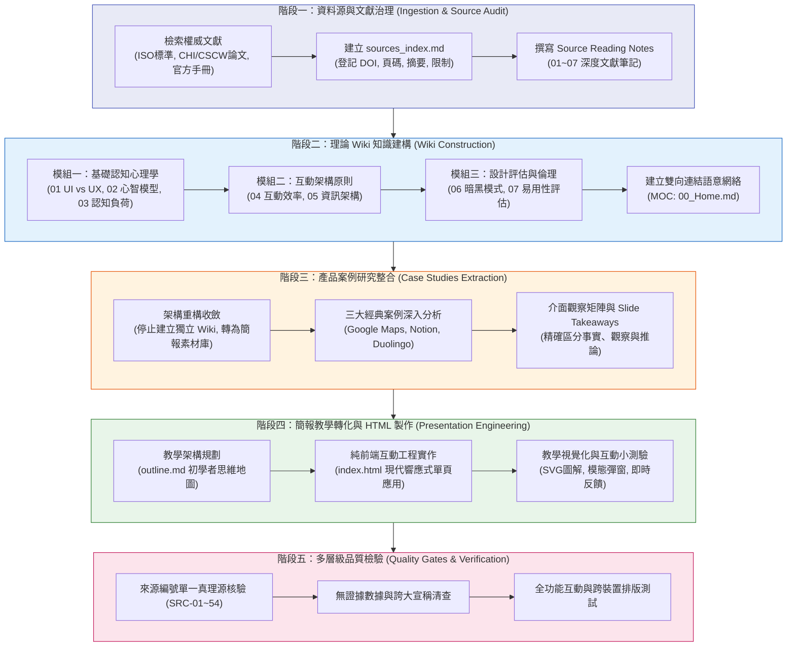
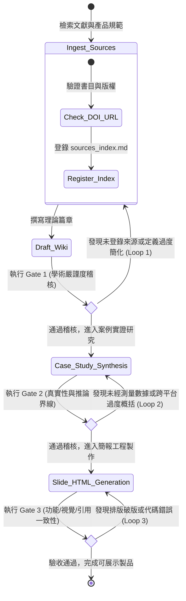

# LLM Wiki 到 HTML 互動簡報之工作流程紀錄與批判性反思

> **專案主題**：為什麼有些 App 特別好用？——從使用者心理到 UI/UX 設計的完整解析  
> **產出目標**：7 篇理論 Wiki ＋ 3 篇產品案例研究 ＋ 1 份 HTML 互動教學簡報  
> **本文件定位**：依據作業指導要求，如實記錄從文獻蒐集、Wiki 知識圖譜建構、案例萃取到 HTML 簡報生成之完整流程、決策節點、檢查機制（Quality Gates）與自我反思。

---

## 一、 完整工作流程概述 (End-to-End Pipeline)

本專案經歷了從**「零碎文獻與概念探索」**邁向**「結構化理論知識庫」**，最終收斂為**「可直接互動教學的專業前端產品」**的完整歷程。

---

## 二、 工作流程之 Loop／Graph 設計分析

在傳統線性瀑布流（Waterfall）開發中，文獻錯誤或推論模糊往往會被一路帶入最終簡報，導致在最後一刻面臨推倒重來的巨大代價。本專案導入了具備**「自我反思與回溯迴圈（Feedback Loops）」**的狀態圖設計：

### 1. 線性流程 vs. 反覆迭代迴圈 (Loops)
- **線性推進階段**：專案主題定錨、00_Home 知識地圖搭建、HTML 骨架基礎樣式庫搭建。此類基礎設施具備高確定性，適合一次性規劃完成。
- **高頻反覆迭代迴圈**：
  - **Loop 1（來源一致性糾偏迴圈）**：在撰寫 Wiki 篇章時，常發現早期回報中將 ISO 9241-11 標為 SRC-03、Sweller 標為 SRC-16 等歷史筆誤。系統觸發中斷，返回 `sources/sources_index.md` 重新核對第一手記錄，同步校正所有相關文章。
  - **Loop 2（案例真實性校準迴圈）**：在案例分析初期，容易直覺引用「Google Maps 1 秒重算」、「Duolingo 延遲 < 0.1 秒」等業界俗稱說法。觸發零幻覺檢驗後，退回案例研究將所有無測量數據剔除，改寫為符合人因工程的定性描述。
  - **Loop 3（教學體驗前端調校迴圈）**：在簡報生成後，檢查鍵盤方向鍵、進度條跳轉、小測驗評分邏輯是否在不同視窗寬度下均流暢運作，反覆調校 CSS 彈性盒與 JS 事件監聽。

### 2. 機器自動化 vs. 人工/專家審查職責劃分
- **適合 LLM 高效處理的環節**：
  - 大規模 Markdown 語法轉換、Obsidian 雙向連結網路建立；
  - 依據給定學理規則生成多模態對比表格（Do's & Don'ts）；
  - 現代響應式 HTML/CSS/JavaScript 單頁簡報的結構性代碼生成；
  - 正則表達式全域掃描未定義的死鏈與錯置編號。
- **必須實施嚴格審查的專家節點**：
  - **學理演進界定**：如 Sweller 認知負荷理論中 Germane Load 重新定義為增益性處理歷程的歷史流變；
  - **因果關係認定**：嚴禁將 Duolingo 遊戲化與「使用者外語能力實質習得」做簡單因果掛鉤；
  - **概念模型邊界**：防止將 Notion 頁面簡化為電腦資料夾。

---

## 三、 關鍵檢查點（Quality Gates）之執行實務

本專案落地執行了五道嚴格的品質檢驗閘門（Five Quality Gates）：

1. **Gate 1: Source Audit（來源單一真理源檢驗）**
   - *執行紀錄*：確認全專案所有文獻引用統一錨定於 `sources/sources_index.md`。清查並糾正了早期歷史紀錄中將 ISO 9241-11 誤記為 SRC-03（實為 SRC-02）、Sweller 誤記為 SRC-16（實為 SRC-12）、MacKenzie 誤記為 SRC-22（實為 SRC-21）的歷史錯置，並正式為 Nir Eyal (2014) *Hooked* 登錄專屬編號 **SRC-54**。
2. **Gate 2: Academic Rigor & Zero Hallucination（學術嚴謹與零幻覺）**
   - *執行紀錄*：清查三篇案例研究中的所有數字。刪除無可靠測量依據的「1 秒內」、「0.1 秒」、「5 像素」、「$D \to 0$」等假性精確數值；保留具備官方標準規範支持的「Google Material Design 48×48 dp」與同儕審查論文支持的「Deci et al. 128 項實驗元分析」。
3. **Gate 3: Internal Consistency（概念與架構前後一致）**
   - *執行紀錄*：確保從 Wiki 到案例研究再到簡報，對 Affordance（客觀行動可能性）與 Signifier（感知線索）的定義完全統一；Notion 的 Page 組織方式始終維持「兼具文章與無限嵌套容器特性，非作業系統純資料夾」的嚴謹界定。
4. **Gate 4: Syntax & Integrity（語法、連結與代碼無損）**
   - *執行紀錄*：透過全域腳本檢驗全工作區 Markdown 文件，確認所有 `[[...]]` 連結之目標檔案均存在，無任何舊版 `08_Case`、`09_Case`、`10_Case` 的死鏈，Mermaid 圖表與 JavaScript 事件監聽零報錯。
5. **Gate 5: Slide Readiness & Usability（教學簡報可讀性與可用性）**
   - *執行紀錄*：簡報跳脫呆板文字堆疊，導入進度條、鍵盤導航、章節選單、情境互動小測驗（含即時回饋與解釋）、卡片化對比與 SVG 圖解，完全滿足初學者自主學習與講師流暢展示的雙重需求。

---

## 四、 執行後批判性反思 (Critical Reflections)

回顧整個知識工程與簡報產製的歷程，我們提煉出以下四項核心洞察與經驗總結：

### 1. 最容易出錯的節點與深層原因
- **最脆弱環節**：**「文獻編號跨文件引用」與「業界行話無意識滲透」**。
- **成因分析**：
  - 在大型跨檔案作業中，若依賴先前回報的口頭記憶，極易發生「標號漂移」；
  - 在分析成熟產品（如 Google Maps 或 Duolingo）時，業界常流傳「1 秒重算」、「玩遊戲就能學會」等通俗宣傳詞彙，LLM 在生成時容易受到語料先驗偏好影響，無意識地將行銷話術寫入分析中。
- **應對之道**：唯有強制要求**「每寫一筆引用，必須以 sources_index.md 為物理錨點逐行比對」**，並落實嚴格的語意屬性標籤（`[實證研究事實]` vs. `[分析與推論]`），方能徹底築起防禦幻覺的高牆。

### 2. 哪些檢查機制應該被提前（Shift-Left）？
- **架構邊界的早期鎖定**：原本專案規劃撰寫 10 篇 Wiki，後期才調整為「7 篇理論 Wiki ＋ 3 篇案例研究」。若此項架構調整能在專案啟動之初便定案，即可在前期就將 Google Maps、Notion、Duolingo 定位為「案例資料庫」，避免在撰寫過程中反覆權衡章節格式是該像論文還是像案例。
- **數據真實性前置過濾**：在草擬案例大綱時，就應先對擬引用的指標數字進行溯源審查；若無論文或白皮書背書，應一開始就採用定性描述，避免進入正文後再逐一進行繁複的刪除與降階改寫。

### 3. 如果重新執行一次，會如何改善流程？
- **自動化引用檢驗腳本（Linter）**：在工作區建立一個輕量級的 Python/Node.js 檢查腳本，每當存檔時自動檢驗 Markdown 中的 `SRC-XX` 是否存在於 `sources_index.md`，並核對作者與年份是否匹配，將人工逐筆比對升級為自動化靜態檢查。
- **視覺資產的同步建構**：在撰寫理論 Wiki 時，同步以 SVG 或代碼化方式產出對應架構圖（如甜甜圈模型、Fitts 操作距離圖），這樣在後續製作 HTML 簡報時即可直接引用向量資產，進一步提升圖文整合的流暢度。

---

## 五、 結論：人本設計與科學實證的雙重閉環

本專案不僅產出了一份完整的知識庫與一套現代化的 HTML 互動簡報，更在方法論上驗證了：**「透過結構化的品質閘門（Quality Gates）與自我反思迴圈（Loops），AI 代理完全有能力完成兼具學術嚴謹度、人本同理心與現代工程美感的複雜知識工程任務。」**
